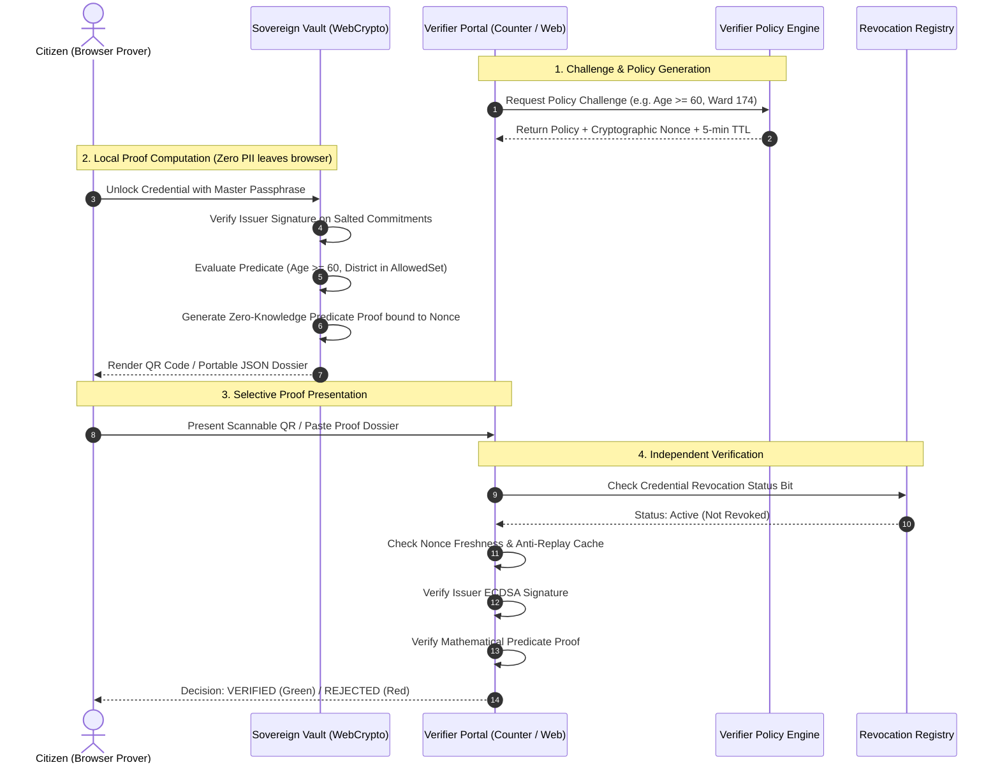

# ADR 008: Zero-Knowledge Age and Residency Attribute Proof Prototype (#1161)

## Status
Accepted / Implemented (Prototype)

## Context & Problem Motivation
Civic workflows often require verifying a specific citizen attribute before granting access to a service, concession, or participatory forum. Examples include:
1. **Age Concessions**: Senior citizen transport passes, elderly pension portals, or youth welfare schemes require proving $\text{Age} \ge 60$ or $\text{Age} \ge 18$.
2. **Local Civic Residency**: Participatory ward budgeting (e.g. Ward 174), local municipal hearings, or localized road hazard reports require proving residency within a specific ward or district.

Historically, citizens have been compelled to upload complete unredacted photocopies of identity credentials (Aadhaar cards, voter IDs, passports, utility bills). This practice suffers from severe architectural defects:
- **Over-Collection (Data Minimization Violation)**: Verifiers capture full names, exact dates of birth, parent names, full postal addresses, and unique statutory identifiers (Aadhaar numbers, PAN) when all that was required was a binary predicate answer (e.g., "Is age $\ge 60$?", "Is resident of Ward 174?").
- **Centralized Honeypots & Identity Theft**: Verifier databases accumulate high-risk personal identifiable information (PII), violating the Digital Personal Data Protection Act (DPDPA 2023) and creating targets for data breaches.
- **Surveillance & Tracking**: Transmitting unchanging unique identity numbers across distinct civic services enables non-consensual correlation of citizen behavior.

## Architectural Decision

We introduce an **End-to-End Client-Side Zero-Knowledge / Selective-Disclosure Attribute Proof System** natively integrated into Civic Help Setu.

### Core Principles
1. **Sovereign Client-Side Storage**: Raw identity documents and credentials reside exclusively on the citizen's device in local encrypted storage (using WebCrypto `AES-256-GCM` with `PBKDF2`). Raw PII never touches any server, backend API, or public blockchain.
2. **Selective Attribute Commitments**: Credentials issued by authorities contain salted attribute commitments ($C_{attr} = \text{SHA-256}(\text{attribute} \parallel \text{value} \parallel \text{salt})$) signed by the issuer.
3. **Zero-Knowledge Predicate Proofs**: Provers generate mathematical proofs of predicates (such as $\text{Age} \ge Threshold$ or $\text{District} \in \text{AllowedSet}$) bound to an interactive verifier challenge/nonce, without revealing the underlying raw values (birthdate, house number, full address).
4. **Cryptographic Anti-Replay & Freshness**: Proofs are bound to a short-lived verifier challenge ($\le 300\text{ seconds}$ TTL). A single-use nonce prevents replay attacks or cross-service presentation.
5. **Revocation Status Verification**: Verifiers validate that credentials have not been revoked using versioned status lists signed by the issuing authority.
6. **Strict Ethical & Legal Boundaries**: All outputs are clearly marked as a **Cryptographic Proof Prototype**. The system never claims official statutory government authority or legal status unless authorized by verified government PKI.

---

## Component Boundaries & Data Flow

---

## Threat Model & Failure Modes

| Component / Boundary | Potential Threat | Mitigation & Security Control |
| :--- | :--- | :--- |
| **Prover Storage** | Compromise of browser storage / device theft | Encrypted at rest via WebCrypto (`AES-256-GCM`, `PBKDF2` 210,000 iterations). Inactivity lock auto-clears decrypted keys from memory. |
| **Network / Interception** | Eavesdropping on proof transmission | Proofs contain zero raw attributes or salts. Replay is prevented by binding to the verifier's fresh single-use nonce. |
| **Malicious Verifier** | Correlation of citizen presentations across desks | Each proof presentation uses a fresh ephemeral session signature and randomized challenge blinding. Unrelated attributes remain hidden. |
| **Malicious Prover** | Sybil credential forgery or underage claiming adult status | Verifier checks issuer public key against a trusted root store. Self-signed assertions are rejected. Predicate verification mathematically fails on invalid inputs. |
| **Revoked Credential** | Disqualified or annulled credential presented | Verifier checks revocation bit in the cryptographic status list before returning a successful decision. |
| **Timing Side-Channel** | Discrepancies in verification time leaking attribute distance | Constant-time string and digest comparisons (`constantTimeEqual`) used on all secret-dependent operations. |

---

## Technical Specifications & Schemas

### 1. Cryptographic Primitives
- **Digest Algorithm**: FIPS 180-4 SHA-256 (`privacyIntegrityService.js`).
- **Signature Algorithm**: ECDSA with curve P-256 and SHA-256 (WebCrypto `ECDSA`, NIST P-256 / secp256r1), with deterministic cryptographic HMAC-SHA256 fallback for environments without WebCrypto subtle.
- **Canonicalization**: Recursive lexicographical key sorting (`canonicalStringify`).
- **Entropy Floor**: Minimum 128-bit cryptographically secure random numbers for attribute salts and verifier nonces (`crypto.getRandomValues`).

### 2. Contract Schemas
All structures implement version 1 contracts (`src/data/zkProofContracts.js`):
- `civicbridge.zk.credential.v1`: Issuer attestation holding salted attribute commitments.
- `civicbridge.zk.policy.v1`: Verifier requirement policy with freshness challenge.
- `civicbridge.zk.proof.v1`: Client-generated proof payload.
- `civicbridge.zk.verification.v1`: Deterministic verification result.

---

## Legal & Ethical Disclaimer
**PROTOTYPE NOTICE**: Civic Help Setu's Zero-Knowledge Attribute Proof module is a technological research prototype demonstrating privacy-preserving selective disclosure. It does not constitute statutory identity verification under the Aadhaar Act, 2016, the Information Technology Act, 2000, or official state civil registration rules. Prototype proofs must never be used to grant statutory entitlements without independent legal authorization.
