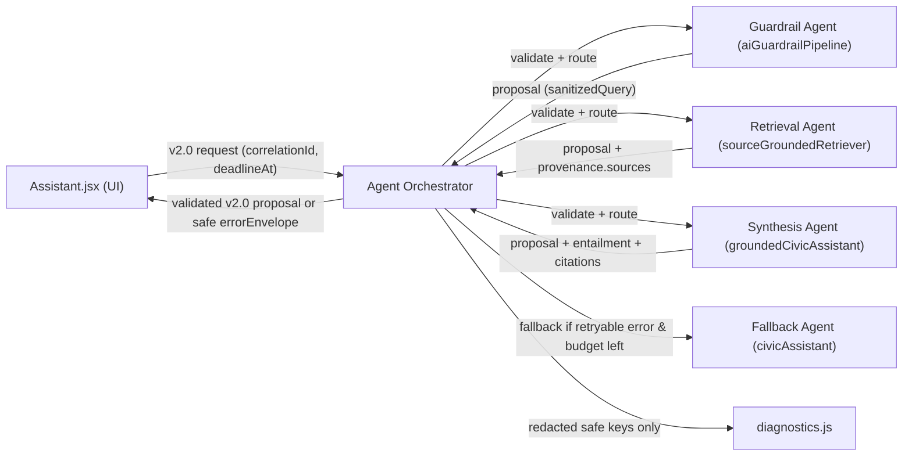

# ADR-1148: Agent-to-Agent Message Contracts and Schema Evolution

- **Status**: Proposed / Implementing (Issue #1148)
- **Date**: 2026-11-26
- **Owner**: Civic Help Setu Maintainers

## 1. Context & Problem

Civic Help Setu coordinates multiple specialist AI/rule modules—pre-inference guardrails (`aiGuardrailPipeline.js`), source-grounded retrieval (`sourceGroundedRetriever.js`), grounded synthesis (`groundedCivicAssistant.js`), and legacy fallback (`civicAssistant.js`). Previously, these modules communicated via ad-hoc plain objects without a shared envelope, schema version, correlation ID, deadline budget, or boundary validation. As prompts, models, and workflows evolve, unversioned payloads risk silent field drift, unvalidated critical fields, unbounded retries, and unclear provenance.

## 2. Decision

Adopt a **strict, versioned, provider-neutral agent-to-agent message contract** (`v1.0` and `v2.0`) enforced at every agent and service boundary:

1. **Typed Message Envelope (`v2.0` canonical)**:
   - `schemaVersion`: `'1.0'` or `'2.0'`
   - `messageId`: unique per-message identifier (used for idempotency)
   - `correlationId`: end-to-end trace identifier propagated across all hops
   - `causationId`: parent `messageId`
   - `messageType`: `'request' | 'proposal' | 'error' | 'ack'`
   - `sender` / `recipient`: registered agent roles (`orchestrator`, `guardrail`, `retriever`, `synthesizer`, `simplifier`, `ui`)
   - `issuedAt` / `deadlineAt`: ISO-8601 timestamps; expired messages fail closed (`DEADLINE_EXCEEDED`) unless explicitly replayed
   - `criticalFields`: list of fields the receiver **must** understand; any unknown critical field triggers fail-closed rejection (`UNKNOWN_CRITICAL_FIELD`)
   - `permissionScope`: explicit capability requested; high-impact actions (`autonomous_filing`, `benefit_denial`, `official_status_claim`) are unconditionally denied
   - `requiresHumanApproval`: boolean; forced `true` for any high-impact or low-entailment proposal
   - `provenance`: `{ sources: Array<{ name, url, verified }>, retrievedChunkIds?: string[], unverified?: boolean }`
   - `payload`: typed body

2. **Schema Evolution & Compatibility Adapters**:
   - Additive non-critical fields are backward-compatible within a major version.
   - `v1.0` messages are automatically upcast to `v2.0` at the boundary via `migrateEnvelope()`.
   - `v2.0` → `v1.0` downcasting succeeds only if no `2.0`-only critical field is present; otherwise it fails closed (`INCOMPATIBLE_CRITICAL_FIELD`).

3. **AI Outputs as Untrusted Proposals**:
   - Every specialist agent output is validated as a `proposal` requiring provenance/citations and subject to deterministic guardrails and human-in-the-loop confirmation in `Assistant.jsx`.

## 3. Data-Flow Diagram

## 4. Threat Model & Failure Modes

| Threat / Failure Mode | Mitigation |
| --- | --- |
| **Unknown critical field smuggling** | `validateMessageEnvelope` checks `criticalFields` against `KNOWN_CRITICAL_FIELDS` and rejects unknown entries (`UNKNOWN_CRITICAL_FIELD`). |
| **Prompt injection across agent hops** | `guardrail` agent runs first; `permissionScope` denies autonomous filing, benefit denial, or official-status claims (`PERMISSION_DENIED`). |
| **PII / credential leakage in logs or envelopes** | `FORBIDDEN_PII_KEYS` rejected at boundary; `observability.js` routes only allow-listed safe keys through `diagnostics.js` (`DATA_RETENTION.md`). |
| **Runaway retries / cascading timeouts** | `deadlineAt` propagated across hops; orchestrator caps retries (`maxRetries = 1`) and aborts if `Date.now() >= deadlineAt`. |
| **Schema version skew** | `schemaEvolution.js` upcasts `1.0` → `2.0` deterministically and rejects unsupported versions (`UNSUPPORTED_SCHEMA_VERSION`). |
| **Unsafe error leakage** | `createErrorEnvelope` strips stack traces, raw prompts, and secrets, returning only safe `code`, `category`, `retryable`, and `correlationId`. |

## 5. Operational Limits, Accessibility & Retention

- **Performance / Cost Limits**: Default request deadline `5000ms`; max `1` retry per hop; max `8` hops per correlation; max `20` provenance sources per envelope.
- **Accessibility**: `AgentContractBadge.jsx` uses semantic `role="region"`, `aria-expanded` toggles, keyboard-focusable controls, and high-contrast status/warning indicators (`role="note"` / `role="status"`).
- **Data Retention**: Contract traces stay in-memory only (bounded ring buffer, max 100 events) and never persist citizen PII (`docs/DATA_RETENTION.md`).
- **Deployment**: Zero new runtime dependencies; runs in-bundle with Vite + Vercel static/serverless setup and Vitest CI.

## 6. Migration, Rollback & Maintainer Operations

- **Adding a new optional field**: Add to `payload` or non-critical metadata; keep `CURRENT_SCHEMA_VERSION = '2.0'`.
- **Adding a new critical field / breaking change**: Bump `CURRENT_SCHEMA_VERSION`, add an upcaster/downcaster pair in `src/ai/contracts/schemaEvolution.js`, register in `SUPPORTED_SCHEMA_VERSIONS`, and add replay fixtures.
- **Rollback**: Revert `Assistant.jsx` call from `runCivicAgentPipeline` to `askGroundedCivicAssistant` if needed; `v1.0` adapters remain supported during deprecation window.
- **Reproducible Evaluation**: Run `npm run eval:contracts` (and `npm test`, `npm run lint:security`, `npm run build`).

## 7. Operational Ownership & Licences

- **Operational Ownership**:
  - **Contracts & Schema Evolution** (`src/ai/contracts/`): AI Platform / Core Maintainers.
  - **Specialist Adapters & Orchestrator** (`src/ai/agents/`): Assistant & Guardrail Maintainers.
  - **UI Provenance & Human Approval Gate** (`src/pages/Assistant.jsx`, `AgentContractBadge.jsx`): Frontend & Accessibility Maintainers.
- **Model, Dataset & External-Service Licences**:
  - **Models**: Deterministic local BM25/rule-based retrieval and entailment checks (no external proprietary LLM API calls or third-party model weights).
  - **Datasets**: Built-in `serviceCatalog` and `FAQ_DATABASE` reference data under the repository's `MIT` license, linking to public Indian government service portals (`services.india.gov.in`, `passportindia.gov.in`).
  - **External Services**: Zero runtime external AI/telemetry services required; synthetic replay fixtures contain no citizen data.
