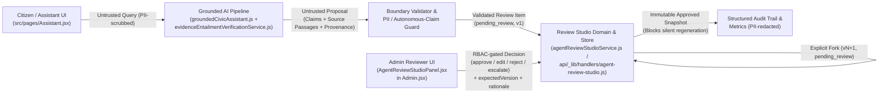

# ADR-1150: Human-in-the-Loop Agent Review Studio for High-Impact Civic Outputs

- **Status:** Accepted
- **Issue:** [#1150](https://github.com/GoldRay19/Civic-Help-Setu/issues/1150)
- **Contract Version:** `2026-11-v1`
- **Operational Owner:** Civic Help Setu Maintainers & Designated Admin Reviewers

---

## 1. Context & Problem Statement

Civic Help Setu uses retrieval-augmented guidance (`src/ai/groundedCivicAssistant.js`) and entailment verification (`src/services/evidenceEntailmentVerificationService.js`) to answer citizen questions about government procedures, statutory fees, processing deadlines, and legal penalties.

High-impact legal or administrative guidance must be **inspectable, attributable, and correctable by a human reviewer** before citizens rely on it, and **approved outputs must never be silently regenerated or overwritten** without an explicit versioned re-review.

---

## 2. Architecture & Component Boundaries

### Component Responsibilities

| Component | Responsibility | Trust Boundary |
|---|---|---|
| `src/ai/groundedCivicAssistant.js` & `evidenceEntailmentVerificationService.js` | Produces candidate claims, risk categories (`HIGH_RISK_FEE`, `HIGH_RISK_DEADLINE`, `HIGH_RISK_PENALTY_LEGAL`, `GENERAL_FACT`), confidence score, and linked source chunks. | **Untrusted producer** — outputs are treated as proposals, never authoritative decisions. |
| `src/services/agentReviewStudioService.js` | Core domain state machine, deterministic input validation, optimistic concurrency (`expectedVersion`), idempotency (`idempotencyKey`), post-approval immutability enforcement, and PII-safe audit/metrics. | **Domain enforcement** — enforces `requirePermission` via `src/services/accessControl.js`. |
| `api/_lib/handlers/agent-review-studio.js` | Vercel serverless HTTP boundary (`/api/agent-review-studio`) enforcing rate limiting, single-flight deduplication, RBAC (`x-civic-role` / verified token context), schema validation, and `409 Conflict` on stale versions or silent regeneration. | **Serverless API boundary** — validates all untrusted JSON inputs. |
| `firebase/firestore.rules` (`agentReviewOutputs/{outputId}`) | Server-side Firestore enforcement restricting reads/writes to `isAdmin()`, rejecting privileged keys, and blocking mutation of `approved` / `edited_approved` records. | **Database security boundary**. |
| `src/components/admin/AgentReviewStudioPanel.jsx` | Accessible side-by-side reviewer UI (claims vs. source passages, confidence, provenance, decision controls, rationale capture, version history, and explicit fork action). | **Admin UI** — gated behind `ProtectedRoute` + `agentReview.read` / `agentReview.decide`. |

---

## 3. Threat Model

| Threat | Vector | Mitigation |
|---|---|---|
| **Hallucinated / Unverified High-Impact Claim** | AI fabricates a statutory fee, deadline, or legal penalty. | High-risk claims require at least one linked source passage (`sourceChunkId` + `excerpt` + `https://` official URL); reviewer sees claims side-by-side with exact source passages before approval. |
| **Silent Post-Approval Regeneration** | Background re-indexing or prompt re-run overwrites an already-approved civic output without human review. | `assertCanRegenerateOrEdit()` rejects in-place mutation/regeneration of `approved` or `edited_approved` items with `SILENT_REGEN_FORBIDDEN` (`409 Conflict`). Updates require `forkNewVersion()` which creates `vN+1` in `pending_review` and marks `vN` as `superseded`. |
| **Autonomous Official Action / Authority Claim** | Output claims automated filing, benefit denial, or official government endorsement. | Boundary validator rejects proposals containing autonomous filing/denial/official-approval assertions (`AUTONOMOUS_ACTION_FORBIDDEN`). |
| **Privilege Escalation (Unauthorized Decision)** | Citizen or unauthenticated caller attempts to approve, edit, reject, or escalate. | `requirePermission('agentReview.decide')` in domain service + `401`/`403` RBAC checks in `/api/agent-review-studio` + `isAdmin()` in `firebase/firestore.rules`. |
| **PII / Credential Leakage** | Citizen Aadhaar, PAN, phone, email, IFSC, bank account, UPI, or API tokens enter review payloads, logs, or analytics. | `validateReviewProposal` and `validateReviewDecision` reject PII/secret patterns; audit logs and metrics store only redacted/aggregate metadata (`actorRole`, `itemId`, `version`, `decision`, `latencyMs`). |
| **Concurrency / Lost Update Race** | Two reviewers act on the same item simultaneously. | Optimistic concurrency via `expectedVersion`; stale submissions fail closed with `VERSION_CONFLICT` (`409 Conflict`). |
| **Retry Storm / Duplicate Transitions** | Network retry submits the same decision twice. | `idempotencyKey` deduplication in both `agentReviewStudioService.js` and `createSingleFlight()` in `api/_lib/handlers/agent-review-studio.js`. |

---

## 4. Failure Modes & Safe Error Handling

- **Validation Failure (`400 Bad Request`):** Returns structured field errors without echoing raw untrusted PII/secrets.
- **Auth / RBAC Failure (`401` / `403`):** Fails closed; never falls back to permissive mode.
- **Version Conflict / Post-Approval Mutation (`409 Conflict`):** Preserves existing approved snapshot intact and instructs client to refresh or fork a new version.
- **Rate Limit Exceeded (`429 Too Many Requests`):** Returns `Retry-After` header via `api/_lib/abuseGuard.js`.
- **Storage / Persistence Failure:** Surfaces a non-destructive UI error banner (`role="alert"`) and preserves reviewer draft input.

---

## 5. Performance, Cost Limits & Data Retention

- **Payload Bounds:** Max 25 claims per output, max 20 source passages, max 2,000 characters per claim/passage/rationale, max 100 KB total request body.
- **Rate Limits:** 30 requests/minute per client key on `/api/agent-review-studio`.
- **Serverless Cost Control:** Single Vercel function bundle (`api/[...path].js`) with bounded in-memory queue (`MAX_ITEMS = 500`, FIFO eviction of oldest non-approved or superseded entries when full) and zero external LLM calls inside the review endpoint.
- **Data Retention:** Synthetic/review records contain zero citizen PII. Superseded versions and audit events are retained for 90 days in production Firestore/export archives (see `docs/DATA_RETENTION.md`) and can be purged via scheduled retention cleanup without affecting active `approved` records.

---

## 6. Accessibility Requirements (WCAG 2.1 AA)

- Semantic landmarks (`<section>`, `<h3>`, `<dl>`), explicit `<label htmlFor>` associations on all inputs and rationale fields, and `aria-describedby` for validation hints.
- Keyboard-navigable queue items and decision radio/button groups with visible focus indicators.
- `aria-live="polite"` status region for decision confirmations and `role="alert"` for conflict/validation errors.
- Minimum 4.5:1 text contrast using existing theme CSS variables (`--text-primary`, `--text-secondary`, `--accent-main`).

---

## 7. Migration, Rollback & Maintainer Operations

- **Deployment:** Deployed as part of the standard Vercel static + serverless bundle (`vercel.json` rewrites `/api/*` to `api/[...path].js`) and Firebase rules (`firebase/firestore.rules`).
- **Migration:** Additive only — introduces `agentReview.*` permissions in `src/services/accessControl.js`, the `agentReviewOutputs` Firestore rule block, the `/api/agent-review-studio` handler, and the `Agent Review Studio` tab in `src/pages/Admin.jsx`. No destructive schema migrations on existing service guides.
- **Rollback:**
  1. Remove the `'agent-review'` tab from `src/pages/Admin.jsx` and the review submission button from `src/pages/Assistant.jsx`.
  2. Remove `'agent-review-studio'` from `api/[...path].js` if disabling the endpoint.
  3. Existing `approved` records remain immutable and readable for audit.
- **Maintainer Operations:**
  - Review escalated items daily in **Admin -> Agent Review Studio**.
  - Run `npm test`, `npm run lint`, `npm run lint:security`, and `npm run build` before merging changes.
  - Export audit logs via JSON from the Studio or `AuditLogViewer` for compliance reviews.

---

## 8. Model, Dataset & External-Service Licences

- **Runtime & UI Dependencies (`package.json`):** React (`MIT`), React Router (`MIT`), Lucide React (`ISC`), Clerk (`MIT` SDK / commercial SaaS), Firebase Admin (`Apache-2.0`), Vitest (`MIT`), Vite (`MIT`).
- **AI / Grounding Engine:** Deterministic local BM25/keyword retrieval (`src/ai/sourceGroundedRetriever.js`) and deterministic rule-based entailment (`src/services/evidenceEntailmentVerificationService.js`) — **no third-party proprietary model weights or external paid LLM APIs required** for the core review studio.
- **Fixtures & Benchmarks:** All test fixtures in `src/test/fixtures/agentReviewFixtures.js` are 100% synthetic and repository-authored under the project's `MIT` licence.
