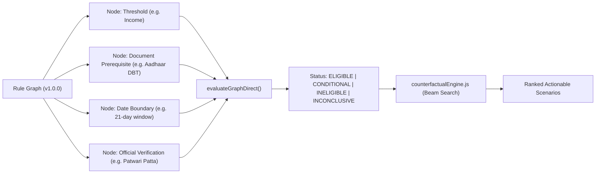

# Explainable Eligibility Simulation Engine & Counterfactuals

This guide provides technical specifications, operational procedures, performance limits, and accessibility compliance rules for the Explainable Eligibility Simulation Engine (Issue #1156).

---

## 1. Overview & Architecture

The **Explainable Eligibility Simulation Engine** is a client-side, privacy-preserving reasoning engine that evaluates citizen and household profiles against versioned, statutory **Rule Graphs (DAGs)**.

Unlike black-box or purely binary eligibility checkers, this engine guarantees:
1. **Source Grounding:** Every evaluated condition provides full statutory provenance (Authority, Gazette Notification / Circular Order Number, and official portal URL).
2. **Actionable Counterfactuals:** When a citizen is ineligible or conditionally eligible, the engine algorithmically derives minimal, realistic hypothetical profile perturbations (e.g. acquiring an Income Certificate, completing Aadhaar bank linking) to achieve qualification.
3. **Boundary Date Awareness:** Detects proximity to statutory deadlines (e.g. birth reporting within the 21-day legal limit).
4. **Evidentiary Conflict Detection:** Identifies contradictory evidentiary claims (e.g. self-declared income exceeding BPL ceilings).
5. **Statutory Non-Determination Separation:** Distinguishes educational simulation guidance from legally binding official determinations.

---

## 2. Rule Graph Domain Model (`v1.0.0`)

Each scheme or service eligibility graph is stored in `src/services/ruleGraphRegistry.js` as an explicit Directed Acyclic Graph (DAG):



### Condition Types
- `THRESHOLD`: Numeric floor or ceiling (e.g. family annual income $\le ₹4,00,000$).
- `BOOLEAN`: Boolean eligibility flags (e.g. `ownsAgriculturalLand`).
- `CHOICE`: Categorical options (e.g. `employment`).
- `DATE_BOUNDARY`: Statutory calendar windows (e.g. `birthRegistrationDays`).
- `DOCUMENT_PREREQUISITE`: Required documentation or certifications (e.g. `hasAadhaar`).

### Condition States
- `satisfied`: Criteria fully met based on input.
- `unsatisfied`: Criteria violated by input.
- `unknown`: Criteria missing or unanswered.
- `conflicting`: Contradictory evidence detected.
- `needs_official_verification`: Requires physical inspection by competent authority (e.g. Patwari).

---

## 3. Counterfactual Search Engine & Cost Metric

The counterfactual generator evaluates the perturbation space of unsatisfied and unknown conditions:

$$\text{Cost} = \sum_{k} w_k \cdot \text{distance}(x_k, x'_k)$$

### Weights
* **Actionable Document Acquisition** ($w = 1.0$): Fast-track steps like Aadhaar e-KYC or Income Certificate issuance.
* **Statutory Timing Adjustment** ($w = 1.5$): Meeting statutory reporting windows.
* **Financial Adjustments** ($w = 3.0$): Income bracket adjustments to published statutory thresholds.
* **Immutable Traits** ($w = \infty$): Categorical caste identities and historical birthdates are constrained.

### Computational Performance Ceiling
- **Budget:** Search operations are hard-capped at $<25\text{ms}$ to ensure zero UI frame drops during slider interactions.
- **Complexity:** Max search depth $\le 3$ condition combinations; candidates are filtered by relevance to unsatisfied nodes.

---

## 4. Privacy, Security & Threat Model

* **In-Browser Execution:** The engine executes 100% in the user's browser. No financial data, demographic answers, or hypothetical parameters leave the device.
* **Input Sanitization at Service Boundaries:** Rejects any input payload containing forbidden PII keys (`FORBIDDEN_FIELDS` in `serviceContract.js`), including Aadhaar numbers, phone numbers, or passwords.
* **Safe Error Handling:** Evaluator exceptions in any node are isolated, logged through `src/utils/diagnostics.js` without PII, and return a safe `INCONCLUSIVE` status without crashing the page.
* **Threat Model Reference:** Documented under threat `T12` in `docs/security/threat-model.md`.

---

## 5. Accessibility (a11y) & WCAG 2.1 AA Compliance

1. **Screen Reader Semantic Hierarchy:** All status outcomes use standard `aria-live` regions or descriptive `role="region"` / `role="article"` containers.
2. **Color Contrast:** All state badges (Green `#16a34a`, Red `#dc2626`, Yellow `#ca8a04`, Blue `#2563eb`) exceed the 4.5:1 WCAG AA contrast ratio against light and dark backgrounds.
3. **Keyboard Accessibility:** All sliders, dropdowns, and counterfactual buttons are fully focusable and navigable via standard keyboard controls (`Tab`, `Space`, `Enter`, Arrow Keys).

---

## 6. How to Add a New Statutory Rule Graph

1. Open `src/services/ruleGraphRegistry.js`.
2. Define the new scheme under `RULE_GRAPHS`:
   ```javascript
   'new-scheme-slug': {
     id: 'new-scheme-slug',
     version: '1.0.0',
     title: 'Scheme Display Title',
     category: 'Category',
     ministry: 'Nodal Ministry / Department',
     benefitSummary: 'Statutory benefit description.',
     nodes: [
       {
         id: 'condition_id',
         label: 'Human-readable criteria title',
         type: 'THRESHOLD', // or 'BOOLEAN', 'DOCUMENT_PREREQUISITE', etc.
         field: 'profileFieldKey',
         isMutable: true,
         citation: {
           authority: 'Statutory Authority Name',
           orderNo: 'Notification / Circular No.',
           gazetteDate: 'YYYY-MM-DD',
           sourceUrl: 'https://official.gov.in',
         },
         evaluate: (profile) => {
           // Return { state: 'satisfied'|'unsatisfied'|'unknown', detail: '...' }
         },
       },
     ],
   }
   ```
3. Run the validation and evaluation suite:
   ```bash
   npm test -- tests/eligibilitySimulationEvaluation.test.js
   ```

---

## 7. Evaluation & Verification Command

To run the full suite of simulation, counterfactual, registry, and benchmark tests:

```bash
npx vitest run src/services/simulationContracts.test.js \
               src/services/ruleGraphRegistry.test.js \
               src/services/counterfactualEngine.test.js \
               src/services/eligibilitySimulationService.test.js \
               src/components/eligibility/EligibilitySimulationWorkspace.test.jsx \
               tests/eligibilitySimulationEvaluation.test.js
```
