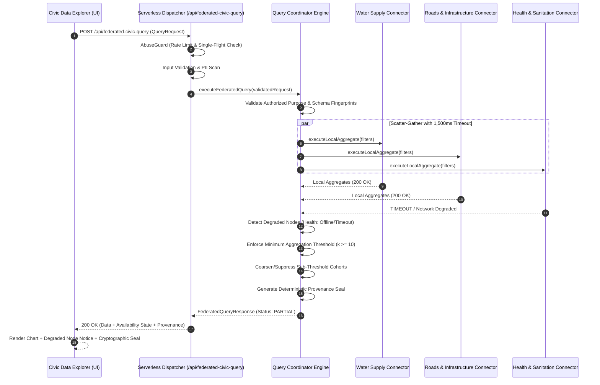

# Architecture Decision Record: Federated Civic Data Query Layer Across Department-Owned Datasets (#1162)

- **Status**: Accepted
- **Driver**: Civic Help Setu Architecture & Privacy Working Group
- **Target Release**: v1.0.0 / Issue #1162
- **Related Issues**: #765 (Participatory Ward Budget), #829 (Citizen Consent Visualizer), #223 (Data Retention)

---

## 1. Problem Statement & Motivation

Civic services and municipal oversight mechanisms need aggregate analytical indicators—such as water disruption severity, pothole density, sanitation backlog, and public transit punctuality—across geographical wards and timelines.

Historically, organizations attempted to solve this by building centralized data lakes, copying raw citizen records into a single monolithic database. In a multi-department municipal setting, this approach creates grave risks:
1. **Sovereignty & Governance Violation**: Line departments (e.g., Water Board, Health Directorate, Public Works) operate under separate statutory mandates and strict data custody policies. They cannot transfer raw operational logs to third-party or shared databases.
2. **PII Honeypot & Privacy Breaches**: Centralizing raw citizen complaints or utility accounts creates a catastrophic single point of failure for identity theft and deanonymization.
3. **Data Staleness & Schema Fragility**: Centralized ETL pipelines break when departmental source schemas evolve, leading to silent calculation discrepancies.

### The Solution: Federated Query Architecture
Instead of harvesting raw records, Civic Help Setu introduces a **Federated Civic Data Query Layer**. 
- Approved analytical queries are dispatched to **decentralized department connectors** running near source systems.
- Connectors execute filtering and aggregation locally and return **strictly bounded aggregate statistics**.
- A central Query Coordinator enforces **purpose limitation**, **minimum aggregation thresholds ($k$-anonymity)**, **schema drift detection**, and **provenance tracking**.
- Partial availability is treated as a normal operating state: if an individual department node is slow or unreachable, the system returns a partial result with transparent confidence flags rather than failing the entire query.

---

## 2. System Architecture & Component Boundaries

### Component Roles

1. **Client / UI (`src/pages/FederatedQueryExplorer.jsx`)**:
   - Provides accessible, interactive cross-department analytics by ward and date range.
   - Surfacing node health status, partial availability badges, privacy threshold notifications, and cryptographic provenance seals.
   - Complies with WCAG 2.1 AA (contrast, keyboard navigation, aria-live announcements).

2. **API Endpoint (`api/_lib/handlers/federated-civic-query.js`)**:
   - Integrated into the unified `api/[...path].js` dispatcher.
   - Enforces IP rate limiting (15 requests/min) and single-flight execution via `abuseGuard.js`.
   - Performs strict input sanitization and anti-PII regex checking (rejects any Aadhaar, PAN, phone, or email traces).

3. **Query Coordinator (`src/services/federatedCivicQueryService.js`)**:
   - Validates query against authorized civic purposes (`INFRASTRUCTURE_MONITORING`, `DISASTER_MITIGATION`, `PUBLIC_HEALTH_SURVEILLANCE`, `TRANSIT_ACCESSIBILITY`).
   - Dispatches parallel execution to registered department connectors with strict per-node timeouts (1,500ms deadline, 2,000ms global circuit breaker).
   - Implements $k$-anonymity suppression ($k \ge 10$): suppresses or coarsens cohorts with fewer than 10 events to prevent inference attacks.
   - Generates deterministic cryptographic seals (`SEAL-FED-<CHECKSUM>`) for tamper-evident provenance.

4. **Department Connectors (`src/services/federatedConnectors/`)**:
   - Encapsulate department data silos (Water, Roads, Health, Transport).
   - Execute local filtering and aggregate computation push-down (`COUNT`, `SUM`, `AVG`, `MIN`, `MAX`).
   - Validate and publish schema signatures to enable automatic drift detection.
   - Never return individual raw citizen rows.

---

## 3. Threat Model & Security Analysis (STRIDE)

### 3.1 Spoofing & Unauthorized Query Origins
- **Threat**: An unauthorized client or internal component mimics an authorized civic service to extract cross-department insights.
- **Countermeasure**: Purpose limitation check (`validateAuthorizedPurpose`). Every query must provide an authorized purpose from an immutable enum. Unapproved purposes are rejected with `PURPOSE_NOT_AUTHORIZED`.

### 3.2 Tampering & Schema Drift
- **Threat**: A department system updates its database schema (e.g. renaming `incident_count` to `tickets`), causing downstream coordinators to compute bogus aggregates or crash.
- **Countermeasure**: Connectors report a deterministic SHA-256 schema signature (`schemaHash`). The coordinator validates the signature against the registered contract (`SCHEMA_VERSION = "1.0.0"`). Mismatches fail-closed for that node with `SCHEMA_DRIFT_DETECTED` and isolate the connector without taking down the rest of the query.

### 3.3 Information Disclosure & Differencing / Inference Attacks
- **Threat**: An adversary issues overlapping aggregate queries with slightly shifted timeframes or filters (e.g., "Complaints in Ward 5 between 10:00 and 10:05" vs "10:00 and 10:06") to deduce whether a specific citizen filed a complaint.
- **Countermeasure**:
  - **Minimum Aggregation Threshold ($k \ge 10$)**: If any cohort, category, or ward slice has an aggregate count $0 < n < 10$, the exact count is suppressed and replaced with a privacy-safe indicator (`isSuppressed: true`, display: `"< 10"`).
  - **Query Shape Constraints**: Time windows are rounded to standard epoch buckets (hourly or daily). Sub-minute micro-queries are rejected.

### 3.4 Repudiation & Discrepancies
- **Threat**: A department claims that reported statistics in a public briefing were forged or tampered with in transit.
- **Countermeasure**: Every query response carries a deterministic cryptographic provenance seal (`SEAL-FED-<16-HEX>`), calculated as a SHA-256 HMAC over `{ queryId, purpose, ward, timestamp, connectorHashes }`. Any party can verify the seal.

### 3.5 Denial of Service & Resource Exhaustion
- **Threat**: Heavy, unconstrained queries spanning multiple years and dozens of dimensions hang serverless execution and overwhelm departmental connectors.
- **Countermeasure**:
  - Strict bounded timeouts: 1,500ms per connector; 2,000ms total wall-clock coordinator timeout.
  - Rate limiting via `abuseGuard.js` (15 calls per minute per IP).
  - Single-flight deduplication: identical concurrent queries share the same execution promise.

---

## 4. Failure Modes & Partial Availability States

A federated system must handle network partitions, slow department adapters, and temporary outages gracefully:

| State | Condition | HTTP Status | Response Contract |
|---|---|---|---|
| `FULL_AVAILABILITY` | 100% of target connectors responded successfully within SLA | `200 OK` | `status: "SUCCESS"`, `availability: "FULL"`, full dataset returned |
| `PARTIAL_AVAILABILITY` | At least 1 connector responded, but 1 or more timed out or experienced schema drift | `200 OK` | `status: "PARTIAL"`, `availability: "DEGRADED"`, available data returned with `degradedNodes` metadata |
| `SERVICE_UNAVAILABLE` | All target connectors timed out or encountered critical errors | `503 Service Unavailable` | `status: "FAILED"`, `availability: "NONE"`, structured diagnostic error returned |

---

## 5. Scope Boundaries & Disclaimers

> [!IMPORTANT]
> **No Statutory or Official Guarantee**:
> Civic Help Setu is a civic enablement platform. Federated query metrics reflect operational estimates from connected departmental adapters and do not constitute official administrative certifications, audit reports, or judicial evidence unless backed by a digitally signed government token.

---

## 6. Data Retention & Privacy Policy Compliance

- **Zero Browser Persistence**: Unlike citizen checklists or personal application trackers, raw federated query results are **never written to browser `localStorage` or `sessionStorage`**.
- **Ephemeral In-Memory Cache**: Coordinates caches responses in-memory for 60 seconds (TTL) to prevent duplicate compute spikes.
- **Compliance with `docs/DATA_RETENTION.md`**: No user identifiers, session IDs, or IP addresses are persisted.
