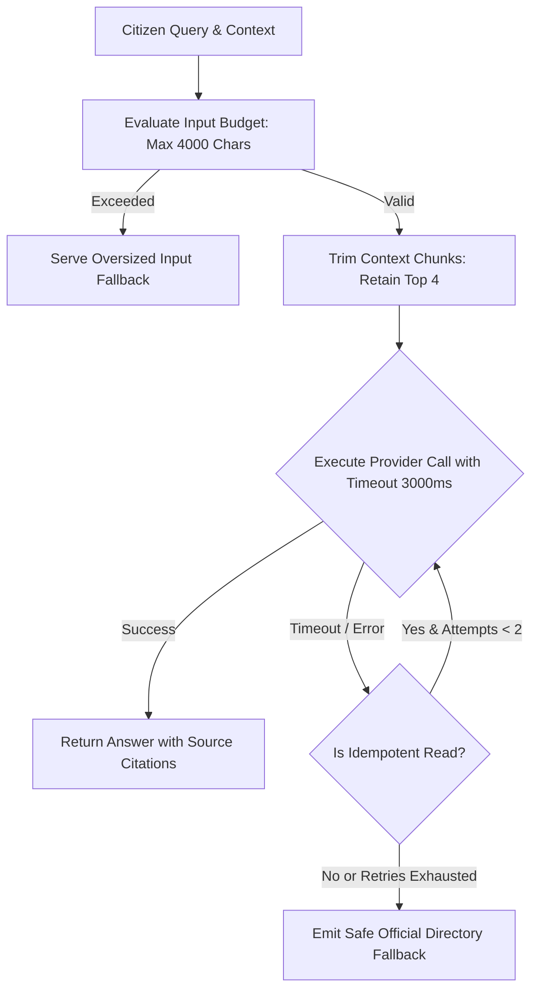

# Adaptive AI Cost, Latency and Context-Budget Controls

## Problem Statement & Context
Conversational civic search operates under strict availability constraints. When upstream foundation models suffer transient latency spikes or when long conversation threads create massive context windows, uncontrolled execution leads to timeout cascades, unexpected API billing spikes, or dropped citations.

The Adaptive Budget Controls service provides predictable, policy-bounded AI execution that guarantees citation integrity while enforcing hard cost, latency, and context ceilings.

---

## Architecture & Governance Controls

1. **Deterministic Context Trimming**:
   - Ranks retrieved chunks by similarity score and retains only the top $K$ items (`MAX_RETRIEVAL_CHUNKS = 4`).
   - Retains source metadata (`sourceId`, `title`) so citations are never dropped or hallucinated.
2. **Input Character Budgeting**:
   - Caps raw prompt length (`MAX_INPUT_CHARS = 4000`), rejecting oversized inputs before sending traffic to LLM endpoints.
3. **Latency Bounding & Timeouts**:
   - Enforces execution deadlines (`TIMEOUT_MS = 3000ms`).
   - If an endpoint times out, execution halts cleanly and serves verified static catalog fallbacks.
4. **Idempotency-Aware Retries**:
   - Read-only search queries retry up to 2 times with backoff.
   - Non-idempotent actions (e.g. state mutations) are strictly single-attempt to prevent duplicate transactions.
5. **Zero-PII Telemetry**:
   - Logs request counts, estimated token volumes, and latency distributions without capturing citizen chat text or identity.

---

## Execution Flowchart & Fallback Matrix



### Maintainer Budget Configuration Guidelines

- `MAX_INPUT_CHARS`: Increase only when processing large official circular attachments; keep at 4000 for standard citizen chat.
- `TIMEOUT_MS`: Set to 3000ms for production Edge environments to ensure user-perceived responsiveness; can be raised to 8000ms in batch evaluation pipelines.
- `MAX_RETRIEVAL_CHUNKS`: Keep bounded to 4-6 chunks to avoid LLM "lost in the middle" attention degradation.

---

## Verification & Execution

Execute unit tests:
```bash
npx vitest run src/ai/adaptiveBudgetController.test.js
```
Automated tests validate context trimming, prompt bounding, non-idempotent retry restrictions, and timeout fallbacks.

