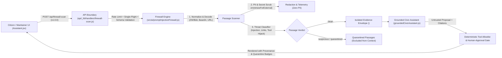

# ADR-0001: Prompt-Injection Firewall for Retrieved Civic Documents and Web Content

- **Status:** Accepted
- **Issue:** [#1151](https://github.com/GoldRay19/Civic-Help-Setu/issues/1151)
- **Date:** 2026-11-26
- **Contract Version:** `1.0.0`

---

## 1. Context & Problem

Civic Help Setu assists citizens with public service eligibility, required documents, fees, and procedures. While built-in catalog data (`src/data/`) is maintainer-reviewed, **uploaded civic PDFs** and **external web pages** are untrusted inputs that may contain:

1. **Indirect prompt injections** attempting to override system instructions, exfiltrate hidden prompts, or force unverified eligibility approvals/denials.
2. **Encoded or obfuscated instructions** (Base64 payloads, URL-encoded directives, Unicode zero-width / bidirectional override characters, HTML comments, hidden CSS spans).
3. **Malicious or exfiltration links** (`javascript:`, `data:text/html`, credentialed URLs, markdown image beacons, unverified external domains).
4. **Embedded secrets or citizen PII** (Aadhaar, PAN, phone numbers, API tokens) that must never enter model context, logs, or analytics.
5. **Unauthorized tool-use or high-impact action forcing** (autonomous application filing, benefit denial, or official government status claims).

---

## 2. Architecture & Data-Flow Diagram

---

## 3. Component & Trust Boundaries

| Boundary | Owner | Responsibility |
|---|---|---|
| **Service Boundary** (`api/_lib/handlers/firewall-scan.js`) | Backend / API Maintainers | Enforces HTTP method (`POST`), `contractVersion` (`1.0.0`), payload size/passage limits, rate limiting (`abuseGuard.js`), and single-flight deduplication. |
| **Firewall Core** (`src/ai/promptInjectionFirewall.js`) | AI Safety Maintainers | Deterministic, provider-neutral scanning, zero-width/encoding normalization, PII/secret redaction, quarantine decisions, and isolated evidence wrapping. |
| **Tool Policy Gate** (`enforceToolAllowlist`) | Platform Security | Enforces tool allowlists **outside** model prompts in code; hard-denies high-impact actions (`submit_application`, `deny_benefit`, `issue_official_status`) without explicit human approval. |
| **Assistant & UI** (`groundedCivicAssistant.js`, `Assistant.jsx`, `FirewallInspectionPanel.jsx`) | Frontend Maintainers | Surfaces provenance, quarantine counts, and accessible notices (`role="status"` / `role="alert"`). Never renders raw untrusted HTML. |

---

## 4. Threat Model & Failure Modes

| Threat | Mitigation | Failure Mode (Fail-Closed) |
|---|---|---|
| Indirect prompt injection in PDF/web text | Multi-pattern directive & delimiter detection + HTML comment/hidden-CSS stripping | Passage marked `quarantined`; excluded from model evidence envelope. |
| Encoded/obfuscated payloads | Strip zero-width/bidi chars; decode Base64 & URL-encoded segments and re-scan | Obfuscated segment flagged `encoded_instruction` and quarantined. |
| Malicious/exfiltration links | Block `javascript:`, `data:`, credentialed URLs, IP literals, markdown image beacons | Passage marked `quarantined` or `suspicious`; links stripped from evidence. |
| Secret / citizen PII leakage | Local redaction via `minimizeForExternal` + Aadhaar/PAN/IFSC/UPI/token detectors | Redacted before context/logs; zero raw PII emitted in telemetry or errors. |
| Autonomous high-impact actions | `enforceToolAllowlist` + `evaluateAssistantProposal` outside model prompts | Action blocked (`allowed: false`, `requiresHumanApproval: true`). |
| Malformed / oversized / burst requests | `validateFirewallInput`, `createRateLimiter`, `createSingleFlight` | `400` validation error or `429` with `Retry-After` header; no stack traces leaked. |

---

## 5. Performance, Cost, Retention & Operations

- **Performance & Cost Limits:**
  - Deterministic, zero-LLM-call local scanning (`O(n)` regex/decode pass per passage).
  - Hard bounds: max document size `100,000` chars, max `50` passages per scan, max `4,000` chars per passage, Base64 decode cap `2,048` chars per match.
  - Rate limit on `/api/firewall-scan`: `20` requests/minute per client IP (`abuseGuard.js`).
- **Accessibility:**
  - All firewall status, quarantine alerts, and human-approval notices use semantic landmarks (`role="status"`, `role="alert"`), `aria-live="polite"`, and keyboard-accessible controls.
- **Data Retention:**
  - Scanned untrusted document text is processed **ephemerally in memory** and is **not persisted** to Firestore or browser `localStorage`.
  - Telemetry events (`FIREWALL_METRICS`) retain only aggregate counts, `sourceType`, `decision`, `threatClasses`, and `latencyMs` — never raw document text, URLs with query tokens, or PII.
- **Migration & Rollback:**
  - Versioned contract (`contractVersion: "1.0.0"`). Consumers ignore unknown optional fields; breaking changes require `"2.0.0"`.
  - Rollback: Disable external document scanning in `Assistant.jsx` or remove the `"firewall-scan"` route in `api/[...path].js` without affecting core built-in catalog RAG.
- **Licenses:**
  - Implemented using repository-native JavaScript/React/Vitest dependencies (MIT/Apache-2.0 compatible). No external proprietary datasets or third-party scanning SaaS APIs are required.
- **Scope Boundary:**
  - Civic Help Setu does **not** claim official government integration, verification, legal authority, or guaranteed outcomes.
