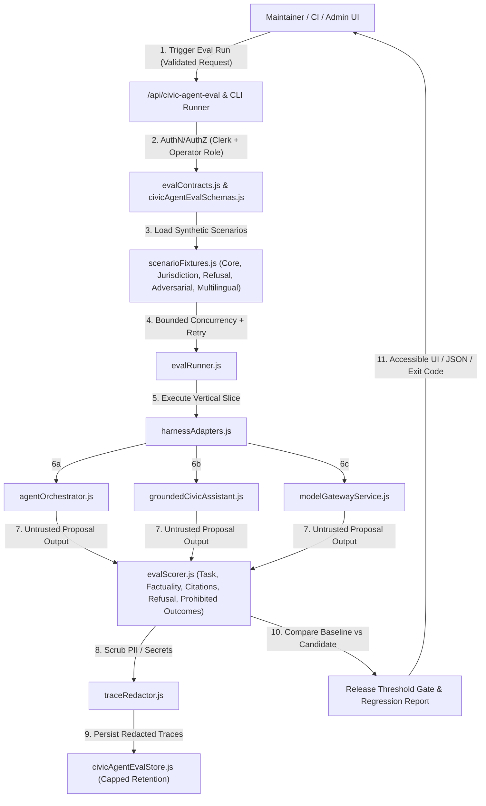

# ADR-002: Civic Agent Evaluation Harness with Scenario-Based Regression Suites

* **Status**: Accepted
* **Date**: 2026-11-26
* **Deciders**: Civic Help Setu Core Maintainers, Security & AI Reliability Reviewers
* **Context**: Issue #1147 (`[level3][feature] Build a Civic Agent Evaluation Harness with Scenario-Based Regression Suites`)

---

## 1. Context and Problem Statement

Civic Help Setu provides citizens with retrieval-grounded civic guidance across national, state, and municipal services using `agentOrchestrator.js`, `groundedCivicAssistant.js`, `aiGuardrailPipeline.js`, and `modelGatewayService.js`.

Prior evaluation utilities (`aiEvaluationSuiteService.js`, `offlineRagBenchmarkService.js`, and `aiEvaluationRunExplorer.js`) evaluated static sample strings or isolated retrieval recall, rather than executing end-to-end agent pipelines against structured civic scenarios. That leaves critical regression gaps:

1. **Anecdotal Validation**: Prompt, retrieval, guardrail, or model-adapter edits can silently degrade citation coverage, jurisdiction accuracy, or refusal behavior.
2. **Safety & Authority Boundary Drift**: Agents could output autonomous filing promises, benefit denial statements, or official government status claims without citations or human approval gates.
3. **Trace Privacy Risk**: Logging raw evaluation traces could leak synthetic or inadvertently supplied PII (Aadhaar, PAN, phone numbers, bank accounts, API keys) into analytics or persistence layers.
4. **Lack of Versioned Release Gates**: Maintainers lacked a deterministic, reproducible command and API contract to compare model/prompt versions and block releases when quality regresses.

---

## 2. Decision

Adopt a modular, provider-neutral **Civic Agent Evaluation Harness** integrated directly into Civic Help Setu's existing agent/gateway vertical slice (`src/ai/evals/`, `api/_lib/handlers/civic-agent-eval.js`, `scripts/runCivicAgentEvalHarness.mjs`, and `CivicAgentEvalHarnessPanel.jsx`).

### Key Architectural Principles
1. **Typed Contracts at All Boundaries**: Versioned schemas (`EVAL_SCHEMA_VERSION = '1.0.0'`) validate every scenario, run request, comparison request, and release-threshold policy. Unknown critical fields, oversized payloads, and forbidden raw PII keys are rejected fail-closed.
2. **Provider-Neutral Target Adapters**: The harness executes against uniform `HarnessTargetAdapter` wrappers (`civicAgentPipelineAdapter`, `groundedRagAdapter`, `modelGatewayAdapter`, and deterministic baseline/candidate comparison adapters) rather than coupling to any specific LLM SDK.
3. **AI Output as Untrusted Proposal**: Every agent output is treated as an untrusted proposal and scored deterministically for task success, factuality/entailment, citation coverage, refusal correctness, prohibited outcomes (autonomous filing, benefit denial, official-status claims), and human-approval signaling.
4. **Privacy-by-Construction Redacted Traces**: Only synthetic fixtures are used in repository suites. Before any trace is stored or returned, `traceRedactor.js` applies pre-inference PII/secret scrubbing (`analyzeAndSanitizeQuery`) and strips forbidden keys (`findForbiddenPiiKey`).
5. **Deterministic Release Gates**: Candidate runs are diffed against baseline runs and evaluated against configurable thresholds (minimum task success, minimum factuality, minimum citation coverage, minimum refusal accuracy, zero prohibited outcomes, maximum p95 latency).

---

## 3. Component Boundaries & Data Flow

### Component Ownership

| Component | Path | Responsibility | Owner |
| :--- | :--- | :--- | :--- |
| Domain Contracts & Validators | `src/ai/evals/evalContracts.js` | Versioned scenario/run/threshold schemas, fail-closed boundary validation | AI Platform Maintainers |
| Trace Redactor | `src/ai/evals/traceRedactor.js` | Pre-storage scrubbing of Aadhaar/PAN/phone/IFSC/UPI/secrets & raw PII keys | Security & Privacy Lead |
| Synthetic Scenario Suites | `src/ai/evals/scenarioFixtures.js` | Versioned synthetic scenarios (core, jurisdiction, refusal, adversarial, multilingual) | Civic Content & AI Team |
| Deterministic Scorer | `src/ai/evals/evalScorer.js` | Task success, factuality, citation coverage, refusal correctness, prohibited-outcome checks | AI Platform Maintainers |
| Provider-Neutral Adapters | `src/ai/evals/harnessAdapters.js` | Wraps `runCivicAgentPipeline`, `askGroundedCivicAssistant`, `executeModelGateway`, and A/B adapters | AI Platform Maintainers |
| Runner & Regression Gate | `src/ai/evals/evalRunner.js` | Bounded concurrency, bounded retries, model comparison, release-gate pass/fail | Release Engineering |
| Safe Observability | `src/ai/evals/evalObservability.js` | Allow-listed ring-buffer telemetry (no PII or raw prompts) | Platform Observability |
| Serverless API & Store | `api/_lib/handlers/civic-agent-eval.js`, `api/_lib/civicAgentEvalSchemas.js`, `api/_lib/civicAgentEvalStore.js` | Clerk-authenticated API endpoints, rate limiting, single-flight, redacted trace persistence | Backend Maintainers |
| Accessible Admin UI | `src/components/admin/CivicAgentEvalHarnessPanel.jsx` | WCAG 2.1 AA dashboard in `Admin.jsx` for model comparison, trace inspection, and gate status | Frontend Maintainers |
| Reproducible CLI | `scripts/runCivicAgentEvalHarness.mjs` | `npm run eval:harness` CI/local execution and machine-readable report | Release Engineering |

---

## 4. Threat Model (STRIDE & AI-Specific Risks)

| Threat | Category | Attack Vector | Mitigation |
| :--- | :--- | :--- | :--- |
| **Prompt Injection in Scenario / Adapter Output** | Tampering / Elevation | Adversarial prompt attempts instruction override, system prompt extraction, or forced benefit approval. | `guardrailAgentAdapter` + `runPreInferenceGuardrails` block injections at hop 1; `evalScorer.js` flags any prohibited autonomous-action claim (`autonomous_filing`, `benefit_denial`, `official_status_claim`) as a critical failure. |
| **PII / Secret Exposure in Traces or Logs** | Information Disclosure | Synthetic or accidental Aadhaar/PAN/phone/UPI/IFSC/API token enters trace hops or error logs. | `evalContracts.js` rejects `FORBIDDEN_PII_KEYS`; `traceRedactor.js` scrubs all text fields before trace creation; `evalObservability.js` logs only allow-listed counters/IDs. |
| **Unauthorized Eval Runs or Threshold Tampering** | Elevation of Privilege | Unauthenticated or non-operator user triggers expensive batch runs or lowers release gate thresholds. | `POST /api/civic-agent-eval/runs`, `/compare`, and `/thresholds` require verified Clerk Bearer JWT + server-side `resolveRole(user.publicMetadata) === 'admin'` (`401`/`403` otherwise); rate limiting and single-flight prevent abuse. |
| **Resource Exhaustion / Cost Runaway** | Denial of Service | Huge scenario batches, unbounded concurrency, or infinite retry loops spike latency/API spend. | Hard limits enforced at validation boundary: `MAX_SCENARIOS_PER_RUN = 50`, `MAX_CONCURRENCY = 5`, `MAX_RETRIES = 2`, `MAX_PROMPT_LENGTH = 2000`, `MAX_TIMEOUT_MS = 15000`. |
| **False Authority / Unverified Citations** | Integrity | Agent fabricates official URLs or omits provenance while sounding authoritative. | Scorer verifies `officialSources` against scenario `expectedCitations` and `approvedDomains`, penalizing missing provenance and requiring `requiresHumanApproval` signaling for low-entailment or degraded responses. |
| **Prototype Pollution / Mass Assignment** | Tampering | Untrusted JSON payload injects `__proto__`, `constructor`, or unknown critical fields. | `civicAgentEvalSchemas.js` and `evalContracts.js` reject unknown keys and prototype keys explicitly. |

---

## 5. Failure Modes & Mitigations

| Failure Mode | Detection | System Behavior | Recovery |
| :--- | :--- | :--- | :--- |
| Transient adapter timeout or `retryable` error | Runner catches timeout or `retryable: true` envelope | Retries up to `maxRetries` (capped at 2); records retry count in redacted trace | Deterministic fallback adapter or scenario failure recorded without crashing batch |
| Non-retryable contract violation (`UNKNOWN_CRITICAL_FIELD`, `FORBIDDEN_PII_KEY`) | Boundary validator fails closed | Scenario immediately fails safety check; error code logged without raw payload | Fix offending adapter/prompt before re-running gate |
| Low sample size (`N < 5` or `< 10` on subset) | `isSampleSizeLow` flag in aggregate metrics | Displays prominent warning badge in UI and CLI report | Expand scenario filter before promotion decision |
| Store unavailable (backend) | Store returns null/throws | API returns `503 store_unavailable` via safe error contract; in-memory fallback preserves stateless run capability | Restore Firestore/memory store and re-run |

---

## 6. Performance, Cost, Retention, Accessibility & Licences

* **Performance & Cost Limits**:
  * Max 50 scenarios per run, max concurrency 5, max per-scenario timeout 15,000 ms, max 2 retries.
  * Local browser / deterministic adapters incur ₹0.00 external API cost; gateway runs report `estimatedCostINR` and token counts per run.
* **Data Retention**:
  * In-memory/Firestore evaluation runs capped (`MAX_STORED_RUNS = 100`, `MAX_TRACES_PER_RUN = 100`, 30-day recommended TTL for persisted redacted runs).
  * Zero raw citizen records, zero unredacted queries, and zero credentials are ever stored.
* **Accessibility (WCAG 2.1 AA)**:
  * `CivicAgentEvalHarnessPanel.jsx` uses semantic landmarks (`<section>`, `<table>` with `scope="col"`), keyboard-focusable controls, `aria-expanded` on trace disclosures, `aria-live="polite"` status updates, and high-contrast status indicators accompanied by text labels (never color-only).
* **Model, Dataset & External-Service Licences**:
  * Synthetic scenario fixtures in `src/ai/evals/scenarioFixtures.js` are authored specifically for Civic Help Setu under the repository's MIT License (`LICENSE`).
  * Public service metadata references official Indian government portals (`services.india.gov.in`, `uidai.gov.in`, `voters.eci.gov.in`, `parivahan.gov.in`, `passportindia.gov.in`, `nfsa.gov.in`, `pmkisan.gov.in`, `pmjay.gov.in`, etc.) solely as informational citations; no official API integration or government endorsement is claimed.
  * Runtime dependencies (`vitest`, `react`, `lucide-react`, `@clerk/backend`) retain their existing MIT/Apache-2.0 licences; no external proprietary datasets or commercial LLM keys are required to execute the default harness.

---

## 7. Scope Boundaries

This harness measures retrieval grounding, contract compliance, refusal behavior, and policy boundaries on **synthetic civic scenarios**. Passing the release gate does **not** certify legal correctness, official government integration, or guaranteed administrative outcomes.
