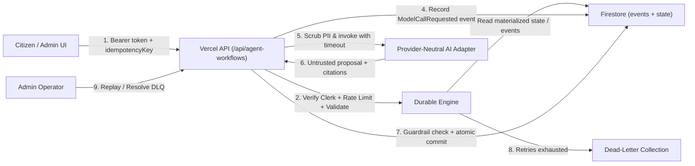

# ADR-1149: Durable Event-Sourced Execution for Long-Running Civic Agent Workflows

- **Status:** Accepted
- **Issue:** [#1149](https://github.com/GoldRay19/Civic-Help-Setu/issues/1149)
- **Owners:** Civic Help Setu Core Maintainers
- **Date:** 2026-11-26

---

## 1. Context & Problem

Long-running civic agent workflows (multi-step service readiness checks, document checklist verification, grievance/RTI draft preparation, and human-reviewed guidance) must survive:
1. **Serverless cold starts and function timeouts** (Vercel Functions).
2. **Duplicate client/webhook retries** and **out-of-order event delivery**.
3. **Model-provider outages, rate limits, and timeouts** without repeating side effects or corrupting workflow state.

Previously, assistant interactions in `src/pages/Assistant.jsx` were stateless request/response turns backed only by browser `localStorage` (`chatStorage.js`). There was no durable server-side event log, no idempotent state machine, no human-approval gate for high-impact proposals, and no dead-letter recovery.

---

## 2. Architecture & Component Boundaries

### 2.1 Components

| Component | Location | Responsibility | Trust Boundary |
|---|---|---|---|
| **Citizen UI** | `src/pages/Assistant.jsx`, `src/components/assistant/DurableWorkflowPanel.jsx` | Start/resume workflows, inspect provenance/citations, approve/reject high-impact proposals, retry failed steps | Untrusted client; authenticated via Clerk session token |
| **Admin / Operator UI** | `src/pages/Admin.jsx`, `src/components/admin/WorkflowDeadLetterPanel.jsx` | Inspect dead-lettered runs, trigger safe replay, view telemetry | Untrusted client; requires `role === "admin"` |
| **Serverless API Boundary** | `api/[...path].js` -> `api/_lib/handlers/agent-workflows.js` & `api/_lib/workflowApi.js` | Verify Clerk session, enforce `abuseGuard` rate limits, validate all untrusted payloads, enforce ownership/admin permissions | Trust boundary; never trusts client-supplied `userId`, `role`, or `status` |
| **Durable Workflow Engine** | `src/workflows/durableWorkflowEngine.js` | Pure deterministic state reducer (`projectWorkflowState`), transition validator, idempotency & sequence checks, checkpoint/replay | Deterministic core; no network I/O |
| **Versioned Contracts** | `src/workflows/workflowContracts.js` | `v1` schemas for events, commands, checkpoints, DLQ records, and strict boundary validators | Shared typed-contract module |
| **Provider-Neutral Adapter** | `src/workflows/providerAdapter.js` | Executes model/retrieval calls with timeout, retry budget, PII scrubbing (`aiGuardrailPipeline.js`), and untrusted-proposal wrapping | Isolates external/model calls from state commits |
| **Persistence (Firestore)** | `agentWorkflows/{workflowId}`, `agentWorkflows/{workflowId}/events/{seq}`, `agentWorkflowDeadLetters/{dlqId}` | Append-only event log, materialized state + checkpoint, dead-letter records | Server-write-only (`firebase-admin`); rules deny client writes |

### 2.2 Data-Flow Diagram

---

## 3. Core Design Decisions

1. **Append-Only Event Log + Materialized State:**
   Every state change is persisted as an immutable event (`schemaVersion: "1.0.0"`, monotonic `sequence`, `idempotencyKey`, `causationId`). The materialized workflow document stores `lastSequence`, `status`, `checkpoint`, and `retentionExpiresAt`, allowing O(1) reads and deterministic replay from any checkpoint.
2. **Separation of Model Calls from State Commits:**
   Model/retrieval calls never mutate state directly. The engine first commits `ModelCallRequested`, runs the provider adapter outside the transaction with a strict timeout, validates/scrubs the output through `aiGuardrailPipeline.js`, and then commits `ModelCallCompleted` (or `ModelCallFailed`) in a separate atomic transaction.
3. **Idempotency & Out-of-Order Protection:**
   - Duplicate `idempotencyKey` submissions return the already-committed event and materialized state without re-executing side effects.
   - Transitions with `expectedSequence !== state.lastSequence` are rejected deterministically with `409 Conflict` (`sequence_mismatch`), preventing out-of-order corruption.
4. **AI Outputs as Untrusted Proposals + Human-in-the-Loop:**
   - Every AI-generated step is recorded as a `StepProposed` event with mandatory `citations` / `provenance`.
   - High-impact steps (e.g., draft submission, escalation letter, benefit-related action) transition to `awaiting_human_approval` and **cannot** complete until a human explicitly submits `HumanApprovalResolved` (`approved` or `rejected`).
   - **Scope Guard:** Deterministic policy rules reject any proposal claiming official government integration, legal authority, autonomous filing, benefit denial, or official-status verification.
5. **Dead-Letter Recovery:**
   When a step exceeds `maxRetries` (default `3`) or encounters a non-retryable validation/policy error, the workflow transitions to `dead_lettered` and writes a sanitized record to `agentWorkflowDeadLetters` for operator inspection and replay.

---

## 4. Threat Model & Failure Modes

| Threat / Failure Mode | Impact | Mitigation |
|---|---|---|
| **Serverless crash / timeout mid-step** | Partial execution or lost progress | `ModelCallRequested` is committed before the call; client/worker resumes from `lastSequence` / checkpoint |
| **Duplicate retry storm** | Repeated side effects or duplicate events | `idempotencyKey` deduplication in `agentWorkflows/{id}/idempotency/{key}` + `createSingleFlight()` |
| **Out-of-order event delivery** | Corrupted state machine | Optimistic concurrency check on `expectedSequence === state.lastSequence` inside Firestore transaction |
| **Model provider outage / hang** | Hanging serverless function | Adapter enforces `timeoutMs` (default `8000ms`), bounded retries, and safe fallback / DLQ routing |
| **Prompt injection / autonomous filing** | Unauthorized claims or actions | `runPreInferenceGuardrails` + deterministic scope-boundary validator + mandatory human approval gate |
| **Privilege escalation (IDOR / forged admin)** | Citizen reads/approves another's workflow or replays DLQ | Clerk session verified server-side; `ownerId === userId` checked on every read/step; `role === 'admin'` required for DLQ |
| **PII leakage in logs/prompts/analytics** | Citizen Aadhaar/PAN/phone exposed | `minimizeForExternal` + `aiGuardrailPipeline` scrubbing before adapter call, error messages, and telemetry |

---

## 5. Performance, Cost Limits, Retention & Accessibility

- **Performance & Cost Limits:**
  - Max events per workflow run: `50` (`MAX_WORKFLOW_EVENTS = 50`).
  - Max retries per step: `3` (`DEFAULT_MAX_RETRIES = 3`).
  - Provider call timeout: `8,000 ms` (`DEFAULT_PROVIDER_TIMEOUT_MS = 8000`).
  - Max input query length: `2,000` chars; max payload size: `32 KB`.
  - API rate limits: `30 req/min` per IP, `20 req/min` per authenticated user (`abuseGuard.js`).
- **Data Retention:**
  - Active/completed workflows carry `retentionExpiresAt` (default `30 days` for citizen workflows, `90 days` for anonymized DLQ audit metadata), aligned with `docs/DATA_RETENTION.md`.
  - Users can delete/purge their own workflows via `DELETE /api/agent-workflows?workflowId=...`.
- **Accessibility (WCAG 2.1 AA):**
  - `DurableWorkflowPanel` and `WorkflowDeadLetterPanel` use semantic `<section>`, `<ol>` step timelines, `aria-live="polite"` status announcements, keyboard-focusable approval/retry controls, and visible status badges (never color-only).

---

## 6. Migration, Rollback & Licences

- **Migration:** Additive Firestore collections (`agentWorkflows`, `agentWorkflowDeadLetters`) and new route `agent-workflows` in `api/[...path].js`. Existing stateless `Assistant.jsx` chat continues to work unchanged.
- **Rollback:** Remove `agent-workflows` from `api/[...path].js` and hide the workflow panel toggle in `Assistant.jsx`. Existing Firestore rules deny client writes by default, so no destructive schema migration is required.
- **External Services & Licences:**
  - Application code: MIT (`LICENSE`).
  - Dependencies: React (MIT), Vite (MIT), Vitest (MIT), `@clerk/backend` (MIT), `firebase-admin` (Apache-2.0), `lucide-react` (ISC).
  - Model/retrieval layer: Uses the repository's local grounded civic catalogue (`src/data/services.js`) and provider-neutral adapter interface; no proprietary third-party dataset is bundled.
