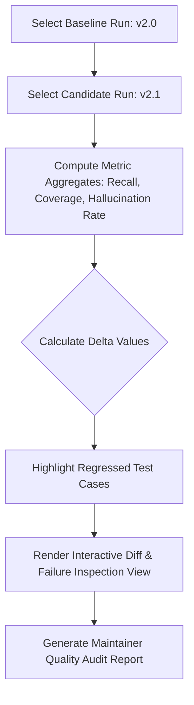

# AI Evaluation Run Explorer for Retrieval & Answer Quality

## Motivation & Overview
Iterative development of conversational AI models (prompt adjustments, chunking modifications, vector embedding upgrades) often produces mixed results: improving recall for English queries while degrading precision for regional languages or introducing subtle hallucinations in statutory checklists.

The AI Evaluation Run Explorer provides maintainers with a dedicated, synthetic benchmark comparison suite to inspect regressions, compare run-to-run deltas, and audit answer quality without exposing live citizen interactions.

---

## Benchmark Metrics & Plain-Language Definitions

| Metric | Formula / Calculation | Denominator | Definition |
| :--- | :--- | :--- | :--- |
| **Retrieval Recall** | $\frac{\text{Relevant Chunks Retrieved}}{\text{Total Ground Truth Chunks}}$ | Total test cases | Measures the ability of the search retriever to surface necessary gazette citations |
| **Citation Coverage** | $\frac{\text{Claims Backed by Valid Source IDs}}{\text{Total Factual Claims Made}}$ | Total factual statements | Measures grounding; penalizes unsubstantiated statements |
| **Unsupported Claim Rate**| $\frac{\text{Cases with Hallucinated Claims}}{\text{Total Run Cases}}$ | Total run test cases | Critical safety metric flagging ungrounded responses |
| **Completeness Score** | Evaluated on scale $0.0 - 1.0$ | Synthetic benchmark items | Assesses whether all mandatory procedural steps were answered |
| **Mean Latency** | $\frac{\sum \text{Latency (ms)}}{\text{Total Requests}}$ | Completed requests | Average response generation speed |

---

## Multi-Dimensional Slicing & Quality Protections

1. **Synthetic Benchmark Isolation**:
   - The explorer runs strictly against reproducible, versioned synthetic test suites. Zero production citizen records or private chat logs are ever loaded.
2. **Statistical Significance Indicator**:
   - Small sample sizes ($N < 10$) display prominent `isSampleSizeLow: true` warnings to prevent maintainers from drawing overconfident conclusions.
3. **Regression Detection**:
   - Automatically cross-references candidate runs against baselines, flagging individual cases where unsupported claims appeared or recall dropped.
4. **Accessible Table Representations**:
   - Performance visualizers include accessible HTML tables, screen reader ARIA labels, and keyboard-operable filter menus.

---

## Benchmark Run Comparison Flowchart



### Supported Benchmark Slicing Filters

- **Languages**: `en` (English), `hi` (Hindi), `kn` (Kannada), `ta` (Tamil), `bn` (Bengali)
- **User Intents**: `eligibility`, `document_checklist`, `application_status`, `fee_inquiry`
- **Civic Domains**: `ration`, `voter`, `pension`, `certificates`, `sanitation`

---

## Verification & Execution

Execute unit tests:
```bash
npx vitest run src/ai/aiEvaluationRunExplorer.test.js
```
Automated tests validate run registration, metric aggregation, low-sample warnings, run-to-run comparison, and slicing filters.

