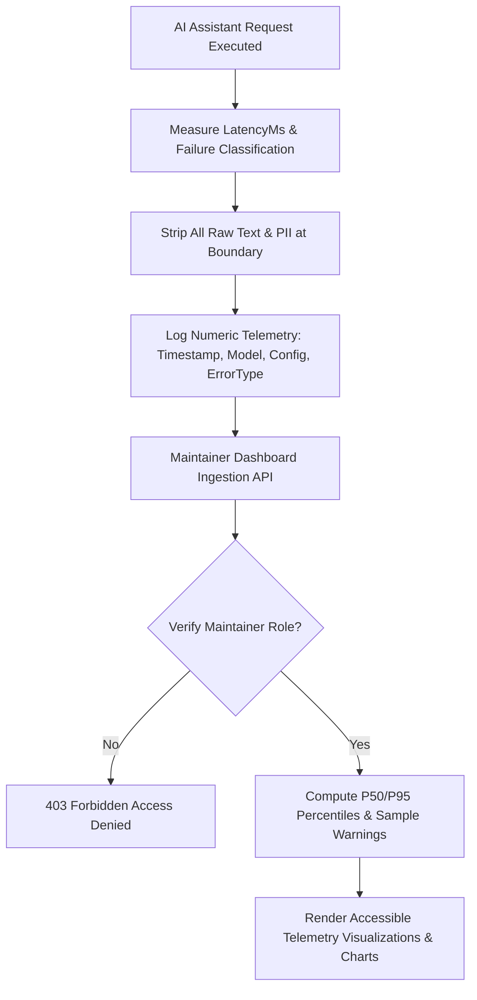

# AI Inference Latency and Fallback Operations Dashboard

## Executive Overview
When citizens interact with the Civic AI Assistant, operational anomalies such as upstream provider latency spikes, rate limits, or context budget exhaustion can degrade service availability. To diagnose regressions and optimize model routing without establishing an invasive surveillance apparatus, maintainers require a dedicated operational health dashboard.

The AI Inference Latency and Fallback Operations Dashboard aggregates non-sensitive operational telemetry, computing latency distributions and failure modes while guaranteeing strict zero-PII logging.

---

## Architectural Principles & Metrics

1. **Strict Privacy Safeguards (Zero-PII)**:
   - Telemetry captures purely numeric performance signals: `latencyMs`, `timestamp`, `modelId`, `configVersion`, and `failureType`.
   - Never logs citizen prompts, response text, document content, session IDs, or account identifiers.
2. **Clear Failure Boundary Classification**:
   - Explicitly distinguishes **Provider Outages** (upstream timeouts, HTTP 500s) from **Local Validation Rejections** (oversized prompts, illegal syntax).
3. **Statistical Integrity & Low-Volume Warnings**:
   - P50 (median) and P95 (tail latency) percentiles are calculated over standardized sliding windows (`1h`, `24h`, `7d`).
   - If total requests in a window are under 10 ($N < 10$), the dashboard displays an explicit warning (`isLowVolume: true`) to prevent misleading statistical interpretations.
4. **Role-Based Access Control**:
   - Dashboard endpoints and views are strictly restricted to authenticated maintainers (`role === 'MAINTAINER'`).

---

## Operations Telemetry Data Dictionary

| Signal | Type | Description |
| :--- | :--- | :--- |
| `latencyMs` | `number` | End-to-end request duration in milliseconds |
| `failureType` | `enum` | `PROVIDER_TIMEOUT`, `PROVIDER_ERROR`, or `LOCAL_VALIDATION_REJECTION` |
| `fallbackActivated` | `boolean` | Indicates whether the system served the static directory fallback |
| `modelId` | `string` | Foundation model invoked (e.g. `gemini-1.5-pro`) |
| `configVersion` | `string` | Release tag binding prompt and retrieval parameters |

---

## Telemetry Retention Policy

- Hourly aggregates are retained for 30 days.
- Detailed numeric event logs are rotated and purged after 72 hours.
- Raw payloads are rejected at the ingestion boundary and never written to persistent disks.

---

## Dashboard Architecture & Telemetry Pipeline



### Telemetry Retention & Operational Runbook

1. **Anomaly Response Protocols**:
   When P95 latency breaches 4000ms or when provider error rates exceed 5%, maintainers trigger automatic fallback routing or degrade context chunk retrieval to maintain UI responsiveness.
2. **Accessible Presentation Guarantees**:
   The dashboard includes accessible HTML tables, visible labels for screen readers, and high-contrast graphs.
3. **Audit Trail Verification**:
   All maintainer access to dashboard endpoints is logged with UTC timestamps and maintainer user handles.

---

## Verification & Execution

Execute unit tests:
```bash
npx vitest run src/services/aiOperationsDashboardService.test.js
```
Automated tests validate percentile calculation, error classification, sample thresholding, time-window filtering, and maintainer role authorization.

