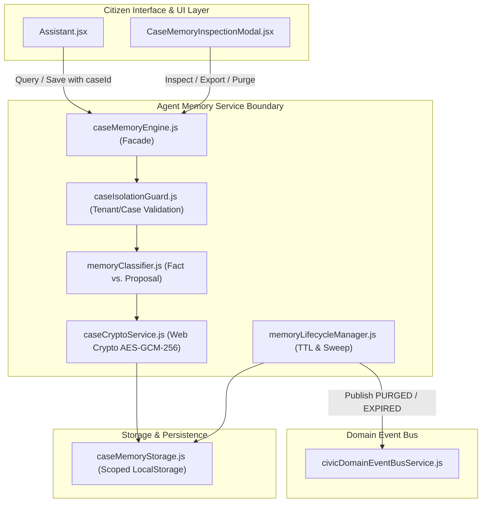

# ADR-0042: Privacy-Preserving Agent Memory Layer with Per-Case Isolation

- **Status:** Accepted
- **Date:** 2026-11-26
- **Context:** Issue #1152 — Level 3 Feature
- **Deciders:** Civic Help Setu Architecture & Privacy Working Group

---

## 1. Context and Problem Statement

Civic Help Setu provides an AI-assisted conversational assistant (`src/ai/`) that assists citizens navigating public government services (e.g. birth certificates, pension schemes, grievances, driving licenses).

Previously, conversational history was stored as an unpartitioned array under a single `localStorage` key (`civicbridge_chat_history`). This introduced several critical vulnerabilities:
1. **Cross-Case Memory Bleed:** When a citizen switches between different administrative cases or services, or when multiple citizens share a device at a digital access kiosk / library, memory entries from previous sessions could contaminate active context.
2. **Conflation of Ground Truth vs. Untrusted Model Proposals:** User-provided facts (such as eligibility criteria, existing document details) and model-generated inferences were merged into the same untyped message stream, risking model hallucinations being treated as verified facts.
3. **Plaintext At-Rest Storage:** Free-text case notes and citizen queries were saved in plaintext in browser storage, vulnerable to local extraction.
4. **Lack of Lifecycle and Deletion Cascades:** Memories had no deterministic Time-To-Live (TTL) or cascade deletion mechanism, preventing compliance with data minimization requirements.
5. **No Citizen Inspection or Export Controls:** Citizens could not inspect what the assistant remembered about their specific case, selectively delete items, or export their case data.

---

## 2. Decision Drivers

- **Zero Cross-Case Leakage:** Absolute cryptographic and logical separation between cases (`tenantId`, `caseId`).
- **Data Minimization & Confidentiality:** Client-side encryption for sensitive case records (Web Crypto API AES-GCM-256) with PBKDF2 case-derived keys.
- **Untrusted Model Proposals:** Strict demarcation between ground-truth citizen facts (`FACTUAL_NOTE`) and model inferences (`MODEL_PROPOSAL`). Model proposals require human verification before being elevated.
- **Lifecycle & Automated TTL:** Deterministic expiration countdowns with automated background sweep and event-driven deletion cascades.
- **Citizen Control & Transparency:** Accessible (WCAG 2.1 AA) inspection, individual item deletion, complete case memory purge, and standards-compliant export (`privacy-export.schema.json`).
- **Zero External Backend Requirement:** Operates entirely within the browser's client-side architecture on static hosting (Vercel), requiring no centralized database.
- **Scope Boundaries:** No claims of official government verification, legal authority, or autonomous filing/denial without human approval.

---

## 3. Considered Options

1. **Option 1 (Status Quo): Global `localStorage` Chat History**  
   *Rejected.* Violates per-case privacy boundaries; prone to memory bleed across users and cases.
2. **Option 2: Volatile In-Memory Only Storage**  
   *Rejected.* Loses all context upon page refresh or tab navigation, failing to provide required multi-step assistance for complex civic procedures.
3. **Option 3 (Chosen): Dual-Track Cryptographically Isolated Case Memory Engine**  
   *Accepted.* Scoped storage under compound keys (`chsetu:mem:<tenantId>:<caseId>:`), field-level encryption with AES-GCM-256, explicit classification between factual notes and model proposals, TTL lifecycle management, and event-driven deletion.

---

## 4. Architecture & Data Flow

---

## 5. Threat Model & Security Controls (STRIDE & LINDDUN)

| Threat Category | Attack Vector | Security Control |
|---|---|---|
| **Information Disclosure (STRIDE)** | Cross-case retrieval leak where query for Case B retrieves Case A memories. | **Compound Scoping & Hard Boundary Guard:** Storage keys partitioned by `tenantId:caseId`. `queryCaseMemory` validates callers against active scope; cross-case attempts throw `CaseBoundaryViolationError`. |
| **Tampering (STRIDE)** | Local extraction or tampering of stored plaintext notes on shared computer. | **Web Crypto AES-GCM-256:** Sensitive fields encrypted at rest using PBKDF2 key derivation with 100,000 iterations and per-case salt. |
| **Spoofing / Repudiation (STRIDE)** | AI model hallucinating official benefits or statuses and persisting them as citizen facts. | **Dual-Track Classification:** Untrusted model outputs are stored as `MODEL_PROPOSAL` with provenance metadata and confidence score; only human verification can promote them to `FACTUAL_NOTE`. |
| **Linkability / Identifiability (LINDDUN)** | Stale case memories persisting indefinitely, linking past inquiries to the user. | **Deterministic TTL & Auto-Pruning:** Configurable TTL (7 days for facts, 24 hours for unverified proposals) with background cleanup on app launch and manual instant purge. |
| **Non-Compliance (LINDDUN)** | Storing unredacted PII in memory prompts. | **Pre-Ingestion Minimization:** All stored memory text is sanitized via `minimizeForExternal()` from `src/utils/dataMinimization.js`. |

---

## 6. Domain Model & Schemas

### 6.1 `MemoryEntry` Contract
- `id`: Unique identifier (UUID v4)
- `tenantId`: Tenant partition (default `'default-citizen'`)
- `caseId`: Case reference identifier (e.g. `'case-srv-birth-cert-2026'`)
- `entryType`: `'FACTUAL_NOTE'` | `'MODEL_PROPOSAL'`
- `category`: `'DOCUMENT_METADATA'` | `'ELIGIBILITY_CRITERIA'` | `'ACTION_STEP'` | `'INTERACTION_SUMMARY'`
- `payload`: Encrypted envelope containing `{ title, text, metadata }`
- `provenance`: `{ source: 'user' | 'assistant', messageId, citationIds, confidenceScore, verifiedByCitizen: boolean }`
- `ttlSeconds`: TTL duration in seconds
- `createdAt`: Timestamp in ms
- `expiresAt`: Timestamp in ms

---

## 7. Operational Ownership & Maintainer Runbook

- **Ownership:** Maintained by the Civic Help Setu Privacy & Security Working Group.
- **Verification Command:** `npx vitest run src/services/agentMemory/`
- **Rollback Strategy:** Feature-flagged memory engine fallback to standard ephemeral session memory if cryptographic APIs are unsupported in legacy environments.
