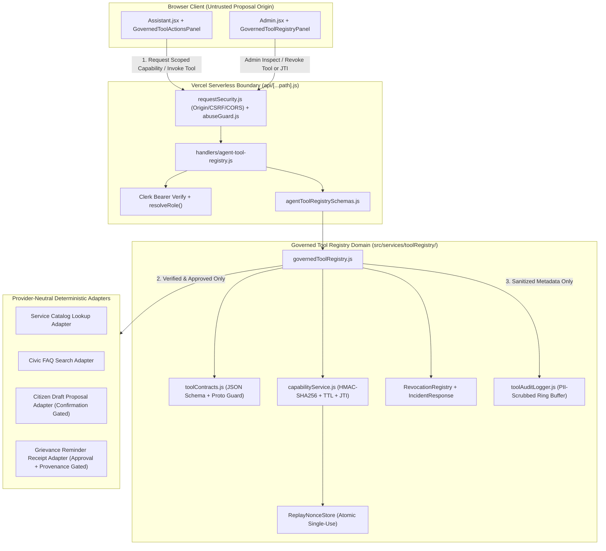

# ADR-1146: Governed Agent Tool Registry with Capability-Based Permissions

- **Status:** Accepted
- **Date:** 2026-11-26
- **Issue:** `#1146` — Create a Governed Agent Tool Registry with Capability-Based Permissions (Level 3)
- **Owners:** Civic Help Setu Security & Agent Runtime Maintainers

---

## 1. Context & Problem Statement

Civic Help Setu exposes an AI-assisted citizen guidance interface ([`Assistant.jsx`](../../src/pages/Assistant.jsx)) and moderation/operations workflows ([`Admin.jsx`](../../src/pages/Admin.jsx)). Prior to this change, [`policyControlledToolRouter.js`](../../src/ai/policyControlledToolRouter.js) offered only an in-memory, client-side prototype:

1. No formal JSON Schema contract per tool, making parameter coercion or unexpected fields possible.
2. No short-lived, cryptographically bound capability tokens — any caller could claim `citizenConfirmed: true` or reuse stale payloads.
3. No cross-user isolation binding capabilities to a verified actor (`sub`) and session.
4. No server-side enforcement boundary in the Vercel serverless API ([`api/[...path].js`](../../api/%5B...path%5D.js)).
5. No replay protection (`jti` single-use consumption) or centralized admin capability/user revocation UI.

Agents and LLM outputs must be treated strictly as **untrusted proposals**. Agents must never receive unrestricted access to application APIs, files, vault records, or another citizen's data.

---

## 2. Decision

We implement a **Governed Agent Tool Registry & Capability Enforcement Layer** across three isolated boundaries:

1. **Canonical Tool Registry & JSON Schema Validator (`src/services/toolRegistry/toolContracts.js`)**
   - Every tool is registered with a strict JSON Schema (`additionalProperties: false`, bounded string lengths, explicit enums/patterns), required `scopes`, `riskTier` (`LOW`, `MEDIUM`, `HIGH`), `approvalRequirement` (`NONE`, `CITIZEN_CONFIRMATION`, `HUMAN_REVIEWER_APPROVAL`), `requiresProvenance`, per-minute rate limit, and execution timeout budget.
   - Unknown or unregistered tools **fail closed** (`UNKNOWN_TOOL`).
   - Prototype-pollution keys (`__proto__`, `constructor`, `prototype`) are unconditionally rejected.

2. **Short-Lived Scoped Capability Engine (`src/services/toolRegistry/capabilityService.js` & `governedToolRegistry.js`)**
   - Capabilities use versioned signed tokens (`ctok_v1.<payload>.<hmac-sha256>`) with:
     - `sub`: verified actor ID (never derived from client-supplied headers)
     - `role`: server-resolved role (`citizen` or `admin` via [`roleService.js`](../../src/services/roleService.js))
     - `sessionId`: bound consultation session
     - `toolName` & `scopes`: least-privilege intersection of tool scopes and role ceiling
     - `riskTier`: immutable tier snapshot
     - `argDigest`: optional SHA-256 digest binding arguments for medium/high-risk executions
     - `jti`: unique nonce for single-use atomic consumption (`ReplayNonceStore`)
     - `iat` / `exp`: short TTL (default `120s`, hard cap `300s`)
   - Capabilities cannot be escalated beyond the actor's server-verified role ceiling.

3. **Server-Side Enforcement Boundary & Audit Pipeline (`api/_lib/handlers/agent-tool-registry.js`)**
   - Exposed under the single Vercel dispatcher [`api/[...path].js`](../../api/%5B...path%5D.js) at `/api/agent-tool-registry/*`.
   - Protected by `withRequestSecurity` (CSRF/Origin/CORS), `abuseGuard.js` rate limiting, Clerk Bearer session verification, and `api/_lib/agentToolRegistrySchemas.js` boundary validation.
   - Audit records pass through [`piiScrubber.js`](../../api/_lib/piiScrubber.js) (`scrubPii`) and [`toolAuditLogger.js`](../../src/services/toolRegistry/toolAuditLogger.js), logging only safe operational metadata (correlation ID, tool name, decision, error code, sanitized argument key names, latency) — **never** raw citizen PII, credentials, tokens, or private document payloads.

---

## 3. Architecture & Data-Flow Diagram

---

## 4. Threat Model & Mitigations

| Threat | Attack Vector | Mitigation & Control | Verification |
|---|---|---|---|
| **Privilege Escalation** | Citizen requests `registry:admin` or `audit:read` scopes, or sends forged `x-role: admin` header | Server resolves role strictly from Clerk `publicMetadata` (`resolveRole`); capability issuer enforces `ROLE_SCOPE_CEILING` | `SCOPE_DENIED` / `403` tests |
| **Capability Replay** | Attacker captures and replays a valid `ctok_v1` token for a state-changing call | Single-use `jti` nonce consumed atomically *before* adapter execution; expired `exp` rejected | `CAPABILITY_REPLAYED` & concurrency race tests |
| **Cross-User Access** | User A submits a capability minted for User B (`sub: user-b`) | Enforcer checks `claims.sub === verifiedActorId` and `claims.sessionId === sessionId` | `CROSS_USER_DENIED` (`403`) tests |
| **Malformed / Injection Arguments** | Extra fields, wrong types, oversized strings, `__proto__`/`constructor` keys, or vault/Aadhaar strings | Deterministic JSON Schema validator (`additionalProperties: false`), prototype key rejection, sensitive pattern check | `INVALID_SCHEMA` & `SENSITIVE_DATA_DENIED` tests |
| **Unknown / Hallucinated Tool** | Prompt injection causes agent to invoke `deleteAllUserData` or `execShell` | Default-deny lookup against frozen `REGISTERED_TOOLS`; unknown names fail closed immediately | `UNKNOWN_TOOL` tests |
| **Autonomous High-Impact Action** | Agent tries to file an application or issue an official status claim autonomously | `MEDIUM` requires `citizenConfirmed`; `HIGH` requires `humanApproved` + provenance citations; statutory filing/benefit denial tools are excluded by policy | `APPROVAL_REQUIRED` & `PROVENANCE_REQUIRED` tests |
| **PII / Credential Leakage in Telemetry** | Sensitive Aadhaar, PAN, phone, email, or raw `formData` in invocation logs | `toolAuditLogger.js` + `piiScrubber.js` strips argument values, records only `argKeys`, and scrubs strings | PII redaction unit & integration tests |
| **Compromised Tool / Runaway Agent** | Buggy or abused tool after deployment | Admin revocation API + UI (`revokeTool`, `revokeCapability`, `revokeUserCapabilities`) synced with `civicAgentIncidentResponse` | Revocation & restore tests |

---

## 5. Failure Modes & Safe Degradation

- **Invalid/Missing Signing Secret in Production:** If `TOOL_CAPABILITY_SECRET` is missing in production (`NODE_ENV === 'production'`), the serverless handler refuses to mint or verify tokens (`503 Service Unavailable`) rather than falling back to a weak/default key.
- **Registry / Store Error:** Fails closed (`500` / `CAPABILITY_INVALID`) without executing side effects.
- **Adapter Timeout:** Enforces per-tool `timeoutMs` (default `5000ms`), aborts execution, logs `TIMEOUT` without PII, and surfaces a safe manual guidance fallback (`NON_AI_CIVIC_FALLBACKS`).
- **Revoked Tool or Active Incident Kill-Switch:** Immediately halts execution with `TOOL_REVOKED` / `KILL_SWITCH_ACTIVE` and prompts citizen to use official manual portals.

---

## 6. Operational Ownership, Performance, Retention & Scope Boundaries

- **Operational Ownership:** Platform Security Maintainers own capability signing keys (`TOOL_CAPABILITY_SECRET`), revocation operations, and audit log review. Feature maintainers own individual tool JSON Schemas and deterministic adapters.
- **Performance & Cost Limits:**
  - Zero external LLM or paid API calls inside tool verification/execution.
  - Per-turn tool budget capped at `3` calls; per-tool `maxCallsPerMinute` sliding-window limit enforced; JSON Schema payload depth capped at `6` and strings bounded to `<= 2048` chars; audit ring buffer bounded to `500` entries in serverless memory (`64 KB` max body).
- **Data Retention:**
  - Capability tokens expire in `120s` (hard cap `300s`); replay nonces are pruned automatically once `exp` passes.
  - Sanitized audit metadata in memory is bounded; Firestore audit records (if enabled) follow the `DATA_RETENTION.md` operational audit window (`90` days) with zero citizen PII.
- **Accessibility:** Both [`GovernedToolActionsPanel.jsx`](../../src/components/assistant/GovernedToolActionsPanel.jsx) and [`GovernedToolRegistryPanel.jsx`](../../src/components/admin/GovernedToolRegistryPanel.jsx) provide semantic landmarks, `aria-live` status regions, explicit labels, keyboard-reachable controls, and clear error feedback.
- **Licenses:** Uses only repository-first-party code and existing dependencies (`react`, `lucide-react`, `@clerk/backend`, Node/Web Crypto). No new third-party packages or external datasets were added.
- **Scope Boundaries:** Civic Help Setu does **not** claim official government integration, legal authority, identity verification, or guaranteed benefit outcomes. All tool proposals are assistive drafts/lookups requiring human verification for impactful actions.
