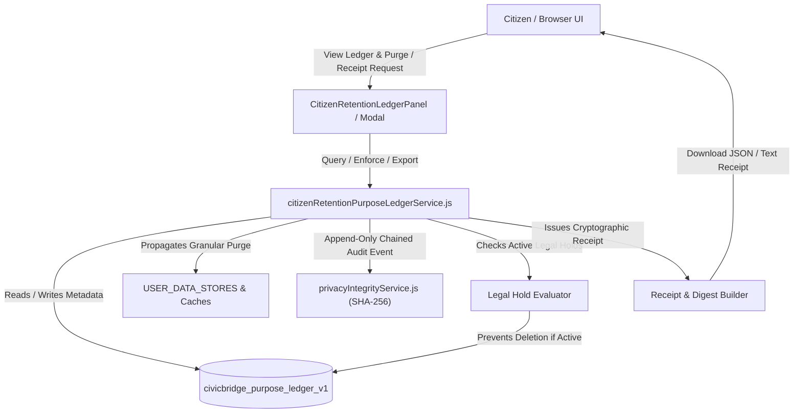

# ADR: Citizen-Controlled Data Retention and Purpose Ledger

**Status**: Accepted  
**Context**: GitHub Issue #1180 — [level3][feature] Build a Citizen-Controlled Data Retention and Purpose Ledger  
**Compliance Framework**: Digital Personal Data Protection (DPDP) Act 2023, GDPR Article 5(1)(e) (Storage Limitation) & Article 13/14 (Fair Processing Notices).

---

## 1. Context & Motivation

Civic Help Setu processes civic service eligibility assessments, appointment tokens, grievance evidence, and assistance queries. While basic opt-in consent and retention periods exist, citizens lack explicit, verifiable visibility into:
1. **Why** each specific category of data is collected and held (Lawful Civic Purpose & Legal Basis).
2. **When** each record expires (Deterministic Time-To-Live / expiry metadata attached to data scopes).
3. **Control**: The ability to inspect, request targeted granular deletion or anonymization, and download cryptographic **Access Receipts** and **Deletion Certificates**.
4. **Legal Holds & Backup Expiry**: Statutory scenarios where data must be preserved pending active dispute/grievance resolution, alongside transparent backup retention schedules.

---

## 2. Architecture & Data Flow

---

## 3. Threat Model (STRIDE)

| Threat Category | Potential Attack / Failure | Mitigation in Civic Help Setu |
| :--- | :--- | :--- |
| **Spoofing** | Unauthorized actor spoofing citizen identity to trigger premature erasure | Ledger and deletion workflows execute locally client-side in the authenticated user's isolated storage context; sensitive destructive actions require explicit user confirmation. |
| **Tampering** | Modification of retention expiry or purpose records to evade erasure or legal holds | Retention ledger entries and deletion receipts are anchored with canonical SHA-256 digests and validated against schema contracts. |
| **Repudiation** | Dispute regarding whether data was erased or held lawfully | Generation of tamper-evident, cryptographically signed Access Receipts and Deletion Certificates with timestamps, record digests, and chain linkage. |
| **Information Disclosure** | PII leak in purpose audit logs, receipts, or diagnostics | Strict synthetic masking: receipts and ledger records contain only category metadata, record counts, purpose keys, and SHA-256 hashes, never raw citizen identities or documents. |
| **Denial of Service** | Malicious script hammering purge or ledger calculations | Rate-limited execution guards, idempotent operations, and non-blocking asynchronous batch processing. |
| **Elevation of Privilege** | Bypassing legal holds to delete evidence under active statutory dispute | Legal holds override deletion routines: any store mapped to an active hold triggers `LEGAL_HOLD_ACTIVE` rejection with statutory notice. |

---

## 4. Component Ownership & State Management

1. **`src/services/citizenRetentionPurposeLedgerService.js`**:
   - Single point of truth for purpose definitions, purpose-record mappings, TTL calculation, legal hold enforcement, and receipt generation.
2. **Storage Keys**:
   - `civicbridge_purpose_ledger_v1`: Master ledger tracking purpose registrations, retention expirations, and active legal holds.
   - Leverages existing `USER_DATA_STORES` and `CONSENT_CATEGORY_STORAGE_MAP` to ensure all derived stores, session storage, and offline caches are pruned without orphan records.
3. **`src/components/privacy/CitizenRetentionLedgerModal.jsx`**:
   - Accessible, mobile-first UI with tabbed ledger inspection, legal hold transparency, one-click purpose erasure, and receipt verification.
4. **`src/pages/Privacy.jsx`**:
   - Surface the Purpose Ledger directly within the privacy center alongside audit logs.

---

## 5. Verification & Measurable Acceptance Criteria

1. **Deterministic Expiry**: Every purpose category defines explicit TTL (`retentionDays`) and lawful basis (e.g. DPDP Section 4(1), Municipal Citizen Charter).
2. **Receipt Verifiability**: Access and deletion receipts include SHA-256 checksums verifiable via `verifyPrivacyReceiptIntegrity()`.
3. **Legal Hold Immunity**: Active legal holds block deletion requests and log security notice.
4. **Zero PII Exposure**: No citizen names, Aadhaar/ID numbers, or credentials appear in receipts, ledger logs, or console diagnostics.
