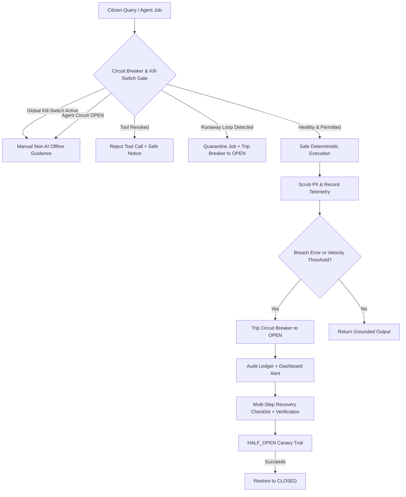

# Civic Agent Incident Response & Kill-Switch Framework

## 1. Problem & Motivation
In high-stakes civic technology platforms like Civic Help Setu, AI agents guide citizens through critical civic services (e.g., Aadhaar enrolment, ration cards, voter registrations, grievance follow-ups). If an agent or underlying LLM provider malfunctions, suffers prompt injection, or becomes compromised:
- Erroneous or fabricated eligibility advice could mislead citizens.
- Runaway execution loops or token velocity spikes could deplete budgets and degrade system availability.
- A malfunctioning agent must be isolated **without** taking down independent civic registries or services.

The **Civic Agent Incident Response and Kill-Switch Framework** (#1182) provides a multi-tiered fail-safe architecture to detect, isolate, quarantine, and recover malfunctioning agents deterministically.

---

## 2. Architecture & System Flow



---

## 3. Key Components & Capabilities

### 3.1 Per-Agent Circuit Breakers
Each agent maintains an independent state machine:
- **`CLOSED`**: Normal healthy operation.
- **`OPEN`**: Tripped due to anomalies. All requests immediately fail closed and route to manual non-AI guidance.
- **`HALF_OPEN`**: Canary trial phase. Limited requests (`maxHalfOpenAttempts: 3`) are admitted to evaluate recovery. If any canary trial fails, it immediately re-trips to `OPEN`.

**Trip Conditions:**
1. **Consecutive Failure Threshold**: $\ge 5$ consecutive errors.
2. **Rolling Window Failure Rate**: $\ge 50\%$ failure rate over rolling 1-minute window ($\ge 6$ calls).
3. **Runaway Loop Detection**: $\ge 4$ identical queries or recursive calls.
4. **Token Consumption Velocity Limit**: Exceeding 20,000 tokens/minute per agent.

### 3.2 Global Emergency Kill-Switch
- Activated by administrators (`P1_CRITICAL`) during widespread provider compromise or critical prompt-leakage incidents.
- Instantly blocks all conversational agent execution across the entire application.
- Enforces strict verification: cannot be disengaged without a signed-off **Post-Incident Recovery Checklist** (or explicit emergency administrative override).

### 3.3 Granular Tool Revocation Matrix
- Operators can revoke specific sensitive tools (e.g., `saveApplicationDraft`, `scheduleGrievanceFollowUp`) without disabling read-only catalogue lookup features.

### 3.4 Queued-Job Quarantine
- Malfunctioning requests or runaway loops are quarantined into a forensic queue with automated PII scrubbing (Aadhaar, PAN, phone numbers, and secrets are redacted).
- Administrators can inspect, evict, or batch-drain quarantined jobs once subsystems are restored.

### 3.5 Deterministic Non-AI Fallbacks
- Verified manual government office procedures and official helpline numbers (e.g., NFSA 1967, ECI 1950, Parivahan direct portal) ensure citizen access is never blocked when AI systems are offline.

---

## 4. Threat Model & Mitigation Strategy

| Threat | Attack Vector / Failure Mode | Mitigation Mechanism |
| :--- | :--- | :--- |
| **Runaway Loop Attack** | Adversary submits recursive queries causing infinite tool calling | Query loop tracker detects repetition $\ge 4$ and trips breaker to `OPEN`, quarantining the job |
| **Provider Compromise** | Upstream LLM outputs malicious instructions or hallucinated fees | Global kill-switch immediately disables inference; deterministic fallback routes are engaged |
| **Data Leakage in Forensics**| Telemetry capturing citizen Aadhaar, PAN, or passwords | Automated `scrubIncidentTelemetry` redacts all PII before writing to audit ledger or quarantine queue |
| **Premature Reactivation** | Operator re-enables agent before fixing underlying issue | `IncidentRecoveryChecklist` enforces 5-step signed verification before disengaging kill-switch |

---

## 5. Verification & Testing

Run unit tests for the core service:
```bash
npx vitest run src/services/incidentResponse/civicAgentIncidentResponseService.test.js
```

Run administrative API integration tests:
```bash
npx vitest run tests/agent-incident-response.test.js
```

Run dashboard component tests:
```bash
npx vitest run src/components/admin/AgentIncidentResponseDashboard.test.jsx
```

Run end-to-end AI guardrail pipeline integration tests:
```bash
npx vitest run src/ai/aiGuardrailPipeline.test.js
```
