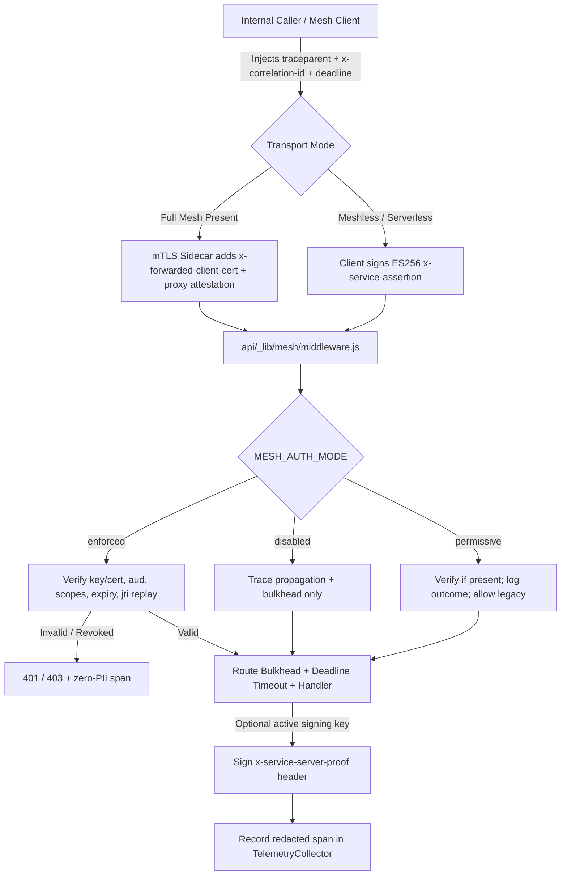
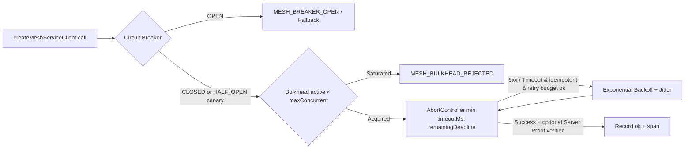

# Internal Service Mesh Readiness Layer — Architecture, Threat Boundaries, Operations & Migration (#1276)

**Status:** Implemented  
**Issue:** #1276 — Build an Internal Service Mesh Readiness Layer for Authentication and Telemetry

---

## 1. Problem & Design Goals

Internal API calls across Civic Help Setu services need consistent **service identity**, **mutual authentication**, **failure isolation**, **bounded retries/timeouts**, and **W3C trace propagation** without assuming every deployment runs a full L7 service mesh (such as Envoy/Istio).

Design constraints satisfied:
1. **Reuse existing abstractions:** Integrates into [api/[...path].js](../../api/%5B...path%5D.js), reuses `BREAKER_STATES` from `src/services/incidentResponse/civicAgentIncidentResponseService.js`, HMAC privacy hashing (`privacyIdentifier`) from `api/_lib/abuseControlPlane.js`, and rate limiting/single-flight primitives from `api/_lib/abuseGuard.js`.
2. **Transport-agnostic mutual auth:** Supports both mesh-terminated mTLS (`x-forwarded-client-cert` gated by trusted proxy attestation) and meshless application-layer mutual ECDSA-P256 assertions + server proofs.
3. **Strict separation from end-user sessions:** Service-to-service identity (`servicePrincipal`) is verified independently of Clerk/Firebase end-user sessions.
4. **Zero-PII telemetry:** All spans and diagnostics scrub Aadhaar, PAN, phone, email, PEM keys, and bearer tokens before buffering or export.
5. **Backward compatible:** Defaults to `MESH_AUTH_MODE=disabled` so existing routes operate unchanged until opted into `permissive` or `enforced` rollout.

---

## 2. Architecture

### 2.1 Components

| Component | File | Responsibility |
|-----------|------|----------------|
| Trace & Telemetry | `api/_lib/mesh/traceContext.js` | W3C `traceparent`/`tracestate`, `x-correlation-id`, `x-request-deadline-ms`, zero-PII `scrubTelemetryPayload`, bounded ring-buffer `createTelemetryCollector` |
| Service Identity & Keyring | `api/_lib/mesh/serviceIdentity.js` | ES256 key generation/signing/verification, XFCC `mtls_header` parsing + proxy attestation, `active`/`staging`/`grace`/`revoked` keyring rotation, bounded `jti` replay cache, mutual `x-service-server-proof` |
| Resilience & Client | `api/_lib/mesh/resilience.js` | Per-dependency `createDependencyPolicy` (circuit breaker, bulkhead, retry budget, jittered exponential backoff, `AbortController` deadline timeout) and `createMeshServiceClient` |
| Middleware | `api/_lib/mesh/middleware.js` | `resolveMeshConfig`, `createMeshReadinessLayer` (`evaluateRequest`, `executeRoute`, `getReadinessSnapshot`), gradual rollout (`disabled` / `permissive` / `enforced`) |
| Dispatcher & Endpoint | `api/[...path].js`, `api/_lib/handlers/mesh-readiness.js` | Wraps all dispatched routes with trace/isolation/auth and exposes `/api/mesh-readiness` for status, public keyring inspection, rotation, revocation, and telemetry |

### 2.2 Dual-Mode Request Flow

### 2.3 Outbound Failure Isolation Flow

---

## 3. Threat Boundaries & Controls

| Threat | Trust Boundary | Control |
|--------|----------------|---------|
| **XFCC / Peer Header Spoofing** | Untrusted internet client -> Serverless API | `mtls_header` mode rejects `x-forwarded-client-cert` unless `x-mesh-proxy-attestation` matches `MESH_TRUSTED_PROXY_SECRET` using constant-time comparison (`timingSafeEqual`) or a custom trusted-proxy predicate. |
| **Confused-Deputy (User vs. Service Auth)** | End-user Clerk session vs. internal service call | Clerk `Authorization: Bearer` tokens are never accepted as service assertions (`x-service-assertion`), and `req.meshContext.servicePrincipal` is strictly isolated from end-user session resolution (`endUserIsolated: true`). |
| **Token / Assertion Replay** | Captured `x-service-assertion` re-sent within TTL | Every assertion carries a `jti` nonce checked against a bounded `seenJtis` cache keyed through TTL + clock skew. Optional `verifyRequestDigest` binds `method`, `path`, and `body` SHA-256 (`reqHash`). |
| **Compromised Service Key / Cert** | Compromised private key or retired workload | `keyring.revokeKey(kid)` immediately transitions the key to `revoked`; verification rejects `revoked` keys even before `notAfter` expires and rejects `mtls_header` peers with revoked keys or mismatched cert hashes. |
| **Audience / Privilege Escalation** | Compromised low-privilege service calling admin route | Assertions validate `aud === config.serviceId`, key-level `allowedAudiences`, key-level `allowedScopes`, and token `scopes` against route-level `routeScopes`. |
| **PII / Secret Leakage in Telemetry** | Request metadata -> Span buffer / logs | `scrubTelemetryPayload` strips Aadhaar, PAN, mobile numbers, email addresses, PEM blocks, and `Bearer` tokens, while `privacyIdentifier` HMAC-SHA256 hashes optional end-user identifiers. Private keys are never returned by `/api/mesh-readiness?action=keys`. |

---

## 4. Operational Failure Modes & Mitigations

| Failure Mode | Symptom | Mitigation |
|--------------|---------|------------|
| **Clock Skew During Rotation/Expiry** | Valid assertions fail near `nbf`/`exp` boundaries across hosts | Configurable `MESH_CLOCK_SKEW_SECONDS` (default `30s`) applied symmetrically to `notBefore`/`notAfter` and `nbf`/`exp`. |
| **Rotation Cutoff Race** | In-flight requests signed with old key fail immediately after rollover | `rotateKey()` demotes prior `active` key to `grace` (verify-only) rather than deleting or revoking it; callers switch to new key while `grace` covers active TTLs before `pruneExpired()`. |
| **Upstream Degradation / Hanging Dependency** | Cascading timeouts exhaust worker concurrency across routes | Per-dependency `createDependencyPolicy` isolates each upstream with an independent circuit breaker (`CLOSED`/`OPEN`/`HALF_OPEN`) and concurrency bulkhead (`maxConcurrent`). Healthy dependencies remain unaffected. |
| **Retry Amplification Storm** | Retries multiply load on an already struggling upstream | Retries occur **only** on idempotent methods (or explicit `x-idempotency-key`), only on transient faults (`429/502/503/504`/timeout), and are capped by both `maxRetries` and a sliding-window `retryBudgetRatio` (default 25%). |
| **Breaker Flapping** | Upstream alternates rapidly between `OPEN` and `CLOSED` | `HALF_OPEN` admits at most `maxHalfOpenAttempts` canary requests; any canary failure immediately trips back to `OPEN` for `resetTimeoutMs`. |
| **Deadline Exhaustion Across Multi-Hop Calls** | Hop 2 starts work after Hop 1 already timed out | `x-request-deadline-ms` propagates downstream; `effectiveTimeoutMs = min(timeoutMs, remainingDeadline)` and pre-expired deadlines fail immediately with `MESH_DEADLINE_EXCEEDED` (504). |

---

## 5. Migration & Rollback Plan

### 5.1 Phased Rollout

1. **Stage 0 — `MESH_AUTH_MODE=disabled` (Default):**
   - Deploy code. All existing `/api/*` routes continue unchanged. W3C `traceparent`, `x-correlation-id`, and ingress bulkhead protection are active.
2. **Stage 1 — `MESH_AUTH_MODE=permissive`:**
   - Provision `MESH_KEYRING_JSON` and `MESH_SIGNING_KEY_JSON` (or `MESH_TRUSTED_PROXY_SECRET` for mTLS mesh).
   - Enable `permissive` mode. Callers begin attaching `x-service-assertion`; unauthenticated/legacy callers are logged with `authOutcome: permissive_bypass` and `x-mesh-auth-status: permissive_bypass` without breaking traffic.
   - Verify via `GET /api/mesh-readiness?action=telemetry` that `authPermissiveBypass` drops to zero for internal callers.
3. **Stage 2 — `MESH_AUTH_MODE=enforced`:**
   - Switch `MESH_AUTH_MODE=enforced`. Protected internal routes (`MESH_INTERNAL_ROUTES`, default `internal/,mesh-readiness`; extend with additional service-only routes as needed) require valid service auth (`401`/`403` otherwise) while keeping browser-facing Clerk routes unaffected.

### 5.2 Key Rotation Runbook

1. Register/distribute new public key via `rotateKey` (or `MESH_KEYRING_JSON` update) — prior `active` key automatically enters `grace`.
2. Update caller `MESH_SIGNING_KEY_JSON` to sign with the new `kid`.
3. After `assertionTTL + clockSkew + graceWindow` elapses, call `prune-expired` or revoke the old `kid`.

### 5.3 Rollback

- **Instant Config Rollback:** Set `MESH_AUTH_MODE=permissive` or `disabled` in environment config and redeploy/reload; no database migrations or schema rollbacks are required.
- **Code Rollback:** Reverting `api/[...path].js` and removing `api/_lib/mesh/` restores prior dispatcher behavior with zero persistent state impact.

---

## 6. Capacity & Performance Assumptions

| Parameter | Default | Memory / Latency Bound |
|-----------|---------|------------------------|
| Replay nonce cache (`maxReplayEntries`) | `10,000` entries | Bounded FIFO + expiry sweep (~1 MB upper bound per warm instance). |
| Telemetry ring buffer (`maxTelemetryEvents`) | `1,000` spans | Fixed-length ring buffer; oldest spans evicted on overflow (~0.5–1 MB). |
| Per-dependency outcome window (`windowDurationMs`) | `60,000 ms` | Time-pruned sliding array per dependency policy. |
| Per-dependency bulkhead (`maxConcurrent`) | `32` outbound / `64` ingress | Caps concurrent sockets/promises per warm Vercel function instance. |
| Cryptographic cost (`ES256` P-256 sign + verify) | ~0.2–0.5 ms/call in Node 24 | Sub-millisecond overhead per hop compared to network RTT. |
| **Serverless Caveat** | Per-instance memory | On Vercel serverless, replay caches, circuit breakers, and ring buffers are per warm function instance (same constraint as `api/_lib/abuseGuard.js`). Global cross-instance state or distributed tracing export should attach an external `onSpan` exporter or shared store when scaling beyond single-instance isolation. |
