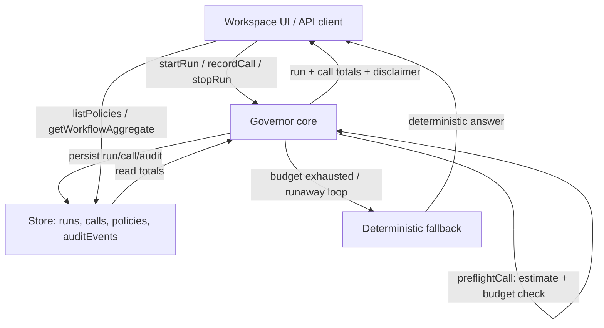

# Civic Agent Cost and Carbon Budget Governor — Architecture Decision Record (#1185)

**Status:** Proposed
**Owner:** Civic Help Setu platform team
**Issue:** #1185 — Implement a Civic Agent Cost and Carbon Budget Governor

---

## 1. Problem statement

Agent workflows can become expensive or resource-intensive when retries and
multi-model chains are unbounded. There is no per-workflow tracking of model
calls, tokens, latency or estimated energy, no budget enforcement, no stop
conditions, and no route to cheaper deterministic fallbacks. Runaway loops and
provider billing metadata gaps can silently drive up cost and carbon footprint.

---

## 2. Decision

Build a **Civic Agent Cost and Carbon Budget Governor** — a production-oriented
vertical slice that:

- Tracks per-workflow model calls, tokens, latency and estimated energy/carbon.
- Enforces per-call and cumulative budgets (cost, tokens, latency, carbon,
  calls per run, calls per minute).
- Triggers stop conditions and routes to cheaper deterministic fallbacks when
  budgets are exhausted.
- Detects runaway loops (rapid repeat calls to the same model + input).
- Flags provider billing metadata gaps (estimates only when no verified
  billing metadata is returned).
- Exposes transparent estimates, never presented as a bill.
- Requires explicit human approval for high-impact actions.
- Persists only aggregated metadata — never citizen records, credentials, raw
  documents or sensitive prompts.

---

## 3. Components

| Component | File | Responsibility |
|-----------|------|----------------|
| Constants / schema / rate table | `src/data/civicAgentCostCarbonConstants.js` | Schema version, enums, error codes, model rate table, carbon/energy factors |
| Persistence & migrations | `src/services/civicAgentCostCarbonMigrations.js` | Versioned store, atomic transactions, rollback, retention |
| Governor core | `src/services/civicAgentCostCarbonGovernor.js` | Budget enforcement, stop conditions, runaway-loop detection, billing gaps |
| Client service | `src/services/costCarbonGovernorService.js` | Browser-facing wrapper over the governor |
| AI-call wrapper | `src/ai/civicAgentCostCarbonWrapper.js` | Estimate-before-call, record-after-call, deterministic fallback routing |
| Versioned schemas | `api/_lib/civicAgentCostCarbonSchemas.js` | v1 request/response validation contracts |
| API store | `api/_lib/civicAgentCostCarbonStore.js` | In-memory store contract (degrades gracefully) |
| API route | `api/civic-agent-cost-carbon.js` | Dependency-injected Vercel serverless handler |
| Workspace UI | `src/components/costCarbonGovernor/CostCarbonGovernorWorkspace.jsx` | Mobile-first accessible workspace |
| Governor page | `src/pages/CostCarbonGovernorWorkspace.jsx` | Route `/cost-carbon-governor` |
| Synthetic fixtures | `tests/fixtures/civicAgentCostCarbonSyntheticFixtures.js` | Non-citizen test data |

---

## 4. Data flow

```
Citizen / operator action
        │
        ▼
Workspace UI  (src/pages/CostCarbonGovernorWorkspace.jsx)
        │
        ├─▶ startRun({ workflowId, modelId, prompt, isHighImpact, humanApproved })
        │      governor.preflightCall()  → estimate cost/tokens/energy/carbon
        │      → fail closed if budget/permission breached
        │      → persist run (status: running)
        │
        ├─▶ recordCall({ runId, modelId, prompt, output, ... })
        │      → update cumulative totals
        │      → check stop conditions (cost, tokens, latency, carbon, calls)
        │      → detect runaway loop (same model + input repeated)
        │      → flag billing metadata gap
        │      → if stopped → route to deterministic fallback or block
        │
        ├─▶ stopRun({ runId, reason })   (operator / user)
        │
        └─▶ getWorkflowAggregate(workflowId)  → read-only totals
        └─▶ getRun(runId)                     → run + calls
        └─▶ listPolicies()                    → budget policies
```

### Data-flow diagram



---

## 5. Threat model

| Threat | Mitigation |
|--------|------------|
| Runaway agent loop (unbounded retries) | Calls-per-minute + per-run caps; rapid repeat same-model+same-input detection; stop + fallback |
| Unexpected billing spike | Per-call and cumulative cost/token/latency/carbon ceilings; fail closed |
| Provider billing metadata gap | Estimates flagged `estimated: true`; `billingMetadataGap` surfaced; never presented as a bill |
| Sensitive prompt leakage | Prompt is hashed before storage; only length stored; sensitive keys/values (Aadhaar, PAN, OTP, tokens, secrets) rejected at trust boundary |
| Unauthorized high-impact action | `humanApproved` required; `isHighImpact` flagged; requires human review |
| Spoofed / malformed input | Versioned schemas validate all external input at trust boundary; unknown fields rejected |
| Storage corruption / corruption rollback | Atomic transactions; migration with fallback to seed; rollback/reset functions |
| Denial of service via concurrent runs | Concurrency cap (`MAX_CONCURRENT_RUNS`) and per-workflow cap (`MAX_RUNS_PER_WORKFLOW`) |

---

## 6. Failure handling

| Failure | Behaviour |
|---------|-----------|
| Store unavailable | Degrade gracefully; in-memory fallback; caller shown offline notice |
| Budget exceeded | Fail closed: call blocked or routed to deterministic fallback; `stopped` flag set |
| Stop condition triggered | Run status set to `stopped`; `stopTrigger` recorded; further calls blocked |
| Runaway loop suspected | `runwaySuspected` flag; run may be stopped; operator notified via audit event |
| Billing metadata gap | Call proceeds with estimates; `billingMetadataGap: true`; estimates labelled |
| Invalid input | 400 `validation_failed` with stable error codes; no internal details leaked |
| Transaction failure | No partial write; previous bundle retained; error returned |
| Store write failure | 503 `store_unavailable`; no partial state |

---

## 7. Component ownership

- **Platform team:** governor core, migrations, API route, schemas, store contract.
- **Frontend team:** workspace UI component, page, client service, AI-call wrapper integration.
- **Security team:** threat model review, sensitive-field redaction, secret rotation (`CIVIC_AGENT_COST_CARBON_SECRET`).

---

## 8. Related documents

- `docs/civic-agent-cost-carbon-governor-evaluation.md` — evaluation criteria, reproducible commands.
- `docs/civic-agent-cost-carbon-governor-deployment.md` — deployment, migration, rollback.
- `docs/security/threat-model.md` — platform-wide threat model.
