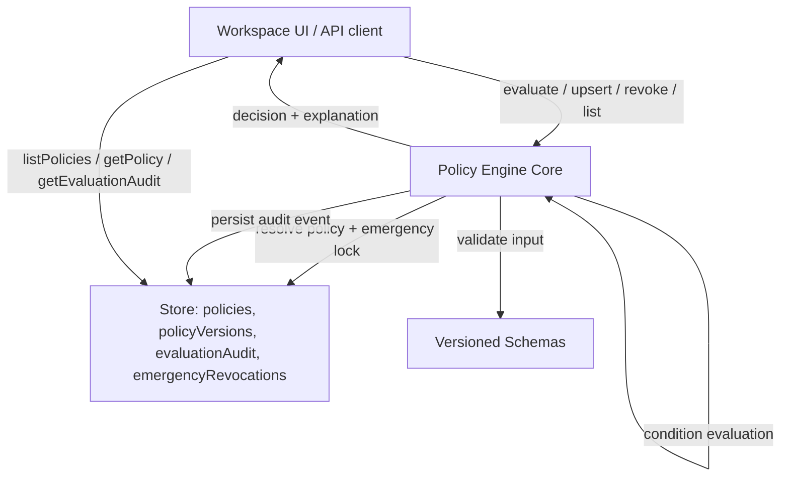

# Civic Agent Workflow Policy-as-Code Engine — Architecture Decision Record (#1187)

**Status:** Proposed
**Owner:** Civic Help Setu platform team
**Issue:** #1187 — Build a Civic Agent Workflow Policy-as-Code Engine

---

## 1. Problem statement

Different civic tasks need explicit rules about which agents, tools, sources and
approvals are permitted. Today, tool access is controlled by ad-hoc permission
tiers in `src/ai/policyControlledToolRouter.js`, with no machine-readable,
versioned policy language, no deny-by-default guarantee, no conflict resolution,
and no emergency revocation mechanism.

---

## 2. Decision

Build a **Civic Agent Workflow Policy-as-Code Engine** — a production-oriented
vertical slice that:

- Defines machine-readable policies evaluated before every tool call and state
  transition.
- Supports deny-by-default: any action not explicitly permitted by an active
  policy is refused.
- Supports policy versioning and conflict resolution by rule priority.
- Exposes policy explanations for transparency.
- Adds policy simulation to test bypass attempts, conflicting policies and
  emergency revocation.
- Requires explicit human approval for high-impact actions.
- Never autonomously files applications, denies benefits or claims official
  verification.

---

## 3. Components

| Component | File | Responsibility |
|-----------|------|----------------|
| Constants / schema / DSL | `src/data/civicAgentPolicyConstants.js` | Schema version, enums, error codes, policy DSL, deny-by-default rule |
| Persistence & migrations | `src/services/civicAgentPolicyMigrations.js` | Versioned store, atomic transactions, rollback, retention |
| Policy engine core | `src/services/civicAgentPolicyEngine.js` | Deny-by-default evaluation, versioning, emergency revocation |
| Client service | `src/services/civicAgentPolicyService.js` | Browser-facing wrapper over the engine |
| Policy simulation | `src/services/civicAgentPolicySimulation.js` | Bypass, conflict, revocation and deny-by-default simulation |
| Versioned schemas | `api/_lib/civicAgentPolicySchemas.js` | v1 request/response validation contracts |
| API store | `api/_lib/civicAgentPolicyStore.js` | In-memory store contract |
| API route | `api/civic-agent-policy.js` | Dependency-injected Vercel serverless handler |
| Workspace UI | `src/components/policyEngine/PolicyEngineWorkspace.jsx` | Mobile-first accessible workspace |
| Governor page | `src/pages/PolicyEngineWorkspace.jsx` | Route `/policy-engine` |
| Synthetic fixtures | `tests/fixtures/civicAgentPolicySyntheticFixtures.js` | Non-citizen test data |

---

## 4. Data flow

```
Citizen / operator action
        │
        ▼
Workspace UI  (src/pages/PolicyEngineWorkspace.jsx)
        │
        ├─▶ evaluate({ policyId, resourceType, resourceId, action, role,
        │          citizenConfirmed, humanApproved, sourceVerified, ... })
        │      → validate at trust boundary (schemas)
        │      → resolve active policy (deny-by-default fallback)
        │      → emergency lock check (refuse all actions)
        │      → rule matching by priority (highest wins)
        │      → condition evaluation (deterministic, order-independent AND)
        │      → require_approval gating (human approval for high-impact)
        │      → persist evaluation audit event (aggregated only)
        │      → return { permitted, decision, reason, code, explanation }
        │
        ├─▶ upsertPolicy(...)          (operator) create/update policy version
        ├─▶ emergencyRevoke(...)       (operator) suspend all actions under policy
        ├─▶ listPolicies()             read-only policy catalogue
        ├─▶ getPolicy(policyId)        read a single policy + rules
        ├─▶ getPolicyVersions(...)     read policy version history
        └─▶ getEvaluationAudit(...)    read aggregated evaluation audit trail
```

### Data-flow diagram



---

## 5. Threat model

| Threat | Mitigation |
|--------|------------|
| Policy bypass (action slips through undetected) | Deny-by-default fallback rule; all external input validated against versioned schemas; simulation tests bypass attempts |
| Conflicting policies (allow + deny for same action) | Conflict resolution by rule priority (highest wins); deterministic evaluation |
| Unauthorized high-impact action | `require_approval` effect + `humanApproved` gating; requires explicit human review |
| Emergency situation (compromised policy) | `emergencyRevoke` suspends all actions under a policy; `emergency_locked` status |
| Malformed / mass-assignment input | Unknown fields rejected; strict type/slug validation at trust boundary |
| Sensitive prompt leakage in policies/audit | Prompts never stored; evaluation inputs hashed (only length + resource ids kept); sensitive keys/values rejected |
| Storage corruption / partial writes | Atomic transactions; rollback on failure; migration with fallback to seed |
| Denial of service via concurrent evaluations | Concurrency cap (`MAX_CONCURRENT_EVALUATIONS`) |

---

## 6. Failure handling

| Failure | Behaviour |
|---------|-----------|
| Store unavailable | Deny by default; caller shown store_unavailable error |
| No active policy | Deny by default; `CP_POLICY_NOT_FOUND` |
| Emergency lock | All actions refused; `CP_EMERGENCY_REVOKED` |
| Invalid input | 400 `validation_failed` with stable error codes; no internal details leaked |
| Transaction failure | No partial write; previous bundle retained; error returned |
| Store write failure | 503 `store_unavailable`; no partial state |
| Concurrency cap exceeded | Deny by default; `CP_RESOURCE_LIMIT_EXCEEDED` |

---

## 7. Component ownership

- **Platform team:** policy engine core, migrations, API route, schemas, store contract, simulation.
- **Frontend team:** workspace UI component, page, client service.
- **Security team:** threat model review, sensitive-field redaction, emergency revocation procedures.

---

## 8. Related documents

- `docs/civic-agent-policy-engine-evaluation.md` — evaluation criteria, reproducible commands.
- `docs/civic-agent-policy-engine-deployment.md` — deployment, migration, rollback.
- `docs/civic-agent-policy-engine-user.md` — user guide.
- `docs/security/threat-model.md` — platform-wide threat model.
