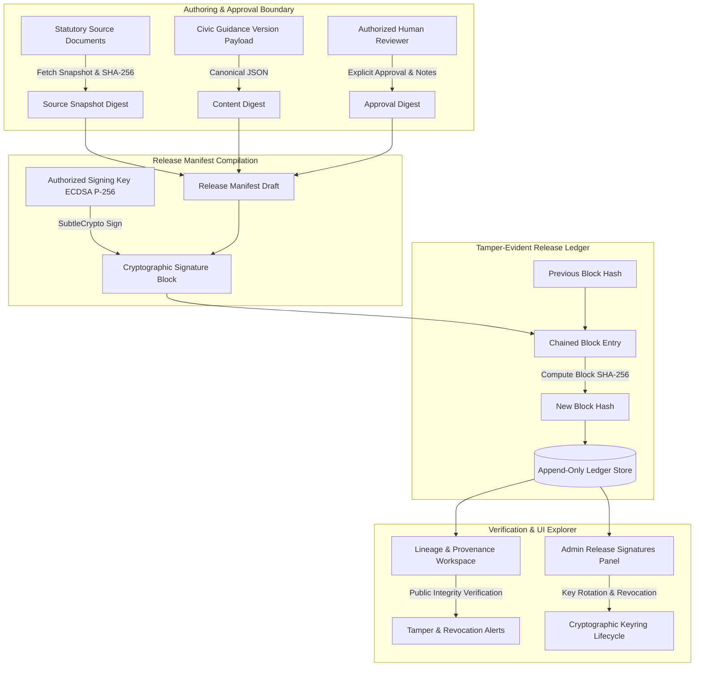

# Architecture Decision Record (ADR): Civic Content Provenance Signature and Tamper-Evident Release Ledger

## Status
Accepted

## Context
Published civic guidance (such as statutory rules, required permits, processing fees, deadlines, and legal procedures) directly impacts citizen entitlements and administrative compliance. When administrative requirements change or discrepancies arise, citizens and municipal reviewers need a tamper-evident, verifiable record demonstrating:
1. The exact official statutory sources (gazette notifications, municipal orders, state portal URLs) referenced.
2. The exact snapshot digests of the source content when the guidance was authored.
3. Explicit human reviewer approvals (legal reviewers, department administrators, civic auditors) before high-impact rules are enacted.
4. Cryptographic integrity of the released guidance without reliance on gas-intensive or speculative distributed ledger / blockchain infrastructure.
5. Continuous auditability with cryptographic key rotation, revocation, and breach detection.

---

## Decision Drivers
- **Verifiability Without Blockchain Overhead**: Standard public blockchains introduce financial volatility, transaction latency, gas costs, and vendor lock-in. A cryptographically chained ledger using W3C/RFC standard ECDSA P-256 and SHA-256 Merkle/hash-chained blocks provides mathematical tamper-evidence natively in standard web runtimes.
- **Deterministic Canonicalization**: Content digests must be strictly reproducible across heterogeneous client environments (Web Crypto API) and server environments (Node 18+). RFC 8785 JSON canonicalization ensures key-order stability.
- **Explicit Human-in-the-Loop Approval**: Autonomous AI outputs must strictly be treated as untrusted suggestions. Every published civic release manifest requires at least one cryptographically hashed human approval from an authorized role (`legal_reviewer`, `department_admin`, `civic_auditor`, `release_officer`).
- **Privacy & Least-Privilege Role Boundaries**: No Personally Identifiable Information (Aadhaar, PAN, phone numbers, individual applicant identifiers) or private cryptographic keys may ever be stored, logged, or exposed in client payloads or public ledger queries.

---

## Architecture Overview & Data Flow



---

## Threat Model & Mitigations

| Threat | Attack Vector | Mitigation & Technical Control |
| :--- | :--- | :--- |
| **Content Tampering** | Malicious actor modifies fees, deadlines, or requirements in the database or transit. | Content digest mismatch detected immediately during block verification; UI alerts with `TAMPERED` status. |
| **History Rewriting / Forking** | Attacker deletes or reorders previous release entries. | Hash chaining (`previousHash` binding): changing any prior block invalidates all downstream block digests. |
| **Compromised Signing Key** | Private signing token leaked or exfiltrated. | Key lifecycle registry supports immediate `REVOCATION` and `COMPROMISED` marking. The ledger audits all historical releases signed by the compromised key and raises visible security warnings. |
| **Unauthorized Autonomous Publication** | AI agent generates and publishes unverified guidance. | Strict schema enforcement (`validateReleaseManifest`): rejection if missing explicit human approval role from `APPROVER_ROLES`. |
| **PII Leakage** | Citizen or reviewer personal identifiers included in public ledger. | Input validation and zero-PII regex scrubbing blocks Aadhaar, PAN, phone numbers, and secrets at the API and service boundary. |
| **Denial of Service / Query Flooding** | Repeated verification requests or ledger exports. | Serverless endpoint implements fixed-window rate limiting (`abuseGuard.take`) with `Retry-After` headers. |

---

## Component Ownership

- **Contracts & Schemas**: `src/data/civicReleaseProvenanceContract.js`
  - Defines versioned schema (`1.0.0`), canonical JSON serializer, status enums, and boundary validation for manifests and ledger blocks.
- **Cryptographic Operations Engine**: `src/services/civicCryptoService.js`
  - Native Web Crypto API (`crypto.subtle`) implementation for SHA-256 digests, ECDSA P-256 keypair generation, JWK serialization, signing, and signature verification.
- **Ledger & Keyring Service**: `src/services/civicReleaseLedgerService.js`
  - Chained block generation, manifest signing, append-only storage, key rotation/revocation, full chain integrity audit, and synthetic fixtures.
- **Serverless API Handler**: `api/_lib/handlers/civic-release-ledger.js`
  - Secure `/api/civic-release-ledger` endpoint with rate limiting, public key querying (zero private key leakage), and administrative signing/revocation verification.
- **User Interface**:
  - `src/components/admin/CivicReleaseProvenanceLedgerPanel.jsx`: Accessible, mobile-responsive ledger audit panel, block explorer, interactive tampering test simulator, and key management.
  - `src/pages/LineageExplorerWorkspace.jsx`: Embedded view mode toggle enabling citizens and reviewers to audit release signatures alongside statutory data lineage.
  - `src/pages/Admin.jsx`: Dedicated admin tab for Release Signatures & Ledger.

---

## Evaluation & Verification Commands

1. **Unit & Integrity Tests**:
   ```bash
   npx vitest run src/services/civicReleaseLedgerService.test.js
   ```
2. **API Endpoint & Abuse Guard Tests**:
   ```bash
   npx vitest run api/_lib/handlers/civic-release-ledger.test.js
   ```
3. **UI Component & Accessibility Tests**:
   ```bash
   npx vitest run src/components/admin/CivicReleaseProvenanceLedgerPanel.test.jsx src/pages/LineageExplorerWorkspace.test.jsx
   ```
4. **Code Quality & Security Linting**:
   ```bash
   npx eslint api/_lib/handlers/civic-release-ledger.js src/data/civicReleaseProvenanceContract.js src/services/civicCryptoService.js src/services/civicReleaseLedgerService.js src/components/admin/CivicReleaseProvenanceLedgerPanel.jsx
   ```
