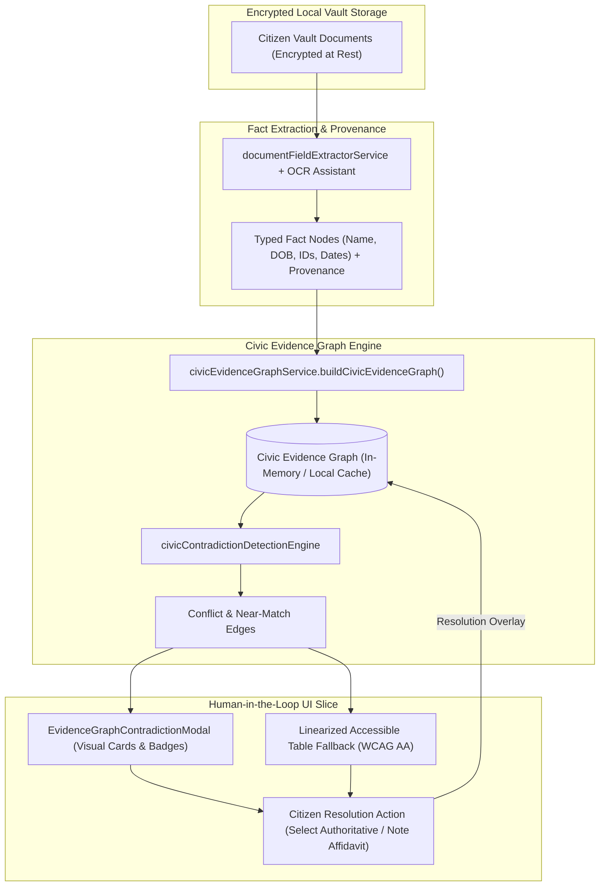

# Architecture Decision Record (ADR): Civic Evidence Graph for Cross-Document Contradiction Detection

**Status:** Approved  
**Date:** 2026-11-24  
**Context:** Issue #1165 — Cross-Document Contradiction Detection across Citizen Vault Records  
**Scope:** Client-Side / Edge Processing within Civic Help Setu  

---

## 1. Context and Problem Statement

When citizens in India interact with government departments (for pensions, ration cards, caste certificates, civil status registrations, or voter record updates), they often possess documents issued across multiple decades by distinct agencies (e.g., school leaving certificates, municipal birth certificates, Aadhaar cards, PAN cards, property tax receipts, and application acknowledgement slips).

Discrepancies across these documents cause high counter-rejection rates:
1. **Date of Birth Inconsistencies**: E.g., `12/06/1985` vs `06/12/1985` (day-month ambiguity) or true year mismatches.
2. **Name Variations & Transliterations**: Differences arising from English transliteration of Indic names (*Lakshmi* vs *Laxmi*, *Choudhary* vs *Chowdhury*) or initials expansion (*K. Suresh* vs *Kumar Suresh*).
3. **Reference Number & Checksum Discrepancies**: Discrepancies between application acknowledgement receipts and scrutiny notices.
4. **OCR Misreads**: Confusion between glyphs such as `O` (letter) and `0` (digit), `I` and `1`, `8` and `B`.

Existing document tooling in Civic Help Setu extracts fields individually but lacks a unified **Evidence Graph** to model relationships, detect cross-document contradictions, capture OCR uncertainty, and provide a non-destructive human-in-the-loop resolution interface.

---

## 2. Decision: Client-Side Civic Evidence Graph

We adopt an in-browser, privacy-preserving **Civic Evidence Graph** (`CIVIC_EVIDENCE_GRAPH_V1`) powered by a pure **Deterministic Contradiction Detection Engine**.

### Core Tenets:
1. **Deterministic Rules Outside LLM Prompts**: Contradiction detection runs purely via deterministic rules (chronological ordering, phonetic/Levenshtein matching, OCR confusion matrices, check-digit algorithms). LLMs or AI assistants must never be relied upon for factual contradiction judgements.
2. **Source Immutability**: Source documents stored in `vaultStorage` are never modified or overwritten by graph operations. Resolutions exist as an overlay assertion layer created and confirmed by the citizen.
3. **Provenance & Uncertainty**: Every extracted fact explicitly retains its source document ID, page number, OCR confidence score, and confidence tier (`HIGH`, `MEDIUM`, `LOW`).
4. **No Autonomous High-Impact Actions**: Contradiction detection is purely advisory. The system never denies applications, files claims, or certifies documents autonomously.
5. **Zero-Retention Client-Side Processing**: Processing occurs strictly in the browser/client environment using encrypted vault records; no document text or PII is sent to external cloud servers.
6. **Dual Presentation**: An accessible, mobile-first visual graph viewer paired with a linearized, WCAG 2.1 AA accessible non-AI table comparison fallback.

---

## 3. Data Flow Architecture

---

## 4. Threat Model (STRIDE)

| Threat Category | Potential Attack / Vulnerability | Mitigation in Civic Evidence Graph |
| :--- | :--- | :--- |
| **Spoofing (S)** | Malicious document injection claiming fraudulent authority. | Documents are anchored in the citizen's authenticated local vault; all facts retain verifiable document source hash and cryptographic provenance. |
| **Tampering (T)** | Modification of extracted facts or silent tampering with original records. | Strict source immutability: original vault documents are read-only. Graph facts carry SHA-256 hashes of source snippets. Resolutions are non-destructive overlays. |
| **Repudiation (R)** | Citizen or official disputes which document was designated for an application. | Explicit resolution audit trail recording timestamp, chosen fact ID, and citizen note. |
| **Information Disclosure (I)** | PII leakage (Aadhaar, PAN, names, addresses) in telemetry, error logs, or browser console. | Strict PII redaction using `maskSensitiveField()`. Zero PII in diagnostics. Only numeric metadata counts are logged. |
| **Denial of Service (D)** | Large documents or high fact counts leading to browser UI lockup or ReDoS attacks. | Bound maximum documents to 25 per dossier and facts to 200 per graph. Pure linear time ($O(N^2)$ bounded on small $N$) deterministic matching; regular expressions sanitized against catastrophic backtracking. |
| **Elevation of Privilege (E)** | Autonomous execution of legal filings or false claims of official government verification. | Hard constraint: system emits explicit legal disclaimer (`LEGAL_DISCLAIMER`) and requires explicit citizen click for any advisory export. No automated external API submissions. |

---

## 5. Component Ownership & Failure Handling

| Component | Responsibility | Failure Mode Handling |
| :--- | :--- | :--- |
| `civicEvidenceGraphSchemas.js` | Versioned data contracts and runtime validators | Rejects malformed fact nodes or corrupted edges with defensive fallbacks; returns structured schema errors. |
| `civicContradictionDetectionEngine.js` | Pure deterministic conflict and near-match rules | Fails open with diagnostic warning; unknown formats default to manual review recommendation rather than crashing. |
| `civicEvidenceGraphService.js` | Graph lifecycle, extraction orchestration, conflict edge attachment | Falls back to empty graph state with clear diagnostic notice if vault records cannot be decrypted. |
| `EvidenceGraphContradictionModal.jsx` | Mobile-first UI + Non-AI accessible table fallback | Screen-reader accessible alternative always rendered when visual graph is unsuited or assistive tech is active. |

---

## 6. Observability & Safe Error Handling

* **Telemetry Standard**: Uses `logDiagnostic('evidence_graph_audit', { docCount, factCount, conflictCount, unresolvedCount })`.
* **Prohibited in Logs**:
  * Raw citizen names, birth dates, or address lines.
  * Unmasked 12-digit Aadhaar, 10-character PAN, or voter EPIC numbers.
  * Raw image binaries or OCR text blobs.
* **Error Containment**: All engine parsing errors are caught within try/catch blocks returning `{ success: false, errors: [...] }` without unhandled React boundary crashes.

---

## 7. Migration, Rollback & Compatibility

* **Schema Versioning**: Graph objects specify `schemaVersion: '1.0.0'`. Future migrations will use additive version handlers (`migrateGraphV1ToV2`).
* **Storage Independence**: The graph structure is a derived cache stored under `civicbridge_evidence_graph_cache`. If corrupted, the cache can be wiped without affecting any underlying documents in `vaultStorage`.
* **Zero-Impact Rollback**: Disabling the feature requires toggling a single flag or removing the modal entry point in `Vault.jsx`; zero persistent schema migrations are imposed on existing vault documents.
