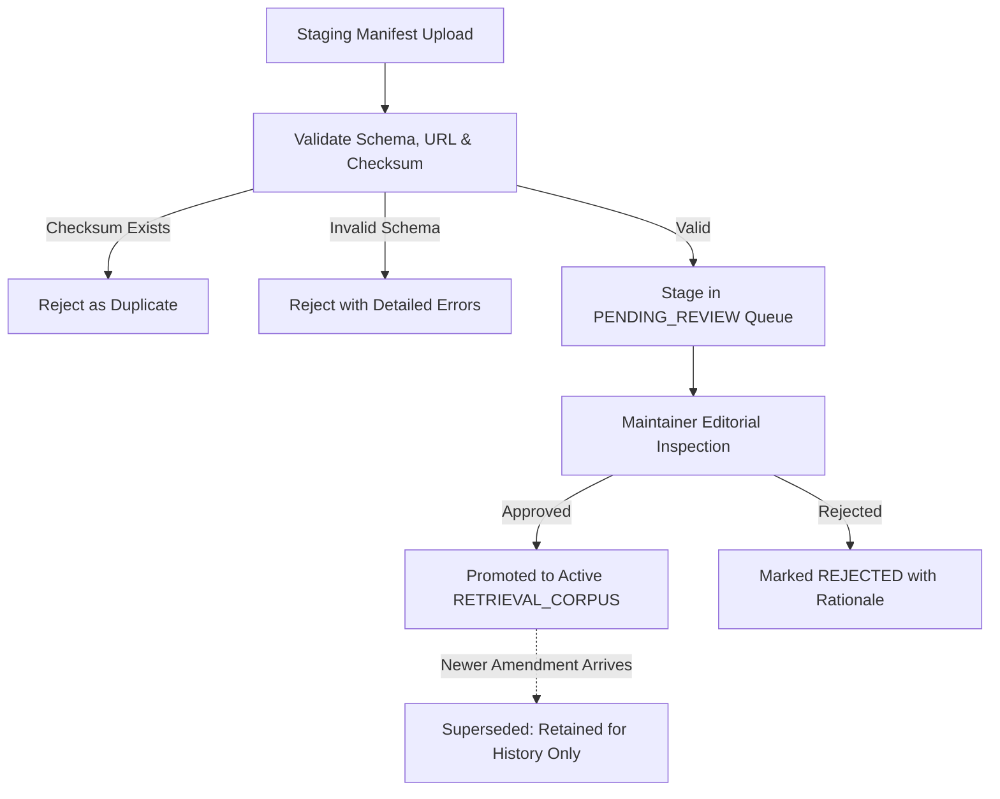

# Civic Knowledge Ingestion Approval Gate for New Source Documents

## Background & Objectives
Retrieval-Augmented Generation (RAG) within civic applications is only as reliable as the underlying source documentation. Ingesting unverified PDF circulars, broken links, or outdated statutory amendments directly into production retrieval risks disseminating erroneous procedural rules to citizens.

The Civic Knowledge Ingestion Approval Gate enforces a strict, staged ingestion workflow where newly imported documents must pass automated structural validation and mandatory editorial approval before entering the active RAG retrieval corpus.

---

## Ingestion Lifecycle & Safety Gates

1. **Manifest Validation Checks**:
   - Requires verified publisher authority, canonical HTTPS URL, publication date, and jurisdiction.
   - Computes cryptographic SHA-256 checksums to immediately block duplicate uploads.
   - Enforces text extraction density checks to reject blank, corrupted, or scanned-image-only PDFs.
2. **Quarantine Staging (`PENDING_REVIEW`)**:
   - Newly ingested files remain isolated in a review queue.
   - Unapproved sources are strictly barred from the production retrieval index.
3. **Traceable Review Attribution**:
   - Authorized reviewers record approvals or rejections with explicit justification notes and maintainer handles.
4. **Active Supersession Management**:
   - When a newer government amendment replaces an older circular, the previous document is marked `SUPERSEDED` and removed from active retrieval, while remaining linked for audit provenance.

---

## Ingestion State Transition Flowchart



### Reviewer Permissions & Auditability Matrix

| State Action | Required Permission Level | Audit Trail Guarantee |
| :--- | :--- | :--- |
| Stage Source Document | Continuous Ingestion Service / Contributor | Timestamp, origin URL, SHA-256 digest |
| Approve for Retrieval | Senior Maintainer / Domain Lead | Reviewer handle, approval notes, effective date |
| Reject Source Document | Senior Maintainer / Domain Lead | Rejection rationale, legal discrepancy note |
| Supersede Source | Senior Maintainer / Automated Pipeline | Superseded document pointer, amendment notice |

---

## Verification & Execution

Execute unit tests:
```bash
npx vitest run src/ai/knowledgeIngestionApprovalGate.test.js
```
Automated tests validate manifest schemas, duplicate rejection, editorial approvals, and supersession mechanics.

