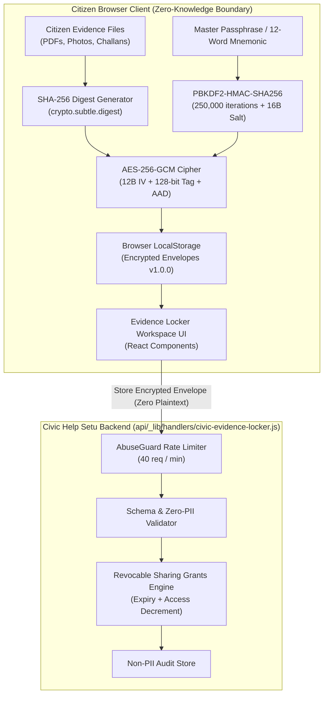

# Civic Service Digital Evidence Locker with Client-Side Encryption

**Issue Reference:** #1186 (Level 3 — Advanced Feature)  
**Status:** Implemented & Verified  
**Schema Version:** `1.0.0`  
**Security Boundary:** Client-Side WebCrypto (Zero Server-Side Key Escrow)

---

## 1. Executive Summary & Problem Motivation

Citizens encountering civic disputes—such as punitive commercial electricity billing on domestic connections, unannounced municipal property tax penalty demands, disputed clinical billing, consumer complaints, or public works delays—regularly gather sensitive electronic evidentiary records (meter reading photographs, treasury challans, letters, RTIs, and invoices).

Before deciding whether to submit these documents to a public authority, grievance redressal forum, or legal counsel, citizens require a secure repository that offers:
1. **Confidentiality with Zero Key Escrow:** The server and cloud database must never see, hold, or escrow the citizen's master passphrase, recovery mnemonic, or unencrypted document payloads.
2. **Metadata & Ciphertext Separation:** Public metadata (category, jurisdiction, file count, timestamps) must remain structured for search and categorization while the evidentiary content and sensitive narrative remain encrypted.
3. **Revocable & Time-Bounded Sharing:** Citizens must be able to generate scoped sharing grants with strict expiry windows and maximum access counts, with the power to immediately revoke access if circumstances change.
4. **Deterministic Integrity Verification:** File contents must have SHA-256 byte digests computed directly in the browser to satisfy the technical foundation of Section 63 Bharatiya Sakshya Adhiniyam, 2023 (BSA 2023) / Section 65B Indian Evidence Act.
5. **Recovery Design & Limitations:** Clear disaster recovery options (12-word recovery mnemonic seed) accompanied by explicit user acknowledgements of the zero-knowledge recovery boundaries.

---

## 2. Architecture & Data Flow



### 2.1 Cryptographic Specification

| Component | Standard / Parameter | Rationale |
| :--- | :--- | :--- |
| **Key Derivation (KDF)** | `PBKDF2` with `HMAC-SHA-256` | 250,000 iterations (exceeding OWASP minimum 100,000 recommendations), 16-byte fresh cryptographically random salt (`crypto.getRandomValues`). |
| **Authenticated Cipher** | `AES-256-GCM` | 256-bit derived key, fresh random 12-byte IV per encryption, 128-bit authentication tag. |
| **Additional Authenticated Data (AAD)** | `v1.0.0\|recordId\|payloadDigest\|canonicalJson(metadata)` | Binds metadata directly to ciphertext. Modifying the record ID or title in storage causes AES-GCM decryption to fail immediately. |
| **File Integrity Digest** | `SHA-256` (Hex lowercase) | Deterministic 64-character hash computed client-side before envelope assembly. |
| **Emergency Recovery Mnemonic** | 12-word phonetic seed | Derived from 256-word BIP-39 subset; key derivation uses 300,000 iterations for emergency cold restore. |

---

## 3. Threat Model & Failure Modes

| Threat Vector | Mitigation Strategy | Failure Handling / Outcome |
| :--- | :--- | :--- |
| **Compromised Server or Cloud Database** | Server stores only encrypted AES-256-GCM envelopes and public metadata. It possesses zero private keys and zero passphrases. | Attacker obtains only ciphertext; cannot decrypt citizen documents without the user's secret passphrase. |
| **Ciphertext Bit-Flipping / Tampering** | AES-256-GCM authentication tag verifies ciphertext integrity on decryption. | Any flipped bit causes `crypto.subtle.decrypt` to abort with a safe error: `"Decryption failed: Incorrect passphrase, tampered ciphertext, or corrupted AAD."` |
| **Metadata Alteration (AAD Tamper)** | Public metadata (title, category, sensitivity, schema version) is included in the AAD byte stream during encryption. | If an attacker modifies metadata values in storage, GCM integrity check fails and payload remains unaccessible. |
| **Forgotten Passphrase (Key Loss)** | 12-word mnemonic recovery seed generated at record creation. | If user loses both passphrase and 12-word mnemonic, records are permanently unrecoverable by mathematical design. Clear disclaimers warn the citizen beforehand. |
| **Unauthorized Grant Access** | Time-bounded expiry and maximum access counter decrement. | Once expired or counter hits zero, server returns HTTP 403. Citizen can also manually trigger instant revocation. |
| **PII Leakage in Server Logs** | Serverless API rejects any request body containing plaintext payloads (`plaintextSample` or raw files). Audit logs record only event types and timestamps. | Prevents citizen names, meter numbers, or unredacted files from reaching application logs or analytics. |

---

## 4. Statutory & Evidentiary Framework (BSA 2023 / BSA § 63)

Under Indian jurisprudence:
- **Section 63 of Bharatiya Sakshya Adhiniyam, 2023 (BSA 2023)** (formerly Section 65B of the Indian Evidence Act, 1872) establishes conditions for the admissibility of electronic records.
- In *Arjun Panditrao Khotkar v. Kailash Kushanrao Gorantyal (2020) 7 SCC 1*, the Supreme Court emphasized contemporaneous verification of electronic media.
- The Digital Evidence Locker calculates deterministic SHA-256 byte digests at the moment files are added. This provides mathematical proof that the bytes presented to a tribunal match the exact file held at the time of initial grievance formation.
- **Legal Limitation Notice:** The system displays a clear disclaimer: Cryptographic hashing verifies *file integrity* (absence of tampering or bit-rot); it does *not* prove legal veracity or official government issuance.

---

## 5. Engineering Constraints & Non-AI Fallbacks

1. **Deterministic Rules Outside LLMs:** All cryptographic hashing, encryption, key derivation, and grant counters are pure deterministic JavaScript running WebCrypto. AI is never in the execution path of encryption or access authorization.
2. **Untrusted Suggestions & Provenance:** If AI is utilized to summarize or parse document categories, outputs are flagged as untrusted recommendations and require explicit citizen confirmation.
3. **Human-in-the-Loop Approval:** No record is filed, transmitted, or deleted without explicit citizen click-through action.
4. **Accessible, Mobile-First UI:** The interface provides keyboard accessibility, ARIA region and alert labeling, dark mode contrast compliance, and responsive layouts for mobile screens.

---

## 6. Verification & Test Suite

The feature includes automated tests covering positive, negative, tampering, and permission boundary scenarios:

| Test File | Description | Test Count |
| :--- | :--- | :--- |
| `tests/civic-evidence-locker-crypto.test.js` | WebCrypto key derivation, AES-256-GCM encrypt/decrypt, AAD binding, ciphertext bit-flip rejection, metadata tamper rejection, 12-word recovery mnemonic. | 9 tests |
| `tests/civic-evidence-locker-api.test.js` | Serverless API handler, rate limiting, zero-PII rejection, revocable grant lifecycle, access decrement, and emergency revocation. | 5 tests |
| `tests/civic-evidence-locker-storage.test.js` | Browser storage persistence, in-memory session locking, auto-lock timeout, synthetic test fixtures, and privacy-preserving audit logs. | 5 tests |

### Reproducible Test Command:
```bash
npx vitest run tests/civic-evidence-locker-crypto.test.js tests/civic-evidence-locker-api.test.js tests/civic-evidence-locker-storage.test.js
```
