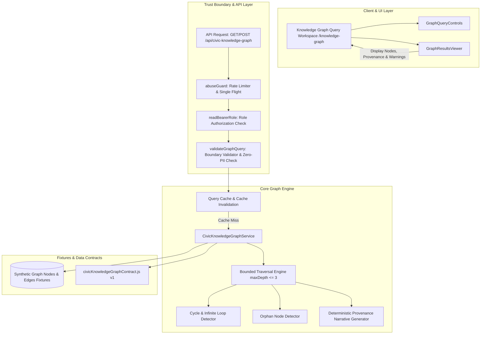

# Architecture Decision Record (ADR): Civic Service Knowledge Graph Query API with Explainable Traversals (#1184)

## 1. Overview & Status
- **Status:** Accepted
- **Driver:** [Issue #1184: Build a Civic Service Knowledge Graph Query API with Explainable Traversals](https://github.com/GoldRay19/Civic-Help-Setu/issues/1184)
- **Scope:** Safe, typed statutory graph traversals across services, offices, documents, departments, portals, and jurisdictions for product features, maintainers, and agent workflows.

---

## 2. Context & Problem Statement
Civic guidance services must resolve multi-hop statutory prerequisites (e.g., obtaining a commercial trade licence requires property tax receipts and ownership deeds; driving licence issuance depends on a learner licence and medical certificate).

Without a safe, bounded graph query architecture, applications risk:
1. **Expensive unrestricted graph scans** causing Denial of Service (DoS) and memory exhaustion.
2. **Infinite recursion from cyclical dependencies** (e.g., circular document references).
3. **Lack of statutory provenance and effective dates**, returning obsolete or unverified administrative procedures.
4. **Data privacy breaches and PII leakage** if personal credentials or citizen identity records enter graph query predicates.
5. **Over-reliance on non-deterministic LLMs** claiming official verification without verifiable lineage.

---

## 3. Decision & Architecture

### 3.1 Principles
| Principle | Implementation in Vertical Slice |
|---|---|
| **Bounded Traversal Depth** | Enforce `maxDepth <= 3` (default 2) at trust boundary; rejects deeper scans with validation errors. |
| **Protection Against Unbounded Scans** | Query schema requires at least one bounding filter (`startNodeId`, `targetTypes`, `jurisdiction`, or `searchTerm`). Empty global scans are rejected. |
| **Cycle & Infinite Loop Defense** | Traversal tracks path histories, records cycles in `cyclesDetected`, and halts recursion gracefully. |
| **Edge Provenance & Effective Dates** | Every edge records `statutoryAct`, `officialUrl`, `reviewedBy`, `timestamp`, `effectiveFrom`, and `effectiveTo`. |
| **Strict Zero-PII Boundary** | `SENSITIVE_PARAM_KEYS` rejects any Aadhaar, PAN, phone, OTP, password, or financial field in queries. |
| **Deterministic Non-AI Fallback** | Traversal paths and explainability narratives are generated deterministically using graph algorithms. |
| **Role-Based Publication Scopes** | Public users can only query `published` nodes. Draft policies require `reviewer` or `admin` authentication. |
| **In-Memory Query Caching** | Versioned LRU cache with an administrative invalidation endpoint (`POST /api/civic-knowledge-graph`). |

### 3.2 Data Flow & Component Architecture



---

## 4. Threat Model & Mitigations

| Threat | Risk Severity | Mitigation |
|---|---|---|
| **Unrestricted Graph Scan (DoS)** | High | Validation requires at least one bounded filter; limits page size to 50 nodes and max depth to 3. |
| **Infinite Recursion via Cycles** | High | Traversal records path arrays. When a duplicate node is encountered, a cycle is flagged and traversal back-tracks without re-enqueuing. |
| **Citizen PII Injection** | High | `SENSITIVE_PARAM_KEYS` checks reject any sensitive key (`aadhaar`, `pan`, `phone`, `otp`, `bank`, etc.) with HTTP 400. |
| **Unauthorized Draft Disclosure** | Medium | Publication status check ensures draft or archived records are restricted to `admin` and `reviewer` roles. |
| **Stale Statutory Guidance** | Medium | `effectiveFrom` and `effectiveTo` temporal filters reject historical records when querying active procedures; in-memory cache invalidation endpoint allows instant refreshes on regulation updates. |

---

## 5. Components & File Ownership

1. `src/data/civicKnowledgeGraphContract.js`: Versioned schemas, node types (`SERVICE`, `DEPARTMENT`, `OFFICE`, `DOCUMENT`, `JURISDICTION`, `PORTAL`), edge types, bounds, and boundary validators.
2. `src/data/civicKnowledgeGraphFixtures.js`: Synthetic, zero-PII fixtures including multi-hop service paths, circular dependencies, and orphan nodes.
3. `src/services/civicKnowledgeGraphService.js`: Core traversal engine, bounded search, cycle detection, orphan detection, explainable step generation, and cache manager.
4. `api/_lib/handlers/civic-knowledge-graph.js`: Vercel serverless API handler supporting GET and POST queries, node lookups, schema definitions, and administrative cache invalidation.
5. `api/[...path].js`: Vercel entrypoint route mapping `/api/civic-knowledge-graph` and `/api/knowledge-graph`.
6. `src/components/knowledgeGraph/`: Mobile-first accessible UI controls (`GraphQueryControls.jsx`) and results viewer (`GraphResultsViewer.jsx`).
7. `src/pages/KnowledgeGraphQueryWorkspace.jsx`: Route component mounted at `/knowledge-graph` and `/knowledge-graph-query`.
8. `src/services/civicKnowledgeGraphService.test.js`, `tests/civic-knowledge-graph-api.test.js`, `src/components/knowledgeGraph/KnowledgeGraphComponents.test.jsx`: 26 automated unit, API, and component tests.

---

## 6. Evaluation Criteria & Reproducible Commands

### 6.1 Automated Verification
Run test suites across engine, API handler, and UI components:
```bash
npx vitest run src/services/civicKnowledgeGraphService.test.js tests/civic-knowledge-graph-api.test.js src/components/knowledgeGraph/KnowledgeGraphComponents.test.jsx
```

### 6.2 Manual Verification of Key Endpoints
1. **Schema Metadata**:
   ```bash
   curl "http://localhost:3000/api/civic-knowledge-graph?action=schema"
   ```
2. **Explainable 2-Hop Traversal**:
   ```bash
   curl "http://localhost:3000/api/civic-knowledge-graph?action=query&startNodeId=service:driving-licence&maxDepth=2"
   ```
3. **Cache Invalidation (Admin)**:
   ```bash
   curl -X POST "http://localhost:3000/api/civic-knowledge-graph" \
     -H "Content-Type: application/json" \
     -H "Authorization: Bearer admin-token" \
     -d '{"action": "invalidate_cache", "reason": "policy_update"}'
   ```
