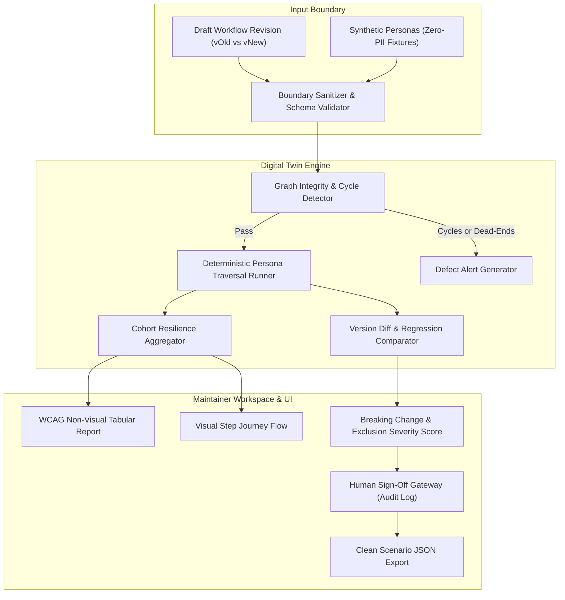

# Civic Workflow Digital Twin for End-to-End Service Journey Simulation

## Overview & Context (#1157)

In Civic Help Setu, catalogue maintainers frequently update public civic procedures—such as amending required supporting documents, adjusting office jurisdiction boundaries, updating municipal fee schedules, or altering statutory SLA days under Public Service Guarantee Acts. 

Publishing untested workflow changes directly to citizens risks introducing subtle but catastrophic regressions:
1. **Dead-End Pathways**: Applicants reaching steps where impossible documents are demanded without an issuing desk.
2. **Circular Dependencies**: Circular prerequisite loops where Step A demands Step B's token, while Step B demands Step A's receipt.
3. **Marginalized Cohort Exclusion**: Subtle rule revisions that inadvertently exclude migrant tenants, senior citizens with biometric sensor mismatches, or low-income students.
4. **SLA Blowouts**: Hidden compounding queue times across sequential physical counters.

The **Civic Workflow Digital Twin** introduces a sandboxed, deterministic journey simulation runtime. It models service stages as computational graphs, evaluates diverse synthetic citizen personas against candidate workflow drafts, automatically detects dead ends and impossible transitions, compares old and new workflow versions, and enforces mandatory human review before publishing.

---

## Architectural Decision Record (ADR)

- **Status**: Accepted (Production Integrated)
- **Deciders**: Civic Help Setu Core Maintainers
- **Date**: 2026-11-26

### Context
Maintainers needed a reproducible way to stress-test complex multi-step citizen procedures before publishing modifications. Live citizen files or production databases must **never** be used for simulation or testing.

### Decision
1. **Typed Graph Domain Contract**: Represent workflows as directed graphs (`NODE_TYPES`: `SERVICE_STEP`, `DOCUMENT_REQUIREMENT`, `OFFICE_DESK`, `TERMINAL_STATE`; `EDGE_TYPES`: `SEQUENTIAL_STEP`, `REQUIRES_DOCUMENT`, `PROCEEDS_TO_OFFICE`, `CONDITIONAL_BRANCH`, `REMEDY_FALLBACK`).
2. **100% Synthetic Persona Fixtures**: Parameterize simulation strictly through synthetic personas. Impose a hard boundary check (`checkForbiddenFields`) rejecting any real citizen Aadhaar, PAN, phone number, biometric hash, or credentials.
3. **Deterministic Traversal & Anomaly Detection**: Graph validation checks for circular loops (DFS recursion stack), unreachable nodes, and dead ends (nodes with no path to approved/remedy terminals).
4. **Automated Version Comparator**: Ingest baseline ($v_{old}$) and proposed candidate ($v_{new}$) graphs to identify excluded cohorts, new dead ends, and SLA deltas.
5. **Human-in-the-Loop Sign-Off**: AI or automated simulator recommendations are treated as untrusted proposals. Publishing approval requires recorded reviewer identity and formal justification.

---

## System Component Architecture & Data Flow



---

## Threat Model (STRIDE Analysis)

| Threat Category | Potential Attack / Failure Vector | Implemented Mitigation |
| :--- | :--- | :--- |
| **Spoofing** | Attacker injects fake citizen records or masquerades as a government authority. | • Personas must explicitly declare `isSynthetic: true`.<br>• System prohibits live database IDs; simulation runs in memory / sandboxed storage. |
| **Tampering** | Malformed graph definitions inject cycles or corrupt state machines. | • Strict input validation via `validateWorkflowGraph`.<br>• DFS cycle detection and dead-end reachability checks reject corrupt graphs before simulation. |
| **Repudiation** | Maintainer publishes a breaking change without accountability. | • All version approval and rejection actions require a mandatory justification and are committed to an immutable audit log (`saveStoredAuditLog`). |
| **Information Disclosure** | Real citizen Aadhaar numbers, phone numbers, or passwords leak into logs or simulation reports. | • Recursive `checkForbiddenFields` inspects all inputs.<br>• `sanitizeDigitalTwinExport` scrubs authorization tokens and session identifiers prior to persistence and export. |
| **Denial of Service** | Graph with unbounded cycles or infinite branching exhausts CPU/memory. | • Hard iteration ceiling (`maxIterations = 50`) on persona journeys.<br>• Visited step frequency limit terminates any step visited more than 3 times as a `DEAD_END`. |
| **Elevation of Privilege** | Untrusted AI proposal automatically updates production service catalog. | • The Digital Twin operates strictly in advisory simulation mode.<br>• AI/simulation outputs are untrusted proposals; production publishing requires human administrative credentials. |

---

## Synthetic Persona Benchmark Cohort

Simulations execute across five canonical, strictly synthetic personas designed to stress-test diverse civic failure modes:

1. **`Priya Sharma` (`STANDARD_CITIZEN`)**: Long-term resident with full digital access, local property tax receipts, and standard KYC proofs. Baseline benchmark.
2. **`Rajesh Mahto` (`MIGRANT_TENANT`)**: Inter-state tenant worker living on informal lease. Tests whether workflows accommodate rent agreements and out-of-state voter cards without demanding local property deeds.
3. **`Devaki Amma` (`SENIOR_CITIZEN_BIOMETRIC_FAIL`)**: Pensioner with age-related epidermal fingerprint degradation. Tests biometric fallback edge transitions and assistance desks.
4. **`Pooja Meena` (`LOW_INCOME_STUDENT`)**: First-generation scholarship applicant seeking statutory fee waivers. Tests BPL income declaration branches.
5. **`Karthik Sundaram` (`ACCESSIBILITY_CONSTRAINED`)**: Wheelchair user requiring ground-floor desks or ramps. Tests physical office counter accessibility tags.

---

## Statutory Boundary & Legal Scope Disclaimer

> [!IMPORTANT]
> **Administrative Notice**: The Civic Workflow Digital Twin is an internal planning and quality assurance simulation tool for Civic Help Setu maintainers. 
> - Simulations model procedures as published in official guides, but do **not** interact with live government backend databases (such as UIDAI, State e-District, or Municipal ERPs).
> - Simulation outcomes do not constitute legal declarations, guarantees of certificate issuance, or official benefit denials.
> - Maintainers must independently verify changes against gazetted state and central rules before approving public releases.

---

## Verification & Reproducible Test Command

Run the complete test suite across contracts, service engine, storage, UI, and serverless API integration:

```bash
# Run Digital Twin unit and integration test bench
npx vitest run src/data/digitalTwinContract.test.js src/services/civicWorkflowDigitalTwinService.test.js src/services/digitalTwinStorage.test.js src/pages/CivicWorkflowDigitalTwinWorkspace.test.jsx tests/digital-twin-simulations.test.js
```

### Performance & Operational Limits
- **Simulation Latency**: Batch cohort simulation (5 personas) executes in `< 15ms` in pure JavaScript.
- **Memory Footprint**: Graph structures are lightweight JSON definitions `< 50KB`.
- **Retention**: LocalStorage retains the 50 most recent simulation runs; zero personal data is retained.
