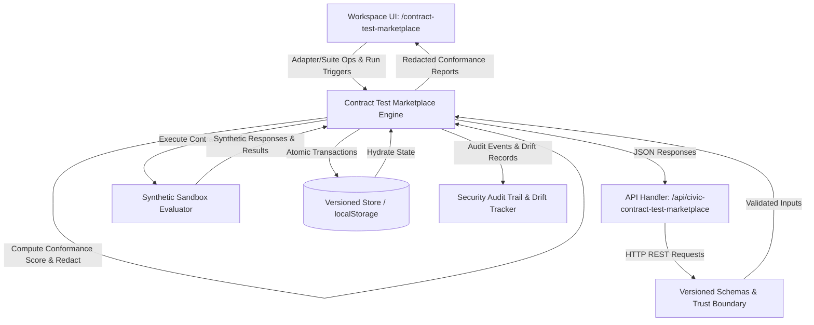

# Civic Service Integration Contract Test Marketplace — Architecture Decision Record (#1191)

**Status:** Proposed  
**Owner:** Civic Help Setu platform team  
**Issue:** #1191 — Implement a Civic Service Integration Contract Test Marketplace  

---

## 1. Problem Statement

External civic data providers (municipal APIs, state portals, departmental endpoints) and internal modules require repeatable tests for API compatibility, schema stability, and data quality. Without repeatable contract verification:
- Breaking API schema changes deployed by upstream providers cause silent failures in civic benefit workflows.
- Unvalidated payloads, malformed authentication, erratic pagination, and stale data degrade citizen services.
- Ad-hoc checks lack provenance, versioning, redaction, and audit trails.
- No public or internal catalog exists to showcase conformance scores, breaking change warnings, and compatibility guarantees.

---

## 2. Decision

Implement a **Civic Service Integration Contract Test Marketplace** — a production-oriented vertical slice integrated with existing Civic Help Setu services and UI:

- **Provider Adapters & Reusable Contract Suites:** Model external and internal civic providers with deterministic adapter specifications (REST, SOAP, GraphQL, file, database, message queue) and reusable test suites (auth, schema, pagination, freshness, error behavior, breaking changes, malicious payloads).
- **Synthetic Conformance & Sandbox Checks:** Run scheduled or on-demand sandbox contract runs using synthetic fixtures only.
- **Redacted Conformance Reports & Drift Detection:** Publish redacted conformance reports (0–100 score, pass/fail summaries, latency, breaking changes, malicious payload alerts) with drift detection when scores fluctuate.
- **Strict Trust Boundary Validation:** Reject unknown fields, validate slug patterns, cap input sizes (`MAX_INPUT_BYTES = 64KB`), and reject sensitive citizen PII/credentials at the boundary.
- **Maintainer Gating & Safety Guardrails:** Diagnostics serve as hints for maintainers and never trigger autonomous changes to provider infrastructure, application filings, or official verification claims.

---

## 3. Components

| Component | File | Responsibility |
|-----------|------|----------------|
| Constants & Enums | `src/data/civicContractTestMarketplaceConstants.js` | Schema version (v1), error codes, status enums, test types, adapter types, limits |
| Persistence & Migrations | `src/services/civicContractTestMarketplaceMigrations.js` | Versioned store schema, atomic transactions, rollback, seed state, retention pruning |
| Contract Engine Core | `src/services/civicContractTestMarketplaceEngine.js` | Validation, adapter/suite management, sandbox runner, synthetic evaluation, score computation, drift tracking, audit logging |
| Client Service | `src/services/civicContractTestMarketplaceService.js` | Browser-facing client service wrapping the marketplace engine |
| Versioned Schemas | `api/_lib/civicContractTestMarketplaceSchemas.js` | Request/response schema validators at trust boundary |
| API Store Contract | `api/_lib/civicContractTestMarketplaceStore.js` | In-memory / serverless persistence interface |
| API Route | `api/civic-contract-test-marketplace.js` | Serverless API handler with session authentication and role checks |
| Workspace UI | `src/components/contractTestMarketplace/ContractTestMarketplaceWorkspace.jsx` | Mobile-first accessible UI for browsing adapters, managing suites, triggering runs, and viewing conformance reports |
| Page Route | `src/pages/ContractTestMarketplaceWorkspace.jsx` | Route mounted at `/contract-test-marketplace` in `src/App.jsx` |
| Synthetic Fixtures | `tests/fixtures/civicContractTestMarketplaceSyntheticFixtures.js` | Synthetic adapters, suites, tests, and mock responses |

---

## 4. Data Flow

```
Maintainer / Operator Action
        │
        ▼
Workspace UI (/contract-test-marketplace)  OR  Serverless API (/api/civic-contract-test-marketplace)
        │
        ├─▶ upsertAdapter({ id, name, type, baseUrl, authType, ... })
        │      → validate slug / URL / types at trust boundary
        │      → sanitize & redact auth credentials / tokens
        │      → atomic store transaction with migration stamp
        │
        ├─▶ upsertSuite({ id, adapterId, name, tests, schedule, ... })
        │      → validate suite schema & contained contract tests
        │      → link with registered provider adapter
        │      → persist suite in versioned store
        │
        ├─▶ runSuite({ suiteId, adapterId, forceRecompute, nowIso })
        │      → verify existence of suite and adapter
        │      → execute synthetic sandbox evaluations across test types:
        │          • Auth verification & header inspection
        │          • Schema matching & required fields
        │          • Pagination cursor & limit boundaries
        │          • Freshness timestamps & age thresholds
        │          • Error behavior & HTTP status codes
        │          • Breaking change detection (removed fields, altered types)
        │          • Malicious payload resistance (injection patterns, XSS probes)
        │      → compute weighted conformance score (0–100)
        │      → redact raw payloads; record latency and summary counts
        │      → record audit log event & evaluate drift against prior run
        │      → return conformance run report
        │
        ├─▶ recordDriftEvent({ runId, previousScore, currentScore, reason })
        │      → record drift event when score delta ≥ 5%
        │
        ├─▶ listAdapters() / listSuites() / listRuns() / getRunResults()
        │      → read paginated entities from store
        │
        └─▶ getAuditLog() / listFeatureWeights()
               → retrieve security audit trail & scoring weights
```

### Data-Flow Diagram



---

## 5. Threat Model

| Threat | Risk Level | Mitigation |
|--------|------------|------------|
| Citizen PII or credential leakage in test runs | High | Strict redaction rules; only synthetic fixtures are allowed. Raw payloads are hashed or length-counted; passwords/tokens are rejected or replaced with synthetic redactions. |
| Server-Side Request Forgery (SSRF) via provider base URLs | High | Adapter URLs are validated, restricted to safe protocols (`https://`, `http://`), and live runs execute through synthetic simulation or tightly controlled sandbox harnesses. |
| Malicious payloads injected into civic schemas | High | Dedicated `TEST_TYPE.MALICIOUS_PAYLOAD` check proactively flags SQLi, XSS, and command injection patterns; inputs are sanitized and escaped. |
| Autonomous unauthorized modifications to civic systems | Critical | Strict human-in-the-loop guarantee: engine results are diagnostic hints only; no automated application filing, benefit revocation, or configuration mutation occurs. |
| Mass assignment / schema injection attacks | Medium | Strict schema validation with unknown key rejection (`validateAdapterInput`, `validateSuiteInput`). Maximum payload size bounded at 64KB. |
| Unauthorized suite execution or adapter configuration | High | API routes enforce Clerk authentication sessions and maintainer/operator permission checks (`verifySession`, `verifyOperator`). |
| Storage exhaustion via continuous test runs | Medium | Store retention policy (`applyContractTestRetentionPolicy`) caps stored runs, audit logs (max 1,000 entries), and archives runs older than 90 days. |

---

## 6. Failure Handling

| Failure Condition | System Behavior |
|-------------------|-----------------|
| Store unavailable / corrupted | Graceful degradation: returns `CT_STORAGE_UNAVAILABLE` (503); attempts auto-recovery via seeded fallback without throwing unhandled exceptions. |
| Invalid adapter / suite input | Returns `CT_VALIDATION_FAILED` (400) with detailed machine-readable field errors; rejects invalid slugs or types. |
| Missing adapter / suite on run trigger | Returns `CT_ADAPTER_NOT_FOUND` or `CT_SUITE_NOT_FOUND` (404); aborts run before sandbox execution. |
| Synthetic test execution timeout / error | Marks individual test result as `error` or `fail` with timeout diagnosis; suite run completes with computed score rather than crashing. |
| Concurrency conflict during store transaction | Atomic lock mechanism rolls back changes and returns `CT_CONCURRENT_WRITE`. |
| Score drift below 5% threshold | Noted without triggering noisy drift audit alerts; prevents alert fatigue. |

---

## 7. Component Ownership

- **Platform Core Team:** Engine logic (`civicContractTestMarketplaceEngine.js`), migration lifecycle (`civicContractTestMarketplaceMigrations.js`), schemas (`civicContractTestMarketplaceSchemas.js`), and API endpoint (`api/civic-contract-test-marketplace.js`).
- **QA & Testing Guild:** Contract test suites, synthetic test fixtures (`civicContractTestMarketplaceSyntheticFixtures.js`), and breaking change evaluation rules.
- **Frontend Team:** Workspace UI (`ContractTestMarketplaceWorkspace.jsx`), service facade (`civicContractTestMarketplaceService.js`), and page route.
- **Security & Compliance Team:** Threat model oversight, credential redaction policy, and SSRF/malicious payload detection rules.

---

## 8. Related Documents

- `docs/civicContractTestMarketplaceEvaluation.md` — Evaluation report, verification criteria, and reproducible commands.
- `docs/civicContractTestMarketplaceDeployment.md` — Deployment guidelines, migration procedures, and rollback plans.
- `docs/civicContractTestMarketplaceUser.md` — Maintainer and user workflow manual.
- `docs/security/threat-model.md` — System-wide security architecture.
