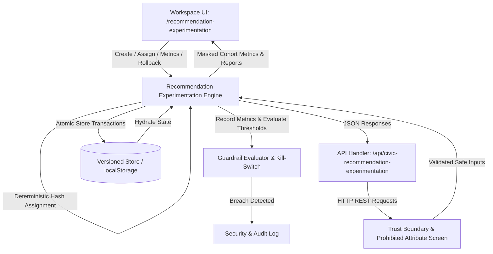

# Civic Service Recommendation Experimentation Platform with Guardrails — Architecture Decision Record (#1193)

**Status:** Proposed  
**Owner:** Civic Help Setu platform team  
**Issue:** #1193 — Build a Civic Service Recommendation Experimentation Platform with Guardrails  

---

## 1. Problem Statement

Civic service platforms must balance recommendation relevance, speed, and document prerequisites. When maintainers seek to experiment with alternative ranking models (e.g. proximity-weighted matching, simplified prerequisites, intent boosts), ad-hoc A/B testing carries significant risk:
- Citizens could receive disparate or unfair access to essential public entitlements.
- Targeting could inadvertently discriminate against vulnerable groups based on sensitive demographic attributes (caste, religion, gender, exact income).
- Experiments without automated guardrails could degrade recommendation relevance or language coverage in regional areas unnoticed.
- Lack of immediate rollback mechanisms could leave degraded experiences active longer than necessary.

---

## 2. Decision

Build a **Civic Service Recommendation Experimentation Platform with Guardrails** — a production-oriented vertical slice integrated with existing Civic Help Setu services and UI:

- **Deterministic Feature Flags & Opt-in Consent:** Assign variants deterministically using a non-reconstructible 32-bit hash (`hash(citizenId:experimentId:salt) % 100`). Citizens retain full transparency and control through an explicit opt-in requirement before experimental allocations apply.
- **Prohibited Sensitive Attribute Protection:** Enforce a strict ban on sensitive demographic targeting (caste, subcaste, religion, gender, biometric/national IDs, exact income). The trust boundary automatically rejects any targeting or context containing prohibited attributes.
- **Continuous Automated Guardrails:** Monitor four vital guardrail metrics:
  1. *Min Relevance Floor:* Ensures mean recommendation score does not drop below threshold (default: 0.60).
  2. *Min Language Coverage:* Enforces that recommendations include localized regional translations (default: 0.80).
  3. *Max Error Rate:* Halts experimentation if execution errors breach safe ceilings (default: 5%).
  4. *Minimum Cohort Protection:* Masks comparative variant metrics until sufficient sample size is reached (default: 20) to prevent small-cohort privacy leaks.
- **Immediate Rollback / Kill-Switch:** Operators can instantly flip any active experiment to `rolled_back`, immediately routing 100% of traffic to the baseline control without requiring code redeployment.

---

## 3. Components

| Component | File | Responsibility |
|-----------|------|----------------|
| Constants & Enums | `src/data/civicRecommendationExperimentationConstants.js` | Schema version (v1), error codes, status enums, guardrail types, prohibited attribute blocklist |
| Persistence & Migrations | `src/services/civicRecommendationExperimentationMigrations.js` | Versioned store lifecycle, atomic transactions, snapshot rollback, seed state, retention pruning |
| Experimentation Engine | `src/services/civicRecommendationExperimentationEngine.js` | Deterministic assignment, prohibited-attribute screening, guardrail evaluation, immediate rollback, metric calculation |
| Client Service | `src/services/civicRecommendationExperimentationService.js` | Browser-facing client service wrapping the experimentation engine |
| Trust Boundary Schemas | `api/_lib/civicRecommendationExperimentationSchemas.js` | Request/response schema validators rejecting unknown keys and sensitive attributes |
| API Store Contract | `api/_lib/civicRecommendationExperimentationStore.js` | In-memory persistence contract for serverless environments |
| Serverless API Route | `api/civic-recommendation-experimentation.js` | API handler with Clerk session verification and maintainer authorization |
| Workspace UI | `src/components/recommendationExperimentation/RecommendationExperimentationWorkspace.jsx` | Mobile-first accessible UI for managing experiments, configuring guardrails, and running assignment simulations |
| Page Route | `src/pages/RecommendationExperimentationWorkspace.jsx` | Route mounted at `/recommendation-experimentation` in `src/App.jsx` |
| Synthetic Fixtures | `tests/fixtures/civicRecommendationExperimentationSyntheticFixtures.js` | Synthetic experiments, safe contexts, and mock evaluations without citizen PII |

---

## 4. Data Flow

```
Citizen / Maintainer Action
        │
        ▼
Workspace UI (/recommendation-experimentation)  OR  Serverless API (/api/civic-recommendation-experimentation)
        │
        ├─▶ upsertExperiment({ id, name, variants, guardrails, ... })
        │      → validate slug / weights at trust boundary
        │      → screen audience criteria for prohibited sensitive attributes
        │      → atomic store transaction with migration stamp
        │
        ├─▶ assignVariant({ experimentId, citizenId, context, optIn })
        │      → screen context for prohibited sensitive attributes (rejects if present)
        │      → check experiment status (if not active, return safe control)
        │      → check opt-in requirement (if opted-out, return control)
        │      → compute deterministic hash: hashFnv1a(citizenId:expId:salt) % 100
        │      → map to variant cumulative weight share
        │      → return { variant, assigned, bucket, reason, disclaimer }
        │
        ├─▶ recordMetric({ experimentId, variantId, relevanceScore, hasLanguageCoverage, isError })
        │      → update privacy-safe aggregate counters (assignments, sums, errorCount)
        │      → evaluate guardrails against configured thresholds:
        │          • meanRelevance < minRelevanceScore
        │          • languageCoverageRatio < minLanguageCoverage
        │          • errorRate > maxErrorRate
        │      → record breach events & audit log if breached
        │      → return { ok, breaches, metrics }
        │
        ├─▶ rollbackExperiment({ experimentId, reason })
        │      → transition status to rolled_back immediately
        │      → record audit event with actor provenance
        │      → force all subsequent assignments to baseline control
        │
        └─▶ getExperimentMetrics(experimentId)
               → verify minimum cohort threshold (minCohortSize)
               → mask aggregate details if cohort size is not met
               → return variant performance summaries & breach history
```

### Data-Flow Diagram



---

## 5. Threat Model

| Threat | Risk Level | Mitigation |
|--------|------------|------------|
| Discriminatory or biased experimentation | Critical | Hardcoded prohibited attribute blocklist (`PROHIBITED_TARGETING_ATTRIBUTES`). Any request containing caste, religion, gender, Aadhaar, PAN, or exact income is rejected at the trust boundary. |
| Involuntary citizen experimentation | High | `optInRequired` defaults to true. Citizens who have not explicitly consented are safely allocated to the baseline rule-based control strategy. |
| Degraded civic service discovery | High | Automated guardrails continuously track relevance floor (0.60), language availability (0.80), and error ceiling (0.05). Breaches trigger audit alerts and immediate operator rollback. |
| Citizen tracking / privacy leakage | High | Zero citizen PII stored. Assignments are computed purely via stateless hashing of pseudonymous IDs. Comparative metrics are masked until minimum cohort size (`minCohortSize = 20`) is satisfied. |
| Unauthorized experiment configuration or rollbacks | High | Mutations require verified Clerk session tokens and maintenance operator authorization (`verifySession`, `authorizeOperator`). |
| Storage exhaustion via continuous metrics | Medium | Store retention policy (`applyExperimentationRetentionPolicy`) prunes metrics and audit logs older than 90 days and caps active audit logs at 1,000 items. |

---

## 6. Failure Handling

| Failure Condition | System Behavior |
|-------------------|-----------------|
| Prohibited attribute detected | Returns `RE_PROHIBITED_ATTRIBUTE_TARGETING` (HTTP 400); blocks experiment creation or safely allocates control. |
| Guardrail threshold breached | Records breach event in audit trail; flags experiment metrics view; facilitates one-click operator rollback. |
| Experiment inactive or rolled back | Seamlessly routes 100% of recommendation requests to the safe standard control variant without disruption. |
| Minimum cohort size not met | Comparative metrics display locked state with warning to prevent small-sample bias and privacy de-anonymization. |
| Store write failure / corruption | Transactional rollback preserves last known good snapshot; falls back to in-memory store cleanly. |

---

## 7. Component Ownership

- **Platform & Governance Team:** Core experimentation engine (`civicRecommendationExperimentationEngine.js`), migrations (`civicRecommendationExperimentationMigrations.js`), schemas (`civicRecommendationExperimentationSchemas.js`), and API routes.
- **Algorithmic Fairness & Ethics Board:** Prohibited attribute blocklist, guardrail metric definitions, and minimum cohort thresholds.
- **Frontend Team:** Workspace UI (`RecommendationExperimentationWorkspace.jsx`), client service (`civicRecommendationExperimentationService.js`), and page route.

---

## 8. Related Documents

- `docs/civicRecommendationExperimentationEvaluation.md` — Evaluation report, verification criteria, and reproducible commands.
- `docs/civicRecommendationExperimentationDeployment.md` — Deployment guidelines, migration procedures, and rollback plans.
- `docs/civicRecommendationExperimentationUser.md` — Maintainer workflow manual and ethical guardrails.
- `docs/security/threat-model.md` — Platform-wide security architecture.
