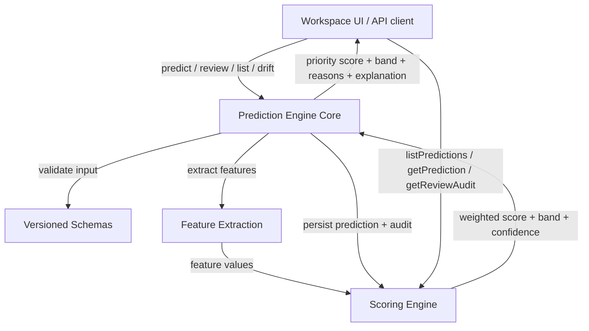

# Civic Information Freshness Prediction and Review Prioritization Model — Architecture Decision Record (#1189)

**Status:** Proposed
**Owner:** Civic Help Setu platform team
**Issue:** #1189 — Build a Civic Information Freshness Prediction and Review Prioritization Model

---

## 1. Problem statement

Maintainers cannot manually review every service page at the same frequency, so
likely-stale content should be prioritized transparently. There is currently no
systematic way to determine which civic service pages or official sources are
most likely to be stale and in need of review.

---

## 2. Decision

Build a **Civic Information Freshness Prediction and Review Prioritization
Model** — a production-oriented vertical slice that:

- Builds deterministic features from source change history, link health, and
  last verification date.
- Computes a review priority score (0–100) with reasons and uncertainty
  estimates.
- Outputs review priority rather than a public "truth score."
- Shows reasons and uncertainty so maintainers can understand *why* a page is
  flagged.
- Supports policy simulation to evaluate precision/recall and detect drift.
- Never auto-edits guidance, never files or denies applications, never claims
  official verification.

---

## 3. Components

| Component | File | Responsibility |
|-----------|------|----------------|
| Constants / schema / feature weights | `src/data/civicSourceFreshnessPredictionConstants.js` | Schema version, enums, error codes, feature weights, priority thresholds |
| Persistence & migrations | `src/services/civicSourceFreshnessPredictionMigrations.js` | Versioned store, atomic transactions, rollback, retention |
| Prediction engine core | `src/services/civicSourceFreshnessPredictionEngine.js` | Feature extraction, scoring, prioritization, uncertainty, review, drift |
| Client service | `src/services/civicSourceFreshnessPredictionService.js` | Browser-facing wrapper over the engine |
| Versioned schemas | `api/_lib/civicSourceFreshnessPredictionSchemas.js` | v1 request/response validation contracts |
| API store | `api/_lib/civicSourceFreshnessPredictionStore.js` | In-memory store contract |
| API route | `api/civic-source-freshness-prediction.js` | Dependency-injected Vercel serverless handler |
| Workspace UI | `src/components/freshnessPrediction/FreshnessPredictionWorkspace.jsx` | Mobile-first accessible workspace |
| Freshness page | `src/pages/FreshnessPredictionWorkspace.jsx` | Route `/freshness-prediction` |
| Synthetic fixtures | `tests/fixtures/civicSourceFreshnessPredictionSyntheticFixtures.js` | Non-citizen test data |

---

## 4. Data flow

```
Citizen / maintainer action
        │
        ▼
Workspace UI  (src/pages/FreshnessPredictionWorkspace.jsx)
        │
        ├─▶ predict({ serviceId, service, linkHealthRecords,
        │          verificationHistory, weights, forceRecompute, nowIso })
        │      → validate at trust boundary (schemas)
        │      → extract deterministic features:
        │          • days since verification (0–1, capped at 180d ceiling)
        │          • link health score (0–1, unreachable = highest concern)
        │          • source age (0–1, capped at 2-year ceiling)
        │          • superseded status (0 or 1)
        │          • change frequency (0–1, capped at 12 events)
        │          • government domain (0 or 1, de-weighted)
        │          • verification count (0–1, de-weighted)
        │      → compute weighted 0–1 score
        │      → map to priority band (low/medium/high/critical)
        │      → compute confidence (0–1)
        │      → build human-readable explanation
        │      → persist prediction + audit event
        │      → return { prediction, features, evidence, score, band, confidence }
        │
        ├─▶ reviewPrediction({ serviceId, reviewerNote, reviewedBy, decision })
        │      → mark prediction as reviewed with human decision
        │      → persist review audit event
        │
        ├─▶ listPredictions({ band, status, limit, cursor })  → list predictions
        ├─▶ getPrediction(serviceId)                          → get a prediction
        ├─▶ getReviewAudit({ serviceId, limit })              → read audit trail
        ├─▶ getDriftEvents({ serviceId, limit })              → read score changes
        ├─▶ recordDriftEvent({ serviceId, previousScore, currentScore, reason })
        │      → record score drift when it exceeds 5% threshold
        └─▶ listFeatureWeights()                              → read weight config
```

### Data-flow diagram



---

## 5. Threat model

| Threat | Mitigation |
|--------|------------|
| Misinterpretation of priority score as "truth score" | Clear disclaimer on all outputs: "estimates are triage hints, not truth scores" |
| Unauthorized modification of civic guidance | Engine only computes scores; never writes to service content. Reviews are human-only. |
| Malformed / mass-assignment input | Unknown fields rejected; strict type/slug validation at trust boundary |
| Sensitive prompt leakage | Prompts/URLs never stored; only feature aggregates and scores retained. Sensitive keys/values rejected. |
| Storage corruption / partial writes | Atomic transactions; rollback on failure |
| Denial of service via concurrent predictions | Concurrency cap (`MAX_CONCURRENT_PREDICTIONS`) |
| Score drift going undetected | Drift events recorded when score changes >5%; drift events viewable |

---

## 6. Failure handling

| Failure | Behaviour |
|---------|-----------|
| Store unavailable | Degrade gracefully; compute in-memory only; caller shown store_unavailable error |
| Invalid input | 400 `validation_failed` with stable error codes; no internal details leaked |
| Missing service/prediction | Return `FP_SERVICE_NOT_FOUND` / `FP_PREDICTION_NOT_FOUND` |
| Transaction failure | No partial write; previous bundle retained; error returned |
| Store write failure | 503 `store_unavailable`; no partial state |
| Concurrency cap exceeded | Return `FP_STORAGE_UNAVAILABLE` |
| Drift below 5% threshold | Not recorded (avoid noise) |

---

## 7. Component ownership

- **Platform team:** prediction engine core, migrations, API route, schemas, store contract, simulation.
- **Frontend team:** workspace UI component, page, client service.
- **Security team:** threat model review, sensitive-field redaction, feature weight governance.

---

## 8. Related documents

- `docs/civicSourceFreshnessPredictionEvaluation.md` — evaluation criteria, reproducible commands.
- `docs/civicSourceFreshnessPredictionDeployment.md` — deployment, migration, rollback.
- `docs/civicSourceFreshnessPredictionUser.md` — user guide.
- `docs/security/threat-model.md` — platform-wide threat model.
