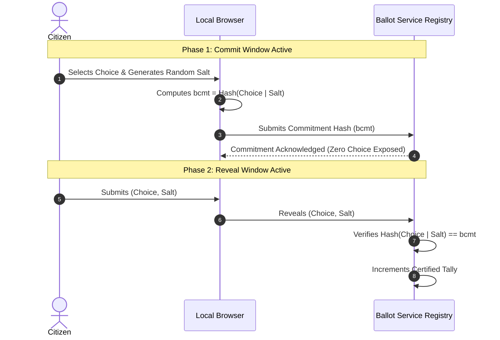

# Commit-Reveal Ballot Integrity for Ward Budget Polls

## Motivation & Overview
In municipal ward-level budget preference polls (such as selecting whether discretionary ward funds prioritize park maintenance, streetlighting, or pedestrian sidewalks), online voting is susceptible to premature vote exposure, bandwagon effects, and duplicate ballots.

The Commit-Reveal Ballot Integrity Service provides a cryptographic commit-reveal protocol for non-binding citizen preference polls that protects vote secrecy without posting citizen identities to blockchains.

---

## Commit-Reveal Protocol Lifecycle



### Critical Legal & Security Safeguards

1. **Explicit Non-Binding Disclaimer**:
   - Every interface and tally view prominently carries the statutory notice:
     > **ADVISORY POLL NOTICE: This is a non-binding neighborhood budget consultation poll. It is not a statutory election and carries no legal standing under Election Commission rules.**
2. **Zero Ballot Content on Public Chains**:
   - Only mathematical commitments (`bcmt_xxxxxxxx`) are anchored during the commit phase.
3. **Deterministic Phase Windows**:
   - Commit phase and reveal phase have strict timestamp boundaries. Submissions outside allowed windows fail closed.
4. **Replay & Double-Vote Rejection**:
   - Re-using an identical commitment or revealing the same salt twice is strictly prevented.

---

## Low-Connectivity & Offline Accessibility Fallbacks

- **SMS / Offline Paper Ballot Receipt**: In regions with transient connectivity, citizens receive a physical or SMS confirmation code corresponding to their salt commitment, enabling them to reveal their vote at a neighborhood Seva Kendra kiosk.
- **Accessible Poll Controls**: Every selection button meets WCAG 2.1 AA requirements, providing distinct aria labels and high-contrast color choices.
- **Client-Side Secret Storage**: The random salt generated during commitment is stored securely in session storage and offered as an immediate downloadable text receipt.

---

## Verification & Execution

Execute unit tests:
```bash
npx vitest run src/services/commitRevealBallotService.test.js
```
Automated tests validate phase boundary transitions, duplicate commitment rejections, reveal matching, and final tally certification.

