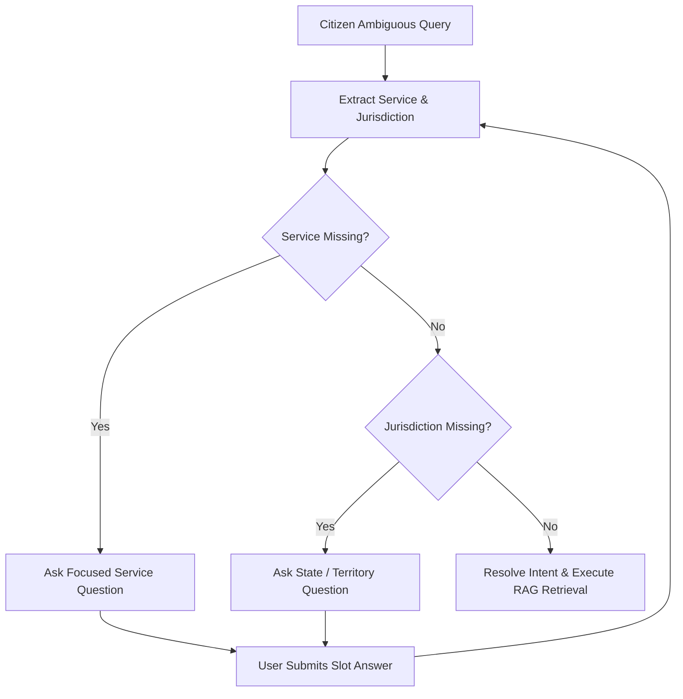

# Context-Aware Clarification Planner for Ambiguous Civic Requests

## Background & Problem Statement
Citizens frequently initiate civic queries with terse phrases such as *"How do I apply?"*, *"Where is my document?"*, or *"Can I get assistance?"*. Without knowing the specific scheme, issuing jurisdiction (State vs. Central), applicant category (BPL, senior citizen, student), or requested action (new registration, tracking, correction), conversational AI assistants can easily hallucinatory guidance or send citizens to incorrect portals.

The Context-Aware Clarification Planner introduces a structured, privacy-preserving conversational slot planner that asks the minimal necessary clarifying questions before executing RAG search retrieval.

---

## Architectural Principles

1. **Structured Slot Schema**:
   Tracks 4 core civic dimensions:
   - `service`: Civic service identifier (e.g., `ration-card`, `voter-id`, `pension-scheme`)
   - `jurisdiction`: Administrative authority state (e.g., Karnataka, Uttar Pradesh, Central)
   - `outcome`: Target action (new application, status check, correction, duplicate reissue)
   - `applicant_type`: Specific citizen profile (senior citizen, student, BPL)
2. **Minimal & Non-Intrusive Questions**:
   Questions are only posed for missing slots. As soon as enough clarity exists to match the verified service catalog, the planner resolves to retrieval.
3. **Strict Zero-PII Ingestion**:
   The clarification planner never requests Aadhaar numbers, PAN, bank passwords, or sensitive personal identifiers.
4. **Resumable State Serialization**:
   The planner state is fully serializable (`serialize()`), allowing seamless resumption across page reloads and mobile device transitions.
5. **Loop Prevention & Safe Fallback**:
   Enforces a ceiling of `MAX_CLARIFICATION_QUESTIONS = 3`. If a citizen remains unable to specify their intent, the system safely falls back to the general Civic Service Directory without trapping the user in an infinite loop.

---

## Slot Schema & Resolution Flowchart



### Safety & Inclusivity Safeguards

- **No Sensitive Credential Asking**: The planner never requests Aadhaar numbers, PAN, bank passwords, or sensitive personal identifiers.
- **Accessible UI States**: Question cards are structured with high-contrast choices, keyboard navigation, and ARIA labels.
- **Explicit Unknown State**: If an applicant resides in an unlisted territory, the jurisdiction remains explicitly marked as `"Unknown"` rather than guessed.

---

## Verification & Execution

Execute unit tests:
```bash
npx vitest run src/ai/contextAwareClarificationPlanner.test.js
```
Automated test fixtures cover full ambiguity resolution, cancellation, state serialization, and maximum question fallbacks.

