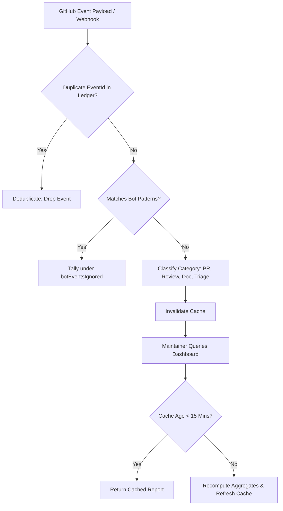

# Contributor Impact & Review Activity Analytics Dashboard

## Executive Summary
Traditional open-source metrics often reduce community health to raw commit counts, inadvertently favoring superficial micro-commits while ignoring vital collaborative contributions like detailed pull-request reviews, architecture documentation, accessibility fixes, and issue reproduction.

The Contributor Impact and Review Activity Analytics Dashboard provides maintainers with a multi-dimensional, cached repository analytics view that distinguishes merged PRs from unmerged PRs, tracks code reviews, and filters automated bot accounts.

---

## Contribution Dimensions & Taxonomy

| Category | Definition | Impact Value |
| :--- | :--- | :--- |
| **`MERGED_PR`** | Successfully reviewed and landed code changes in `main` | High functional delivery |
| **`UNMERGED_PR`** | Closed, abandoned, or rejected pull requests | Tracked distinctly from merged work |
| **`CODE_REVIEW`** | Constructive review comments and approving reviews | Quality stewardship & peer mentorship |
| **`DOCUMENTATION`** | New or updated user guides, schema docs, or ADRs | Knowledge sharing & onboarding ease |
| **`ISSUE_TRIAGE`** | Verifying steps to reproduce and categorizing citizen bugs | Community support & issue velocity |

---

## Rate-Limit & Caching Architecture

1. **15-Minute Cache TTL**:
   - Analytics aggregates are cached for 15 minutes (`CACHE_TTL_MS = 15 * 60 * 1000`), protecting against GitHub API secondary rate limits.
2. **Event Deduplication**:
   - Ingested GitHub webhook and REST payloads are deduplicated by `eventId`, preventing double-counting during network retries.
3. **Automated Bot Exclusion**:
   - Accounts matching known bot patterns (`dependabot[bot]`, `renovate`, `github-actions[bot]`) are tallied separately and excluded from human contributor totals.
4. **Zero Personal Surveillance**:
   - Collects zero private emails, geographic locations, or demographic inferences. Data reflects purely public repository interactions.

---

## Ingestion & Caching Flowchart



### Dashboard Visualization Guidelines

- Renders distinct stacked bar and area charts for merged code vs. review stewardship.
- Fully accessible keyboard navigation and linear table exports.
- Displays explicit indicator of `lastRefreshedAt` and caching expiration timer.

---

## Verification & Execution

Execute unit tests:
```bash
npx vitest run src/services/contributorImpactAnalyticsService.test.js
```
Automated tests validate event deduplication, contribution category segregation, bot filtering, and cache TTL behavior.

