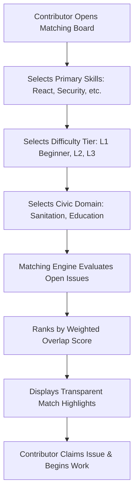

# Contributor Skill & Interest Matching Board

## Motivation & Overview
New and returning contributors frequently encounter decision fatigue when navigating dozens of open issues in an active repository. Traditional issue finding often relies either on invasive behavioral tracking or simple unranked label filters.

The Contributor Skill & Interest Matching Board provides a client-side, zero-tracking discovery experience that ranks open issues according to a contributor's declared competencies, difficulty preferences, and civic interest domains.

---

## Matching Algorithm & Scoring Weights

| Criteria | Weight | Rationale |
| :--- | :--- | :--- |
| **Direct Skill Label Match** | +30 pts | Exact match between declared skill (`react`, `security`, `accessibility`) and GitHub issue labels |
| **Skill in Description** | +15 pts | Contextual mention within issue body text |
| **Difficulty Tier Alignment**| +25 pts | Matches requested complexity (`good-first-issue`, `level1`, `level2`, `level3`) |
| **Civic Domain Interest** | +20 pts | Matches civic sector (e.g. `sanitation`, `education`, `grievance`, `ration`) |

---

## Privacy-First Architecture

- **No Server Tracking**: Contributor selections exist strictly in local component state; zero profile scraping or tracking cookies are employed.
- **Explainable Recommendations**: Every suggested issue includes transparent `matchHighlights` explaining why the issue is relevant to the contributor.
- **Dynamic Limit Controls**: Board returns top $N$ recommendations sorted by descending match score.

---

## Workflow Integration Flowchart



### Supported Skill & Domain Taxonomy

- **Frontend & UI**: `react`, `javascript`, `css`, `tailwind`, `accessibility`
- **Backend & Reliability**: `nodejs`, `firebase`, `security`, `vitest`
- **Civic Focus Areas**: `grievance`, `ration`, `education`, `sanitation`, `health`, `women_safety`

---

## Verification & Execution

Execute unit test suite:
```bash
npx vitest run src/services/issueMatchingBoardService.test.js
```
Automated tests validate label normalization, difficulty compatibility, and ranking sorting.

