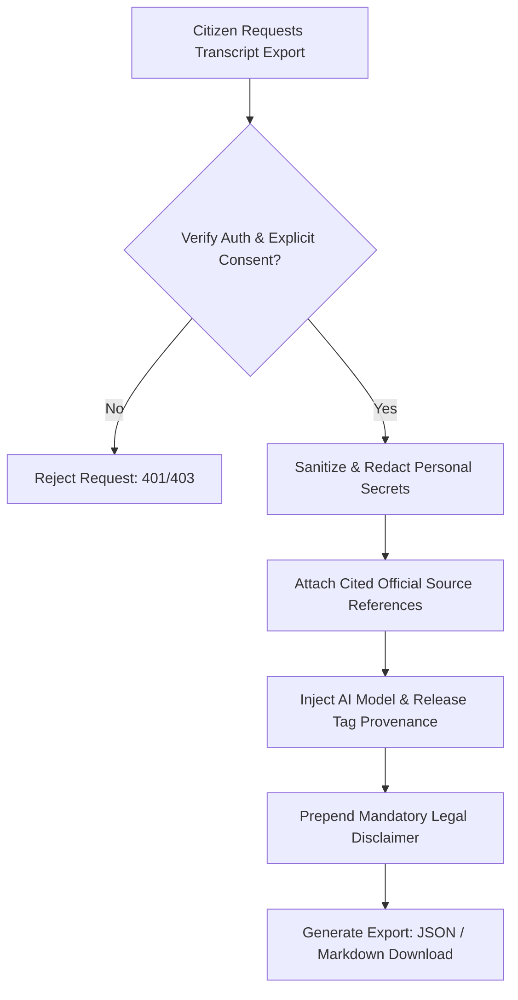

# Civic Assistant Conversation Export with Source & Model Provenance

## Motivation & Objectives
Citizens interacting with the Civic AI Assistant frequently ask about eligibility conditions, document checklists, and submission offices. Later, when visiting administrative offices (e.g. Gram Panchayat, Seva Kendra, or Tehsildar Office), citizens may wish to present a clear record of the guidance they reviewed.

However, a raw chat screenshot or generic transcript lacks authoritative context. The Conversation Provenance Exporter generates structured, verifiable guidance records that document the exact statutory circulars, official URLs, and AI model release versions used to formulate the answers, while explicitly protecting citizens from misunderstanding guidance as binding administrative orders.

---

## Architectural Principles & Protections

1. **Explicit Legal Disclaimer**:
   - Every export bundle prominently features an immutable legal notice clarifying that the transcript is informational guidance and does not substitute for a formal administrative ruling.
2. **Authoritative Provenance Metadata**:
   - Attaches:
     - Cited official source records with canonical URLs (`https://...`)
     - AI model identifier (e.g. `gemini-1.5-pro`)
     - Non-secret prompt release tag (e.g. `2026.11-v1`)
     - UTC retrieval and export timestamps
3. **Explicit Consent & Authentication**:
   - Exports can only be requested by authenticated citizens with explicit opt-in confirmation (`userConsented: true`).
4. **PII Redaction Guard**:
   - Automatically sanitizes private identifiers (Aadhaar, PAN, passwords, secret tokens) before serializing export packages.
5. **Portable Formats**:
   - Supports structured JSON schemas for programmatic audits and accessible GitHub-style Markdown documents for offline reading and printing.

---

## Export Bundle Schema & Flowchart



### Export Payload Data Dictionary

| Property | Data Type | Description |
| :--- | :--- | :--- |
| `exportId` | `string` | Unique identifier (`exp_...`) for audit traceability |
| `disclaimer` | `string` | Non-binding legal notice explicitly advising official verification |
| `provenance.aiModelId` | `string` | LLM version utilized for generating responses |
| `provenance.configurationReleaseTag` | `string` | Non-secret system release tag binding prompts & safety policies |
| `citedSources` | `Array<Object>` | List of official government references cited with verified URLs |

---

## Verification & Execution

Execute export test suite:
```bash
npx vitest run src/ai/conversationExportService.test.js
```
Automated test fixtures cover authentication checks, consent requirements, PII sanitization, and Markdown formatting.

