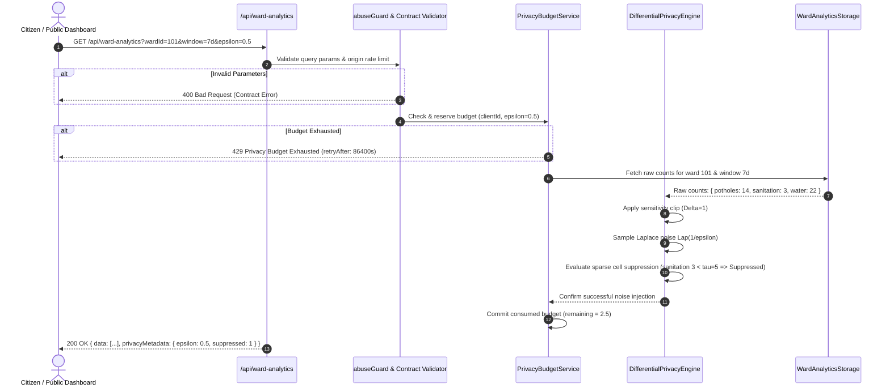

# Differentially Private Ward-Level Civic Analytics Architecture & Threat Model (#1163)

## 1. Overview & Problem Statement
Municipal dashboards and civic monitoring platforms in **Civic Help Setu** aggregate citizen complaints and service requests (e.g. broken streetlights, contaminated drinking water, pothole hazards, solid waste dumping) across municipal wards. 

While public transparency encourages accountability, raw aggregate reporting exposes individual citizens and households to severe privacy harms:
- **Small-Cohort Leakage**: When a ward or remote sub-locality records only 1 or 2 complaints in a sensitive category (e.g., corruption report against a local inspector or illegal construction complaint), neighbors can easily deduce the complainant's household.
- **Differencing / Reconstruction Attacks**: An adversary making repeated queries over sliding time windows (e.g., "complaints between 10:00 and 11:00" vs. "between 10:00 and 11:01") can isolate individual submissions.
- **Membership Inference Attacks**: An adversary with prior auxiliary knowledge can infer whether a targeted citizen participated in civic feedback.

To address this, issue **#1163** establishes a production-grade, mathematically verified **Differentially Private (DP) Ward-Level Civic Analytics Platform**.

> **Statutory Notice & Scope Boundaries**:
> Public civic analytics generated by this service are **advisory statistical estimates** released for community awareness and civic transparency. They do not constitute official municipal corporation decree, legal evidence, or administrative certification of government action. Furthermore, AI and automated algorithms operate as untrusted decision-support proposals; no autonomous filing, benefit denial, or punitive enforcement occurs.

---

## 2. Threat Model & Trust Boundaries

### 2.1 Trust Boundaries
1. **Untrusted Public Boundary**: Browser clients, public consumers, automated scrapers, and malicious adversaries submitting arbitrary HTTP requests.
2. **Perimeter Security Boundary**: WAF, rate limiters (`abuseGuard`), and untrusted query parameter sanitizers.
3. **Privacy Governance Boundary**: The **Privacy Budget Ledger**, which tracks cumulative privacy loss $\sum \epsilon$ per client/session and enforces budget caps before queries hit data stores.
4. **Data Isolation Boundary**: Raw grievance submissions and household records reside in encrypted, isolated storage. The analytics engine performs read-only, non-joinable aggregation and immediately transforms counts via DP noise.

### 2.2 Adversary Personas & Attack Vectors
| Adversary Profile | Objective | Attack Technique | Mitigation |
| :--- | :--- | :--- | :--- |
| **Curious Neighbor** | Discover if a specific neighbor complained about sanitation or illegal encroachment. | Inspects sparse ward cells with low total volume. | **Sparse Cell Suppression**: Any raw or noisy cell count below threshold $\tau = 5$ is masked as `SUPPRESSED` (`< 5`). |
| **Statistical Reconstruction Adversary** | Recover true complaint counts by executing hundreds of queries and averaging random noise. | Repeated queries with slightly altered date filters or client resets. | **Cryptographic Privacy Budget Ledger**: Queries consume $\epsilon$. When session budget $\epsilon_{\text{total}}$ is exhausted, requests are rejected with `HTTP 429 Privacy Budget Exhausted`. |
| **Linkage Adversary** | Correlate civic analytics with leaked voter lists or external complaint trackers. | Attribute matching via timestamp and geospatial coordinates. | **Spatial & Temporal Coarsening**: Timestamps are bucketed into discrete daily/weekly epochs; locations are aggregated strictly at municipal ward level (no sub-ward lat/lng points). |
| **Parameter Poisoning Adversary** | Craft malicious query inputs (negative epsilons, NaN, giant dates) to crash or bypass DP checks. | HTTP parameter tampering. | **Strict Schema Validation**: Inputs are validated against `wardAnalyticsContract.js` before evaluation. |

---

## 3. Mathematical Differential Privacy Specification

### 3.1 $(\epsilon)$-Differential Privacy Guarantee
A randomized mechanism $\mathcal{M}$ provides $\epsilon$-differential privacy if for all neighboring datasets $D, D'$ differing by at most one citizen record ($|D \oplus D'| = 1$), and for all query response subsets $S \subseteq \text{Range}(\mathcal{M})$:

$$\Pr[\mathcal{M}(D) \in S] \le e^{\epsilon} \cdot \Pr[\mathcal{M}(D') \in S]$$

### 3.2 Global Sensitivity ($\Delta$)
Civic Help Setu restricts query aggregation to counting queries over partition-disjoint ward categories. Since an individual citizen record contributes at most one report per category within an aggregation window:

$$\Delta f = \max_{D \sim D'} \|f(D) - f(D')\|_1 = 1$$

### 3.3 Laplace Mechanism & Discrete Post-Processing
For an aggregate count $C(D)$, calibrated noise drawn from a zero-mean Laplace distribution is added:

$$\tilde{C} = C(D) + \text{Lap}\left(0, \frac{\Delta f}{\epsilon}\right) = C(D) + \text{Lap}\left(0, \frac{1}{\epsilon}\right)$$

Where the Laplace random variable $\eta \sim \text{Lap}(b)$ with scale $b = 1/\epsilon$ has probability density:
$$f(\eta) = \frac{1}{2b} \exp\left(-\frac{|\eta|}{b}\right)$$

For civic presentation, non-negative integer counts are produced using deterministic rounding and non-negative clamping:
$$\hat{C} = \max(0, \lfloor \tilde{C} \rceil)$$

### 3.4 Sparse-Cell Suppression ($\tau$-Thresholding)
To prevent small-cohort re-identification and heavy-tailed Laplace outliers revealing presence, a dual thresholding rule is enforced:

$$\text{PublishedCount}(C, \tilde{C}) = \begin{cases}
\text{null (Suppressed)}, & \text{if } C < \tau \text{ or } \tilde{C} < \tau \\
\hat{C}, & \text{otherwise}
\end{cases}$$

Where default threshold $\tau = 5$.

### 3.5 Privacy Loss Composition & Budget Ledger
Under basic composition, if a client executes $k$ queries with parameters $\epsilon_1, \epsilon_2, \dots, \epsilon_k$, total privacy loss is:
$$\epsilon_{\text{total}} = \sum_{i=1}^{k} \epsilon_i$$

- **Default Session Budget ($\epsilon_{\text{total}}$)**: $3.0$ per 24-hour epoch.
- **Default Query Cost ($\epsilon_{\text{query}}$)**: $0.5$ per query.
- **Idempotency Exemption**: Repeated identical queries within a 5-minute cache TTL return the previously generated DP aggregate with **0 budget deduction**.
- **Exhaustion Enforcement**: If $\sum \epsilon + \epsilon_{\text{query}} > \epsilon_{\text{total}}$, the server rejects the request with `429 Privacy Budget Exhausted`.

---

## 4. Component Boundaries & Data Flow

---

## 5. Utility vs. Privacy Trade-Off Matrix

Based on empirical evaluations using synthetic civic issue distributions (5,000 records across 15 wards):

| $\epsilon$ | Privacy Protection Level | Root Mean Square Error (RMSE) | Expected Noise Std Dev | Best Use Case |
| :---: | :---: | :---: | :---: | :---: |
| **0.1** | Maximum (Indistinguishable) | $\approx 14.14$ | $14.14$ | Sensitive public health & grievance audits |
| **0.5** | High (Default Recommended) | $\approx 2.83$ | $2.82$ | **Public Ward Heatmaps & Dashboards** |
| **1.0** | Moderate | $\approx 1.41$ | $1.41$ | High-density civic works tracking |
| **2.0** | Low (Utility Prioritized) | $\approx 0.71$ | $0.70$ | Internal departmental workload balancing |

---

## 6. Failure Modes & Safe Error Handling

1. **Privacy Budget Depletion (`BUDGET_EXHAUSTED`)**:
   - HTTP Status: `429 Too Many Requests`
   - Response Payload: `{ error: 'Privacy budget exhausted for current epoch', retryAfterSeconds: 43200, resetEpochUtc: '...' }`
   - User Experience: The dashboard displays an informative "Privacy Shield Active" banner explaining that queries are limited to prevent reconstruction attacks.
2. **Sparse Ward Data**:
   - When all categories in a ward have $< \tau$ reports, all cells are marked as `Suppressed`.
   - UI displays an accessible note: *"Fewer than 5 reports registered in this category. Data suppressed under DPDP Act privacy rules."*
3. **Offline / Disconnected Operation**:
   - `wardIssueHeatmapStorage.js` caches the last successfully fetched DP snapshot in `localStorage` with a timestamped integrity seal.
   - Offline banner alerts the user that data is cached and read-only.

---

## 7. Operational Ownership & Maintainer Runbook

- **Primary Owner**: Data Engineering & Privacy Governance Team.
- **Data Retention**: Raw grievance timestamps and location identifiers are retained for 90 days as per `DATA_RETENTION.md`, after which only pre-computed DP aggregate archives are preserved.
- **Rollback Procedure**:
  - If a differential privacy mechanism issue is detected, the feature flag `VITE_ENABLE_DP_WARD_ANALYTICS` can be set to `false`, gracefully falling back to a static municipal ward summary without granular categories.
