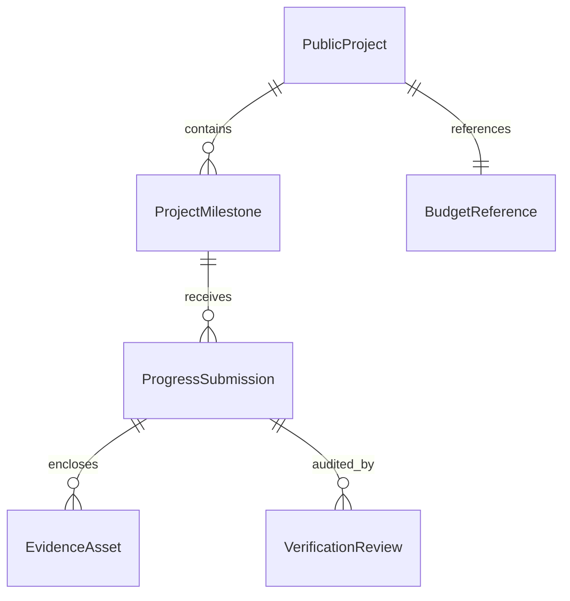

# Geospatial Public Project Progress Verification and Evidence Timeline (#752)

## 1. Overview & Architectural Boundaries

Civic Help Setu provides a dedicated, independently verifiable capability for tracking public infrastructure projects (roads, stormwater drains, schools, public healthcare facilities, parks) across municipal jurisdictions.

This system replaces static information cards and unvalidated progress claims with:
- **Map-linked spatial boundaries** (Points, LineStrings, Polygons) with bounding boxes and municipal ward references.
- **Milestone-driven execution timelines** with weighted completion percentages.
- **Tamper-evident photographic evidence archives** utilizing SHA-256 integrity hashes.
- **Bounded computer vision discrepancy hints** that assist human reviewers without ever making automated completion judgments.
- **Role-based governance** separating public viewers, citizen verifiers, contractors, reviewers, and administrators.

---

## 2. Core Entities & Data Model

The data layer uses normalized entity collections persisted under versioned schema keys (`schemaVersion: 1`):

### Entity Schema Specifications:

1. **`PublicProject`** (`civicbridge_public_projects_v1`):
   - `id`: Unique project identifier (e.g. `proj-road-101`)
   - `title`: String (10 - 150 chars)
   - `description`: String (20 - 2000 chars)
   - `category`: Enum (`roads`, `drains`, `schools`, `public_buildings`, `parks`, `healthcare`)
   - `status`: Enum (`PLANNED`, `ACTIVE`, `DELAYED`, `COMPLETED`, `ABANDONED`)
   - `jurisdiction`: `{ wardNumber, wardName, zone, municipality }`
   - `locationGeometry`: `{ type: 'Point'|'LineString'|'Polygon', coordinates, boundingBBox, centerLat, centerLng, landmark }`
   - `budgetReference`: `{ sanctionedAmountInr, financialYear, tenderId, isPublic }`
   - `contractorDetails`: `{ name, licenseId }`
   - `startDate`: ISO Date
   - `targetCompletionDate`: ISO Date
   - `overallProgressPercent`: Integer (0 - 100)
   - `schemaVersion`: 1

2. **`ProjectMilestone`** (`civicbridge_project_milestones_v1`):
   - `id`: Milestone identifier (e.g. `ms-road-101-1`)
   - `projectId`: Foreign key referencing `PublicProject`
   - `sequenceOrder`: Integer (1, 2, 3...)
   - `title`: Milestone objective
   - `description`: Scope of work
   - `weightPercentage`: Integer (sums to 100 per project)
   - `targetDate`: Target completion date
   - `status`: Enum (`PENDING`, `IN_PROGRESS`, `SUBMITTED`, `VERIFIED`, `REJECTED`)
   - `verifiedDate`: ISO timestamp | null
   - `completionCriteria`: Array of statutory compliance specifications

3. **`ProgressSubmission`** (`civicbridge_progress_submissions_v1`):
   - `id`: Submission ID (e.g. `sub-road-101-3-01`)
   - `projectId`, `milestoneId`: Foreign keys
   - `submittedBy`: `{ id, name, role }`
   - `submissionDate`: ISO timestamp
   - `narrative`: Sanitized progress report (min 20 chars, zero PII)
   - `reportedPercent`: Integer (0 - 100)
   - `evidenceAssetIds`: Array of evidence asset IDs
   - `status`: Enum (`PENDING_REVIEW`, `VERIFIED`, `REVISION_REQUESTED`, `DISPUTED`)
   - `seal`: Deterministic verification seal (`SEAL-PPP-XXXX-YYYY`)

4. **`EvidenceAsset`** (`civicbridge_evidence_assets_v1`):
   - `id`: Unique asset ID
   - `assetHash`: 64-character SHA-256 integrity hash
   - `storageUrl`: Internal storage URL (stripped in public projection)
   - `publicPreviewUrl`: Redacted preview URL
   - `geoTag`: `{ lat, lng, accuracyMeters }`
   - `capturedAt`: Original capture timestamp
   - `redactionStatus`: Enum (`REDACTED`, `VERIFIED_SAFE`, `RESTRICTED`)

5. **`VerificationReview`** (`civicbridge_verification_reviews_v1`):
   - `id`: Review identifier
   - `reviewerId`, `reviewerName`: Official audit personnel
   - `decision`: Enum (`APPROVE`, `REJECT`, `REQUEST_EVIDENCE`)
   - `findings`: Official audit observations (min 15 chars)
   - `automatedHint`: Bounded CV advisory payload (score, factors, ruleset)
   - `decisionTimestamp`: ISO timestamp

---

## 3. Domain State Machine & Transition Invariants

### Milestone Lifecycle:
- `PENDING` -> `IN_PROGRESS`
- `IN_PROGRESS` -> `SUBMITTED` (requires at least one evidence asset with SHA-256 hash)
- `SUBMITTED` -> `VERIFIED` (authorized reviewer decision: `APPROVE`)
- `SUBMITTED` -> `REJECTED` (authorized reviewer decision: `REJECT`)
- `SUBMITTED` -> `IN_PROGRESS` (authorized reviewer decision: `REQUEST_EVIDENCE`)
- Direct jump from `PENDING` to `VERIFIED` is strictly rejected.

### Project Lifecycle:
- Overall project progress percentage is the weighted sum of `VERIFIED` milestones.
- When 100% of milestones are `VERIFIED`, project status transitions to `COMPLETED`.

---

## 4. Bounded Intelligence & Computer Vision Policy

Computer vision diffing operates under strict safety invariants:
1. **Advisory Signal Only**: Image analysis produces only an advisory discrepancy score (0.0 to 1.0).
2. **No Automated Approvals**: Under no circumstances does the model mark a milestone as complete.
3. **Full Explainability**: Every recommendation logs:
   - `rulesetVersion`: `cv-evidence-diff-v1.4.2`
   - `modelRef`: `civic-ground-verification-vision-v1`
   - `featureWindow`: Baseline vs. current capture dates and elapsed days
   - `influencingFactors`: Texture alignment, road boundary adherence, daylight indices
4. **Deterministic Fallback**: When model service is unavailable or file formats are non-standard, the system issues a fallback record requiring manual visual inspection without blocking the review queue.

---

## 5. Privacy, Security & RBAC

1. **Role Scoping (`src/services/accessControl.js`)**:
   - `publicProjects.create`: Restricted to `admin`
   - `publicProjects.verify`: Restricted to `admin` / authorized inspectors
   - `publicProjects.audit`: Restricted to `admin` / oversight auditors
   - Unauthenticated & citizen users can view public timelines and submit field observations.
2. **Public Data Minimization**:
   - Contractor tax identifiers, banking details, and unredacted raw media links are removed from public projections (`getPublicProjectDetail(id, storage, false)`).
   - Facial features and vehicle license plates are masked in public preview assets under the Digital Personal Data Protection (DPDP) Act.
3. **Anti-PII Validation**:
   - Serverless endpoints reject submissions containing regex patterns for Aadhaar, PAN, phone numbers, or private emails.

---

## 6. API & Abuse Controls

- **Endpoint**: `/api/public-projects`
- **Rate Limiting**: 20 requests per minute per IP via fixed-window rate limiter (`abuseGuard.js`).
- **Single Flight**: Concurrent identical submissions share execution flights to prevent double-click duplicates.
- **Tamper Seals**: Generates deterministic FNV-1a cryptographic seals (`SEAL-PPP-XXXX-YYYY`) for all submissions.

---

## 7. Migration & Rollback Strategy

1. **Forward Migration**:
   - Initial seed and dynamic records carry `schemaVersion: 1`.
   - Adding new spatial columns (e.g. 3D elevation vectors) will increment `schemaVersion: 2` with backward-compatible defaults.
2. **Rollback Strategy**:
   - If a deployment failure occurs, rollback preserves the existing JSON local storage key (`civicbridge_public_projects_v1`).
   - Legacy readers safely ignore unmapped attributes.
