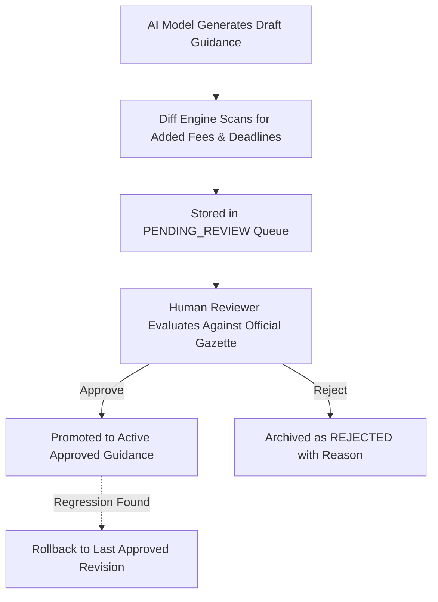

# Human-Reviewed AI Draft Comparison and Revision Workspace

## Motivation & Overview
Large Language Model (LLM) outputs can subtly alter crucial factual details between model versions or prompt revisions. For civic assistance, small wording shifts in fee amounts (e.g. ₹50 vs. ₹100), statutory deadlines (e.g. 15 days vs. 30 days), or eligibility criteria can mislead citizens and lead to rejected applications.

The Human-Reviewed AI Draft Comparison and Revision Workspace enforces that no AI-generated civic guidance enters public citizen workflows without explicit human review, diff inspection, and auditable approval.

---

## Workspace Architecture & Safety Checks

1. **Strict Editorial Staging**:
   - Newly generated AI drafts enter an isolated `PENDING_REVIEW` queue.
   - Unreviewed output is never presented as approved official guidance.
2. **Deterministic Diff & Fact Extraction**:
   - Automatically computes line-level additions and deletions compared to the last approved version.
   - Specifically scans and flags alterations to:
     - Fees and monetary requirements (`₹`, `Rs`, `INR`)
     - Timelines and deadlines (e.g. `15 days`, `30 working days`)
     - Statutory references and legal articles (e.g. `Section 12`, `Rule 4`)
3. **Traceable Review Attribution**:
   - Approvals and rejections record the reviewer handle, timestamp, and justification reason.
4. **Immediate One-Click Rollback**:
   - If a regression or gazette contradiction is discovered, maintainers can rollback to the previous approved revision with full audit logging.
5. **PII Isolation**:
   - Workspace fixtures strictly manage service explanation texts and public gazette excerpts; citizen identities and private chat histories are never stored in review fixtures.

---

## Draft Review Lifecycle Diagram



### Reviewer UI & Mobile Accessibility Considerations

- Review diff views render additions in green (`+`) and deletions in red (`-`) with text alternatives for screen reader compatibility.
- Interactive decision buttons (`Approve`, `Reject`, `Rollback`) are keyboard navigable with visible focus states and WCAG 2.1 AA compliant contrast ratios.
- Modal dialogues confirm all high-impact actions like rejections and rollbacks to avoid accidental triggers.

---

## Verification & Execution

Execute draft workspace test suite:
```bash
npx vitest run src/ai/humanReviewedDraftWorkspace.test.js
```
Automated tests validate sensitive fact detection, diff computation, reviewer approval, and rollback operations.

