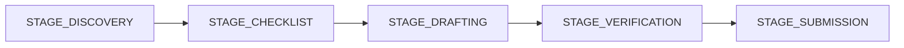

# Civic Service Journey Bottleneck Sankey & Funnel Explorer

## Motivation & Problem Statement
Citizens often encounter friction or confusion when navigating multi-step civic procedures (such as gathering affidavits, visiting local kiosks for biometric verification, or completing online portals). Maintainers require visibility into where citizens get confused or drop off, but must never infer that a closed browser session represents an application rejection or failure.

The Journey Bottleneck Funnel Explorer provides an aggregate, privacy-first journey funnel view that tracks transitions between stages while guaranteeing $k$-anonymity cohort protection.

---

## Canonical Journey Stages



1. **`STAGE_DISCOVERY`**: Citizen discovers service eligibility and rules.
2. **`STAGE_CHECKLIST`**: Reviewing required proofs, identity certificates, and affidavits.
3. **`STAGE_DRAFTING`**: Completing application fields and preparing supporting docs.
4. **`STAGE_VERIFICATION`**: In-person Seva Kendra / Gram Panchayat biometric verification.
5. **`STAGE_SUBMISSION`**: Official submission to department portal.

---

## Privacy Safeguards & Non-Inference Rules

| Safeguard | Implementation Rule |
| :--- | :--- |
| **Non-Inference Rule** | Never implies or asserts that session drop-off equals application denial. Explains that citizens frequently switch to offline channels. |
| **Cohort Suppression ($k \ge 10$)**| Any stage event count with $< 10$ events is masked as `< 10` (`suppressed: true`) to prevent re-identification. |
| **Zero Private Data** | Collects zero names, emails, IPs, or document attachments. Events are purely aggregate transition counts. |
| **Accessible Table Alternative** | Every funnel chart renders an accessible HTML table with ARIA attributes for screen-reader parity. |

---

## Maintainer Operational Insights

1. **Checklist to Drafting Friction**:
   A high drop-off between `STAGE_CHECKLIST` and `STAGE_DRAFTING` typically indicates missing clarity in required document formats (e.g. citizens need to know whether an affidavit requires notary attestation or simple self-declaration).
2. **Offline Hand-Off Realities**:
   In many Indian states, citizens research online via Civic Help Setu but complete their physical application at a CSC (Common Service Centre) or Bangalore One / MeeSeva center. Maintainers must treat drop-off as intentional offline migration rather than failed journeys.
3. **Continuous Review Cadence**:
   Funnel transition metrics are evaluated quarterly by service maintainers to prioritize UI clarification enhancements.

---

## Verification & Execution

Execute unit tests:
```bash
npx vitest run src/services/journeyBottleneckFunnelService.test.js
```
Automated tests validate stage transition math, cohort suppression thresholds, error handling, and jurisdiction filtering.

