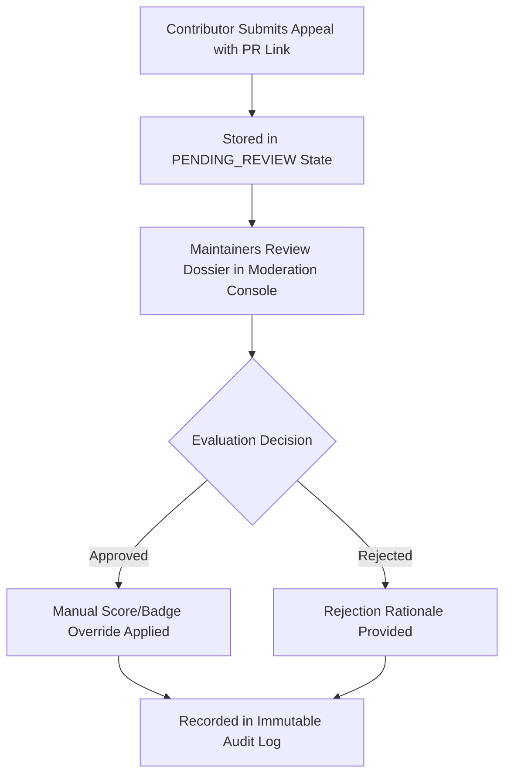

# Maintainer Moderation Console and Ranking Appeals

## Motivation & Overview
In any community gamification or contributor metric system, automated algorithms can occasionally misclassify work (e.g., mislabeling a substantive core refactor as a superficial documentation edit or encountering transient network timeouts during badge minting). Without a formal appeal channel, contributors feel unappreciated or unfairly judged.

The Maintainer Moderation Console and Ranking Appeals Service delivers a structured, audit-logged dispute resolution mechanism.

---

## Appeals Workflow & Lifecycle



### Supported Appeal Categories

1. **`SCORE_CORRECTION`**: Request re-evaluation of contribution category weights or points.
2. **`BADGE_MISSING`**: Claim missing achievement badge when technical criteria were fulfilled.
3. **`PENALTY_DISPUTE`**: Contest automated spam or bot penalties applied to account.
4. **`STREAK_RESTORATION`**: Request grace freeze reinstatement due to documented life emergency or repository CI outages.

---

## Anti-Abuse & Accountability Guarantees

- **No Silent Edits**: Maintainers cannot arbitrarily change scores or badges without providing a documented rationale and their maintainer handle.
- **Immutable Audit Trail**: All overrides emit audit records (`audit_<timestamp>_<entropy>`) accessible for repository transparency reporting.
- **Zero Retaliation Safeguards**: Contributors have a safe, standardized path to question metrics without confrontation.

---

## Appeal Resolution Policy Matrix

| Appeal Type | Evidentiary Requirement | Typical Resolution Window | Allowed Overrides |
| :--- | :--- | :--- | :--- |
| `SCORE_CORRECTION` | Link to merged PR and commit diff | 48 hours | Adjust category points up to +50 pts |
| `BADGE_MISSING` | Link to merged PR meeting badge rule criteria | 24 hours | Mint missing achievement badge with evidence digest |
| `PENALTY_DISPUTE` | Explanation proving original code was not automated spam | 72 hours | Nullify spam penalty and restore baseline standing |
| `STREAK_RESTORATION` | Verified notification of emergency or repository outage | 48 hours | Reapply grace week freeze to streak tracker |

---

## Verification & Execution

Execute moderation test suite:
```bash
npx vitest run src/services/maintainerModerationService.test.js
```
Automated workflows audit moderation logs during regular maintenance releases.

