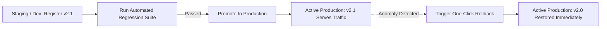

# Civic Assistant Model & Prompt Release Registry

## Problem Statement & Objectives
Prompt templates, retrieval parameters, and foundational LLM model IDs directly dictate the quality and safety of citizen guidance. Without a release registry, system updates occur implicitly, making it impossible to reproduce answers, debug hallucinations, or reliably roll back an unstable deployment.

The Model & Prompt Release Registry introduces a versioned, non-secret configuration ledger that guarantees full traceability and one-click rollback for AI configurations.

---

## Architecture & Governance

1. **Non-Secret Configuration Records**:
   - Stores strictly public/runtime metadata:
     - `versionTag`: Canonical release name (e.g. `2026.11-v1`)
     - `modelId`: Foundation model identifier (e.g. `gemini-1.5-pro`)
     - `promptHash`: Cryptographic fingerprint of the prompt template (`pmt_xxxxxxxx`)
     - `retrievalConfig`: Top-K and threshold hyperparameters
     - `author`: Maintainer or engineer who staged the release
   - Rejects any attempt to commit API keys, bearer tokens, or provider secrets.
2. **Environment Separation**:
   - Maintains distinct state for `PRODUCTION`, `STAGING`, and `DEVELOPMENT`.
   - Staging releases must pass regression suites before promotion to production.
3. **Instant One-Click Rollback**:
   - Maintainers can revert production to any prior approved configuration tag instantly without touching database schemas or citizen records.
4. **Answer Traceability**:
   - Every generated AI response records the active `versionTag`, establishing auditability for legal and administrative inquiries.

---

## Promotion & Rollback State Transitions



### Non-Secret Hygiene Rules

- **Zero Credential Storage**: Under no circumstances shall provider authorization tokens, client credentials, or webhook secrets be placed into release tags.
- **Provider API Decoupling**: API keys are injected exclusively via secure server-side environment variables at execution time.
- **Audit Logging**: Any promotion or rollback event logs the executing maintainer handle and UTC timestamp to GitHub release notes.

---

## Verification & Execution

Execute registry tests:
```bash
npx vitest run src/ai/modelPromptReleaseRegistry.test.js
```
Automated tests validate version promotion, rollback, prompt hashing, and secret rejection schemas.

