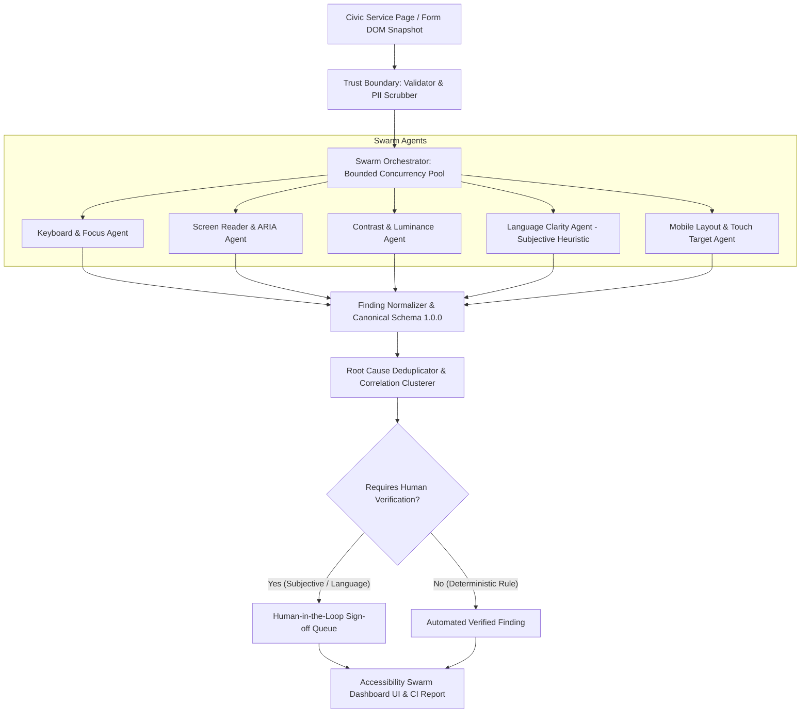

# Multi-Modal Civic Accessibility Testing Agent Swarm (Architecture & ADR)

**Status:** Approved  
**Version:** 1.0.0  
**Issue:** #1177  

---

## 1. Problem & Motivation

Public civic platforms and government portals frequently present multi-dimensional accessibility barriers that single-perspective linters fail to catch. A button might technically pass HTML syntax validation while remaining entirely invisible to keyboard users, lacking focus rings, using low-contrast labels, embedding impenetrable bureaucratic jargon, and collapsing into an un-tappable 20px target on mobile devices.

The **Multi-Modal Civic Accessibility Testing Agent Swarm** coordinates complementary, specialized agents to evaluate civic user journeys across five core modalities:
1. **Keyboard Navigation & Focus Traps** (WCAG 2.1.1, 2.4.3, 2.4.7)
2. **Screen Reader Semantics & ARIA** (WCAG 1.1.1, 1.3.1, 4.1.2)
3. **Contrast & Visual Perception** (WCAG 1.4.3, 1.4.11)
4. **Plain Language & Reading Clarity** (WCAG 3.1.5)
5. **Mobile Layout & Touch Targets** (WCAG 1.4.10, 2.5.5)

---

## 2. Architecture & Swarm Data Flow



---

## 3. Threat Model & Privacy Safeguards

| Threat Vector | Mitigation Strategy |
| :--- | :--- |
| **Citizen PII Ingestion** | Real citizen identifiers (Aadhaar, PAN, phone numbers, email addresses) are stripped at the trust boundary prior to ingestion by any agent. |
| **AI Hallucination / Over-reliance** | Deterministic calculations (contrast ratios, DOM element attributes, viewport scaling) are kept strictly outside LLM prompts. Subjective findings are marked `unverified_suggestion` and cannot be escalated without human sign-off. |
| **Denial of Service / Unbounded Scans** | Maximum DOM size capped at 250KB, maximum 5 concurrent agents, 4.5s timeout per agent, and circuit breakers. |
| **Autonomous Action Guardrail** | The agent swarm has zero authority to unilaterally alter civic rules, deny benefits, or submit government applications. |

---

## 4. Complementary Modalities & Evaluation Criteria

| Modality | WCAG Criteria | Deterministic vs Subjective | Default Severity |
| :--- | :--- | :--- | :--- |
| **Keyboard** | 2.1.1, 2.4.3, 2.4.7 | Deterministic | High |
| **Screen Reader** | 1.1.1, 4.1.2, 3.1.1 | Deterministic | Critical / High |
| **Contrast** | 1.4.3, 1.4.11 | Deterministic ($L_1/L_2$ formula) | High |
| **Language Clarity** | 3.1.5 | Subjective (Requires human sign-off) | Low |
| **Mobile Layout** | 1.4.4, 1.4.10, 2.5.5 | Deterministic | Critical / Medium |

---

## 5. Non-AI Fallback Mode

In bandwidth-constrained or strict compliance environments, the swarm supports a dedicated Non-AI fallback:
```javascript
const orchestrator = new AccessibilitySwarmOrchestrator({
  enableNonAiFallbackOnly: true
});
```
This skips heuristic and LLM evaluations while executing all deterministic rule checkers natively.

---

## 6. Verification Commands

Run unit and integration tests:
```bash
npx vitest run src/services/accessibilitySwarm/swarmOrchestrator.test.js
npx vitest run src/components/accessibilitySwarm/AccessibilitySwarmDashboard.test.jsx
```
