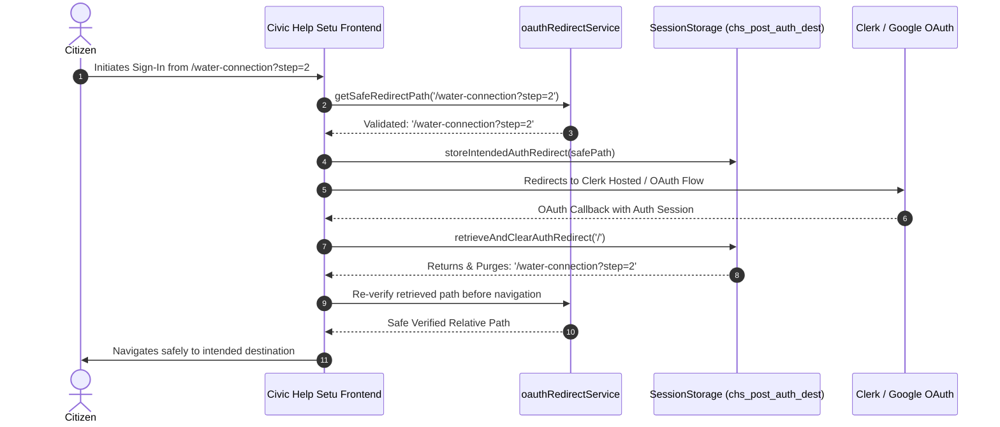

# Hardened OAuth Redirect Validation Architecture & Security Policy

## 1. Threat Model & Security Objectives
Open redirects and unvalidated return destinations pose critical security risks in OAuth/OIDC and email authentication flows. An attacker can construct a crafted login link that appears legitimate (`https://civichelpsetu.in/sign-in?redirect_url=https://phishing-site.com`), causing the application to redirect the user to a credential harvesting page immediately post-login.

Furthermore, attackers utilize sophisticated obfuscation strategies:
- Protocol-relative URLs: `//evil.com` or `///evil.com`
- Mixed backslash substitutions: `/\\evil.com` or `\\evil.com`
- Percent-encoding variants: `%2f%2fevil.com` and double-encoding `%252f%252fevil.com`
- Path traversal escapes: `/services/../../evil`
- Script injection via schemes: `javascript:`, `data:`, `vbscript:`

---

## 2. Authentication Flow & Safe Return Destination

---

## 3. Strict Allowlist Policy

Only relative application paths rooted in the canonical routes table are permitted:
- `/`
- `/services`
- `/track`
- `/offices`
- `/assistant`
- `/admin`
- `/open-source`
- `/privacy`, `/terms`, `/faq`
- Verified civic modules: `/jurisdiction-handoff`, `/micro-volunteer`, `/water-connection`, `/heatwave-relief`, `/flood-response`, `/school-zone-safety`

Any foreign origin, unparseable string, or unlisted path immediately falls back to `/`.

## 4. Expired-Session & Callback State Handling
When a citizen's session times out during form completion:
1. `resolveSessionTransition('SESSION_EXPIRED', '/current-form')` safely deposits the sanitized path into session storage.
2. The user is redirected to `/sign-in`.
3. Upon successful Clerk / Google OAuth callback, `retrieveAndClearAuthRedirect` retrieves and flushes the return path, restoring the user directly to their uncompleted civic workflow without stranding them on arbitrary routes or losing form context.

## 5. Security Regression Verification Checklist
- Run `npm test -- src/services/oauthRedirectService.test.js` to verify:
  - Relative routing preservation.
  - Complete neutralisation of external origins.
  - Multi-layer URL decoding resistance against %2f and %252f attacks.
  - In-memory storage lifecycle clearing upon consumption.
