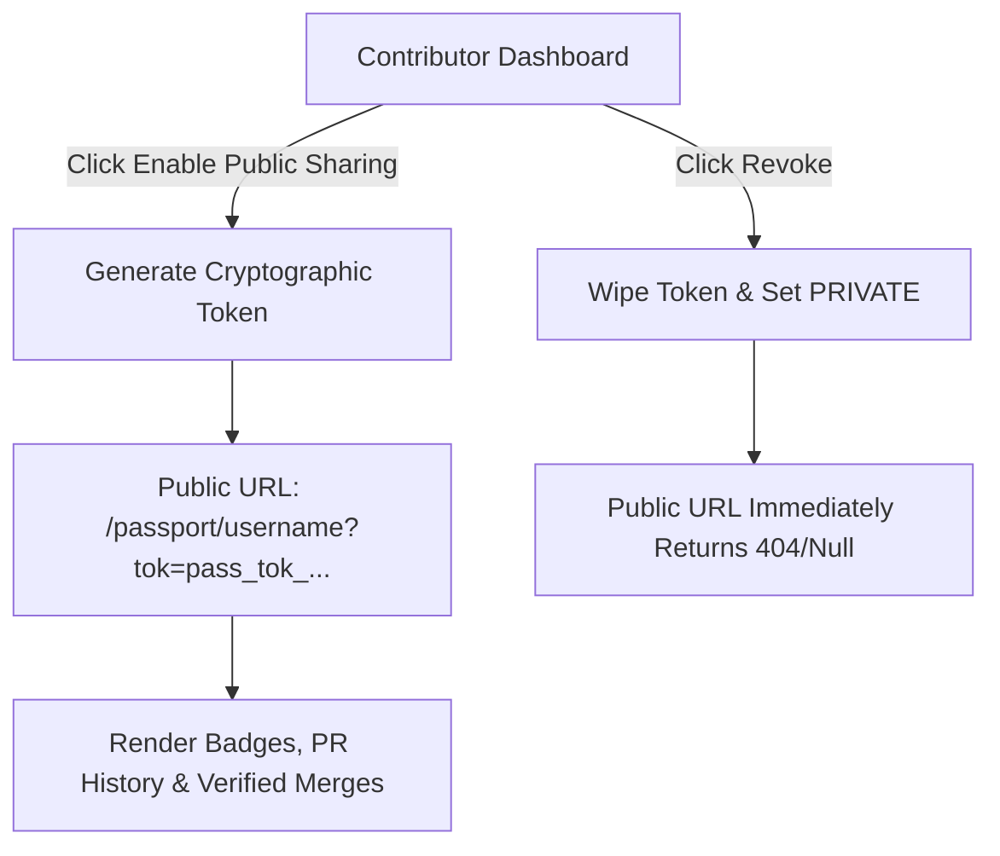

# Personal Contribution Passport

## Background & Objectives
Contributors who donate time, technical expertise, and domain knowledge to Civic Help Setu deserve a first-class, verifiable mechanism to highlight their civic tech contributions. Whether applying for software engineering careers, fellowships, or public service grants, developers need a verifiable digital portfolio.

However, public developer portals must prioritize contributor privacy and consent. The Personal Contribution Passport implements an opt-in, unguessable, revocable credential sharing system.

---

## Core Privacy & Security Architecture

1. **Opt-In Default Privacy**:
   - Every contributor passport begins in strict `PRIVATE` state.
   - Zero profile data is publicly listed or indexed without deliberate contributor consent.
2. **Unguessable Capability URLs**:
   - Enabling sharing generates an unguessable token (`pass_tok_<timestamp>_<entropy>`).
   - Prevents unauthorized scraping or enumeration of contributor portfolios.
3. **Instant One-Click Revocation**:
   - At any time, a contributor can revoke sharing. This immediately nullifies the existing token, severing public access permanently.
4. **Granular Privacy Controls**:
   - Optional toggles allow contributors to mask activity timestamps, conceal email contacts, and select which contributions are highlighted.
5. **Multi-Format Portability**:
   - Contributor portfolios can be exported as structured JSON schemas or formatted GitHub Markdown files for embedding in GitHub READMEs and CVs.

---

## Passport Architecture Diagram



### Privacy Configuration Matrix

| Privacy Setting | Default State | Contributor Control | Effect on Public View |
| :--- | :--- | :--- | :--- |
| `visibility` | `PRIVATE` | Toggle to `PUBLIC` / `UNLISTED` | Controls whether passport can be loaded via share URL |
| `showActivityTimestamps` | `true` | Can be set to `false` | Omits UTC dates from contribution timeline |
| `showEmail` | `false` | Can be set to `true` | Keeps contributor email address private |
| `shareToken` | `null` | Regenerated or revoked | Cryptographic gatekeeper token preventing enumeration |

---

## Verification & Execution

Execute passport test suite:
```bash
npx vitest run src/services/contributionPassportService.test.js
```
Automated test suites validate token unguessability, revocation mechanics, and privacy filters.

