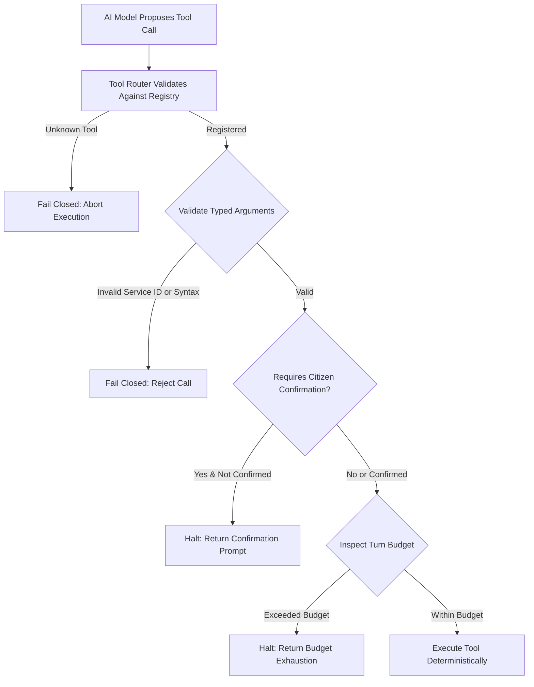

# Policy-Controlled AI Tool Router for Civic Assistant Actions

## Problem & Motivation
Modern conversational AI assistants often utilize tool/function calling to query backend databases and trigger external actions. However, relying on unconstrained LLM output to invoke tools directly creates severe vulnerabilities:
- Prompt injection attacks attempting to execute arbitrary code or retrieve private data.
- Unintended state mutations (e.g. submitting unreviewed applications or altering grievance records without explicit citizen consent).
- High-latency or infinite invocation loops causing service degradation.

The Policy-Controlled AI Tool Router introduces a deterministic, policy-governed routing layer that validates every proposed action before execution.

---

## Architectural Principles & Security Invariants

1. **Fail-Closed Default**:
   - Any tool name not explicitly registered in `TOOL_DEFINITIONS` is rejected with `TOOL_NOT_FOUND`.
   - Arguments failing typed validator schemas are rejected with `INVALID_ARGUMENTS`.
2. **Catalog Validation**:
   - Service lookups validate the `serviceId` argument against the verified repository service catalog, blocking synthetic or poisoned identifiers.
3. **Vault & PII Isolation**:
   - Tool arguments are proactively scanned for unauthorized attempts to access citizen vaults, credentials, or personal identity numbers (`SENSITIVE_ACCESS_PROHIBITED`).
4. **Explicit Citizen Confirmation for State Changes**:
   - Actions marked with `CITIZEN_CONFIRMED_ACTION` cannot be executed solely via generated assistant text. They require an explicit confirmation handshake (`citizenConfirmed: true`).
5. **Per-Turn Execution Budgeting**:
   - Strictly enforces limits on tool call counts per turn (default: 3) and execution timeouts (default: 5000ms), eliminating denial-of-service loops.

---

## Tool Execution Flowchart



### Permission Tiers & Capability Boundaries

| Permission Tier | Default Scope | Confirmation Handshake Required? |
| :--- | :--- | :--- |
| `READ_ONLY_CATALOGUE` | Queries public schemes, FAQs, and office locations | No (Safe read-only execution) |
| `CITIZEN_CONFIRMED_ACTION`| Modifies local draft progress, schedules reminders | Yes (Requires explicit modal confirmation) |
| `ADMIN_RESTRICTED` | Ingests new circulars or updates system registries | Yes (Restricted to authenticated maintainers) |

---

## Verification & Execution

Execute tool router unit tests:
```bash
npx vitest run src/ai/policyControlledToolRouter.test.js
```
Automated tests validate tool rejection, argument schemas, confirmation checks, and turn budgeting.

