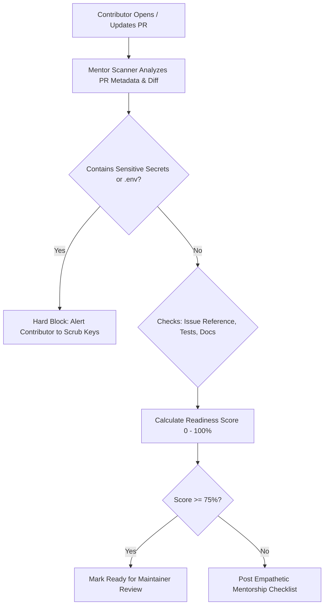

# Pull Request Review Mentor and Pre-Flight Readiness Checklist

## Motivation & Goals
Contributors often submit pull requests before verifying essential repository hygiene requirements, such as linking closing issues, authoring regression test cases, or avoiding accidental credential commits. In busy open-source projects, this leads to lengthy review turnaround times and reviewer fatigue.

The Pull Request Review Mentor provides an automated, constructive pre-flight coaching assistant that inspects pull requests before maintainer review.

---

## Pre-Flight Evaluation Criteria

| Checklist Requirement | Point Value | Verification Scope |
| :--- | :--- | :--- |
| **Closing Issue Reference** | 25 pts | Ensures description contains `Closes #XYZ` or `Fixes #XYZ` for automated lifecycle tracking |
| **Zero Sensitive File Leaks**| 30 pts | Scans against `.env`, `.pem`, `id_rsa`, and `serviceAccount*.json` |
| **Automated Test Coverage** | 25 pts | Verifies presence of unit/integration test specifications (`.test.js`) |
| **Documentation Updates** | 20 pts | Validates accompanying updates in `docs/` or `.md` files |

---

## Readiness Tiers & Coaching

- **Ready for Review (Score >= 75%)**: The PR satisfies primary criteria with zero secret leaks. Ready for maintainers.
- **Action Required (Score < 75%)**: Actionable hints guide the contributor to attach an issue reference or write unit tests.
- **Hard Blocker**: Any detected `.env` or credential file immediately sets `readyForReview: false` regardless of point score.

---

## Pre-Flight Automation Flowchart



### Guidance Tone & Contributor Inclusivity
- Pre-flight suggestions are phrased constructively rather than as harsh gatekeeping.
- Mentorship feedback offers clear examples (e.g. *"Did you mean Closes #939?"*).
- Contributors are encouraged to ask maintainers for help if blocked on writing test fixtures.

---

## Verification & Execution

Execute mentor test suite:
```bash
npx vitest run src/services/prReadinessMentorService.test.js
```
Automated workflows execute this checklist on pull request initialization and updates.

