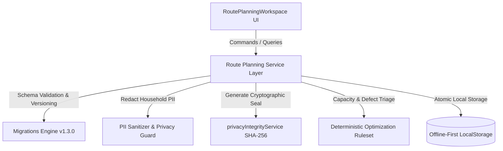

# Municipal Waste Collection Route & Segregation Audit Planner (#755)

## Overview
The Municipal Waste Collection Route and Segregation Audit Planner provides municipal sanitation supervisors with an end-to-end operational capability to:
1. Plan and schedule ward-level collection routes and pickup checkpoints.
2. Monitor vehicle fleet payload capacities and overload risks.
3. Log sampled waste segregation audits with tamper-evident cryptographic seals.
4. Receive deterministic, explainable AI recommendations subject to human-in-the-loop review (Accept, Edit, or Reject with mandatory audit reasons).
5. Expose public aggregate summaries without leaking worker movements or household identities.

---

## Architecture & Data Flow



---

## Domain Entities & Schema Evolution

Entities are modeled in `src/data/routePlanning/models.js` and support schema versioning from `1.0.0` through `1.3.0`:

- **CollectionRoute**: Defines route name, municipal ward, operating hours, checkpoint sequence, and assigned vehicles.
- **PickupPoint**: Specific collection location, waste stream expectations (wet, dry, hazardous), estimated daily load (kg), and service status (`SCHEDULED`, `SERVICED`, `MISSED`).
- **Vehicle**: Sanitation fleet asset, body type (`tipper`, `compact`, `standard`), maximum payload limits (`capacityKg`, `capacityLitres`), and current live load.
- **RouteRun**: Tracks run execution, completed vs missed points, and collected tonnage.
- **SegregationAudit**: Sampled audit measuring stream separation compliance %, compliance rating (`EXCELLENT`, `GOOD`, `FAIR`, `POOR`), and cryptographic seal `SEAL-WRA-...`.
- **RouteRecommendation**: Explainable AI suggestion with `sourceFields` provenance, `modelVersion`, and human decision status (`PROPOSED`, `ACCEPTED`, `EDITED`, `REJECTED`).
- **MissedPickup**: Tracking unserviced checkpoints with operational failure reasons (`ACCESS_DENIED`, `ROAD_BLOCKED`, `VEHICLE_BREAKDOWN`).

---

## Intelligence & Bounded AI Optimization

The optimization engine (`generateDeterministicRecommendations`) implements bounded heuristics:
- **Vehicle Capacity Overload Risk**: Triggers high/critical priority recommendations when total estimated checkpoint waste on a route exceeds 85% of assigned vehicle capacity.
- **Low Segregation Compliance Alert**: Triggers when sampled ward audits average below 65% compliance, recommending dual-compartment tippers and pre-collection citizen awareness sweeps.
- **Missed Pickup Rerouting**: Surfaces unresolved missed pickups from previous runs to be prioritized at the start of the next collection schedule.
- **Explainability & Provenance**: Every automated recommendation exposes its underlying input features (`sourceFields`), ruleset version (`ruleset-v1.0.0-deterministic`), and timestamp.

---

## Privacy, Security & Anti-Surveillance Safeguards

- **Household Aggregation**: Checkpoint addresses are aggregated at street or gate level. Flat and door numbers are automatically redacted by `sanitizeUserInput`.
- **Worker Anti-Surveillance**: Worker GPS tracking is not performed. Telemetry is restricted to discrete checkpoint status transitions (`SCHEDULED` -> `SERVICED` / `MISSED`).
- **Cryptographic Audit Seal**: Each audit is hashed using SHA-256 (`SEAL-WRA-XXXX-YYYY`) to prevent tampering after supervisor sign-off.
- **Public View Isolation**: `getPublicRouteSummary` masks internal driver notes, vehicle identifiers, and raw coordinates.

---

## Local Setup & Test Verification

Run targeted test suites using Vitest:

```bash
# 1. Schema migration and rollback tests
npm test -- --run src/services/routePlanning/migrations.test.js

# 2. Service layer, transactions, and optimization tests
npm test -- --run src/services/routePlanning/service.test.js

# 3. Security, PII sanitization, and privilege escalation tests
npm test -- --run tests/route-planning-security.test.js

# 4. Component and accessibility tests
npm test -- --run src/pages/RoutePlanningWorkspace.test.jsx
```
