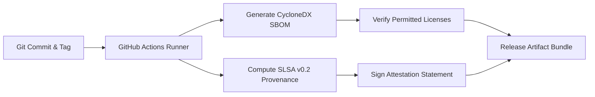

# Software Bill of Materials (SBOM) and Build Provenance Attestation

## Overview
Civic Help Setu delivers public software infrastructure that citizen users and government entities rely on for authentic administrative information. To guarantee software supply chain security, mitigate dependency confusion attacks, and prevent malicious tampering, every production release must produce a cryptographically verifiable Software Bill of Materials (SBOM) and a verifiable SLSA build provenance record.

---

## Supply Chain Security Principles

1. **CycloneDX Machine-Readable Manifest**:
   - Compiles all direct production and development dependencies into standard CycloneDX 1.4 JSON.
   - Attaches Package URL (`purl`) identifiers and exact versions.
2. **Subresource Integrity & Hash Validation**:
   - Validates that third-party artifacts adhere to SHA-512 SRI digests, blocking modified packages.
3. **Automated License Compliance Scanning**:
   - Enforces an automated permit list for permissive open-source licenses (`MIT`, `Apache-2.0`, `BSD`, `ISC`).
   - Flags copyleft and restricted licenses (`GPL-3.0`, `AGPL-3.0`, `SSPL`) for review.
4. **SLSA Level 2+ Build Provenance Attestation**:
   - Emits in-toto v0.1 / SLSA v0.2 statements recording:
     - Exact Git commit SHA and repository URI
     - Immutable GitHub Actions runner identifier
     - Deterministic build invocation entrypoint (`npm run build`)
     - Build timestamp and reproducibility flags

---

## Architecture & Tooling

- Core Engine: `src/services/sbomAttestationService.js`
- Test Verification: `src/services/sbomAttestationService.test.js`
- Automated CI Integration: Generates `.sbom.json` and `.provenance.json` release artifacts.

---

## Automated Attestation Ingestion Pipeline

### SLSA Provenance Security Attributes

| Field | Purpose | Security Guarantee |
| :--- | :--- | :--- |
| `_type` | In-toto envelope definition | Standardized schema structure interoperable with cosign |
| `predicateType` | SLSA Provenance v0.2 spec | Specifies strict build isolation constraints |
| `subject.digest` | Cryptographic SHA-256 commit digest | Binds attestation immutably to exact code revision |
| `builder.id` | Hardened runner URI | Verifies build executed inside authorized workflow environment |
| `invocation.entryPoint` | Command payload executed | Audits that release was built using standardized `npm run build` |

---

## Release Verification Runbook

Maintainers verifying a tagged release artifact should perform:
1. Verify the release digest against the commit SHA signed by GitHub Actions.
2. Ingest the CycloneDX SBOM to verify no high-severity CVEs exist.
3. Validate that all license identifiers match permissive categories.
4. Execute signature checks using automated cosign or in-toto policy validators.
5. Confirm that no development-only packages are bundled into production deployment artifacts.
6. Verify Subresource Integrity (SRI) hashes across any CDN-hosted assets.
7. Archive both `.sbom.json` and `.provenance.json` statements with the GitHub Release tags for long-term auditability.

