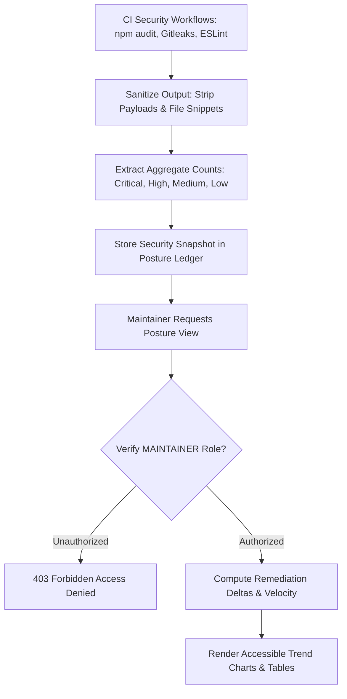

# Security Posture Trend View for Maintainers

## Motivation & Problem Statement
Security scanners (npm audit, Gitleaks, ESLint security rules) produce valuable findings that guide repository hardening. However, publishing raw security vulnerability reports in open-source dashboards presents significant risks:
- Exposing vulnerable code snippets or unpatched dependency vectors can facilitate targeted exploitation before patches are released.
- Dumping secrets or file paths risks unintended disclosure.

The Security Posture Trend View delivers a privacy-safe, maintainer-restricted analytics view that tracks aggregate vulnerability counts and remediation velocity without revealing exploit payloads or sensitive advisory metadata.

---

## Architectural Principles & Access Invariants

1. **Maintainer-Only Access Gate**:
   - Access to posture metrics is strictly restricted to authenticated users holding the `MAINTAINER` role.
2. **Safe Aggregate Counts Only**:
   - Ingests strictly counts by severity (`CRITICAL`, `HIGH`, `MEDIUM`, `LOW`) and binary pass/fail statuses (`secretScanClean`, `securityLintClean`).
   - Never captures or renders raw CVE descriptions, exploit proofs-of-concept, or vulnerable file line snippets.
3. **Remediation Velocity Tracking**:
   - Calculates chronological deltas between scan snapshots to evaluate whether vulnerability exposure is increasing or decreasing over time (`improving: true`).
4. **Accessible Visual and Tabular Formats**:
   - Every metric chart is accompanied by an accessible linear table with clear severity legends.

---

## Security Audit Telemetry Pipeline



### Confidentiality & Disclosure Boundaries

| Data Type | Publicly Disclosed? | Maintainer View? | Rationale |
| :--- | :--- | :--- | :--- |
| Aggregate Severity Counts | No | Yes | Guides remediation priorities without exposing attack surface |
| Vulnerable Source Snippets | No | No | Strictly suppressed to prevent zero-day exploitation |
| Secret Scan Pass/Fail | No | Yes | Confirms integrity without exposing key strings |
| Mean Remediation Age | No | Yes | Tracks organizational response velocity |

---

## Verification & Execution

Execute unit tests:
```bash
npx vitest run src/services/securityPostureTrendService.test.js
```
Automated tests validate maintainer role verification, scan snapshot ingestion, remediation trend math, and sensitive payload exclusions.

