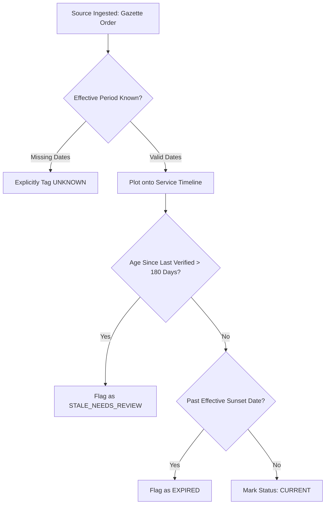

# Civic Service Source Freshness and Validity Timeline

## Executive Summary
Citizens rely on Civic Help Setu for procedural requirements, application timelines, and required evidentiary documents. However, government departments periodically issue amendments, sunset clauses, or gazette revisions. If old orders are treated as current, citizens risk following repealed procedures.

The Source Freshness and Validity Timeline provides a dedicated maintainer workspace to audit statutory document freshness, track supersessions, and detect stale guidance before citizens rely on it.

---

## Freshness Classification Taxonomy

| Status | Meaning | System Behavior |
| :--- | :--- | :--- |
| **`CURRENT`** | Legally in force, within effective window, verified $< 180$ days | Actively served in RAG retrieval |
| **`STALE_NEEDS_REVIEW`** | Legally active but $> 180$ days since human verification | Triggers reviewer review task |
| **`EXPIRED`** | Passed `effectiveTo` statutory sunset date | Flagged for maintainer removal |
| **`SUPERSEDED`** | Replaced by a subsequent circular (`supersededBy: id`) | Archived for provenance; excluded from search |
| **`WITHDRAWN`** | Officially repealed or revoked by government authority | Retained with warning; never served |

---

## Key Invariants & Safeguards

1. **Publication vs. Legal Effective Dates**:
   - The timeline distinctly surfaces when a circular was printed (`publicationDate`) versus when its legal mandate takes effect (`effectiveFrom` / `effectiveTo`).
2. **Explicit Unknown Dates**:
   - Incomplete gazettes with missing expiry dates explicitly display `UNKNOWN`. The system never guesses or estimates legal dates.
3. **No Automatic Guidance Mutation**:
   - Expiring documents are flagged in the maintainer timeline without abruptly breaking citizen chat or causing service outages.
4. **Accessible Timeline UI**:
   - Provides an accessible linear list alternative with ARIA attributes and keyboard navigation.

---

## Timeline Flowchart & Review Workflow



### Reviewer Actions & Provenance Audit
- Reviewers click directly to inspect canonical PDF links and checksum digests.
- If a source is superseded, the old order links to the replacement ID (`supersededBy`), preserving historical lineage.
- Stale alerts provide one-click buttons to mark as reviewed or submit an amendment request.

---

## Verification & Execution

Execute unit tests:
```bash
npx vitest run src/services/sourceFreshnessTimelineService.test.js
```
Automated tests validate timezone-independent date normalization, staleness thresholds, supersession tracking, and chronological timeline ordering.

