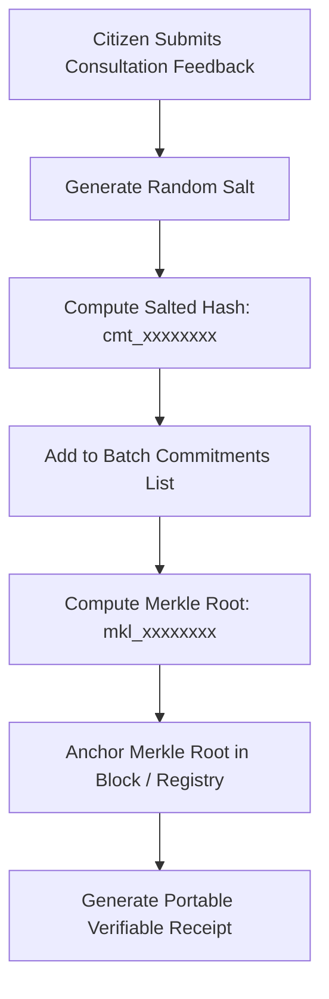

# Tamper-Evident Timestamp Commitments for Public Consultation Submissions

## Executive Summary
In public municipal policy consultations, citizens require cryptographic proof that their submission existed prior to an official deadline (such as budget feedback deadlines or master plan zoning inputs), without publishing their raw feedback, personal identity, or contact details onto public blockchains.

The Tamper-Evident Timestamp Commitments Service implements a privacy-first, opt-in commitment protocol that anchors batch Merkle roots while storing full submissions in secure, access-controlled off-chain storage.

---

## Cryptographic Commitment Architecture



### Key Privacy & Operational Guarantees

1. **Zero Raw Text or PII on Chain**:
   - Neither citizen names, emails, telephone numbers, nor feedback bodies are ever published to blockchain transactions or publicly exposed trees.
2. **Salted Commitments**:
   - Every submission is salted (`submissionText|salt`) before hashing, preventing rainbow table attacks or dictionary matching of common civic phrases.
3. **Independent Offline Verifier**:
   - Anyone holding the portable receipt and the original submission text can verify inclusion against the anchored Merkle root without accessing the Civic Help Setu backend.
4. **Honest Pending Status**:
   - If network anchoring is delayed or fails, the receipt remains explicitly marked `anchored: false`, preventing false assurances.
5. **Non-Blocking Opt-In**:
   - The feature is completely optional; citizens who do not wish to generate timestamp commitments participate normally.

---

## Cryptographic Receipt Data Schema

| Field | Type | Description |
| :--- | :--- | :--- |
| `receiptId` | `string` | Unique tracking identifier (`rcpt_...`) |
| `commitment` | `string` | Salted SHA-based commitment hash (`cmt_...`) |
| `salt` | `string` | Cryptographic secret salt generated client-side |
| `merkleRoot` | `string` | Anchored batch Merkle root (`mkl_...`) |
| `timestamp` | `string` | UTC ISO-8601 creation timestamp |
| `deadlineIso`| `string` | Official consultation submission deadline |

### Threat Model & Attack Surface Mitigation

- **Deadline Race Conditions**: Timezones are standardized strictly to UTC with local conversion handled purely at the presentation layer.
- **Commitment Alteration**: Changing even a single character in the submission feedback generates a divergent commitment hash, causing immediate verification failure.
- **Non-Chain Fallbacks**: If blockchain RPC nodes or network services are unreachable, receipts remain saved locally in browser storage with clear pending indicators.

---

## Verification & Execution

Execute unit tests:
```bash
npx vitest run src/services/publicConsultationTimestampService.test.js
```
Automated tests validate salted hashing, deterministic Merkle root derivation, batch anchoring, and offline receipt verification.

