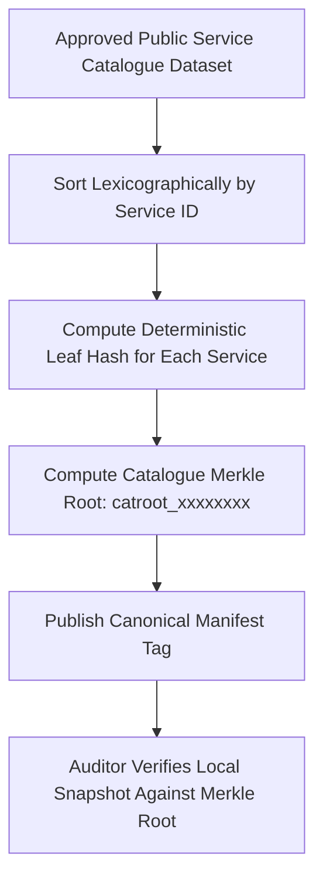

# Verifiable Civic Catalogue Release Manifest & Snapshot Verifier

## Motivation & Overview
Civil society organizations, public interest researchers, and government auditors often need to verify exactly which civic procedures, eligibility rules, and statutory fee guidance were published in Civic Help Setu at a particular moment in time.

The Verifiable Civic Catalogue Release Manifest Service generates canonical release manifests with embedded Merkle roots, enabling independent offline verification of downloaded catalog snapshots without storing private citizen data on public ledgers.

---

## Canonical Manifest Architecture



### Core Integrity Guarantees

1. **Deterministic Reproducibility**:
   - Manifest generation sorts items deterministically by service ID. Passing records in any arbitrary order yields the exact same Merkle root.
2. **Strict Non-PII Inclusion**:
   - Only public catalog fields (`id`, `name`, `category`, `checksum`) are digested into the Merkle tree. All internal moderation notes and user data are stripped.
3. **Independent Offline Verifier**:
   - The verification logic relies purely on deterministic SHA-based leaf and root math. Anyone can audit a downloaded snapshot using CLI tools.
4. **Append-Only Versioning**:
   - Releasing version `v2.0` supersedes `v1.0` while preserving `v1.0` manifests permanently for historical audit inquiries.

---

## Manifest Verification Protocol & Data Dictionary

| Manifest Field | Type | Description |
| :--- | :--- | :--- |
| `versionTag` | `string` | Canonical version identifier (e.g. `catalogue-2026.11`) |
| `publisher` | `string` | Issuing authority or maintainer body |
| `merkleRoot` | `string` | Cryptographic Merkle root hash (`catroot_...`) |
| `totalServices` | `number` | Count of published service records in release |
| `entries` | `Array<Object>`| Sanitized list of public services with associated leaf hashes |

### Legal & Truth Distinction Disclaimer

The manifest certifies exclusively that an exported dataset matches the exact public release published by maintainers. It distinguishes mathematical snapshot integrity from external real-world ground truth (e.g. if an external department portal alters URL parameters without notifying maintainers).

---

## Verification & Execution

Execute unit tests:
```bash
npx vitest run src/services/civicCatalogueReleaseManifestService.test.js
```
Automated tests validate deterministic leaf hashing, Merkle root invariance to ordering, snapshot verification, and tamper detection.

