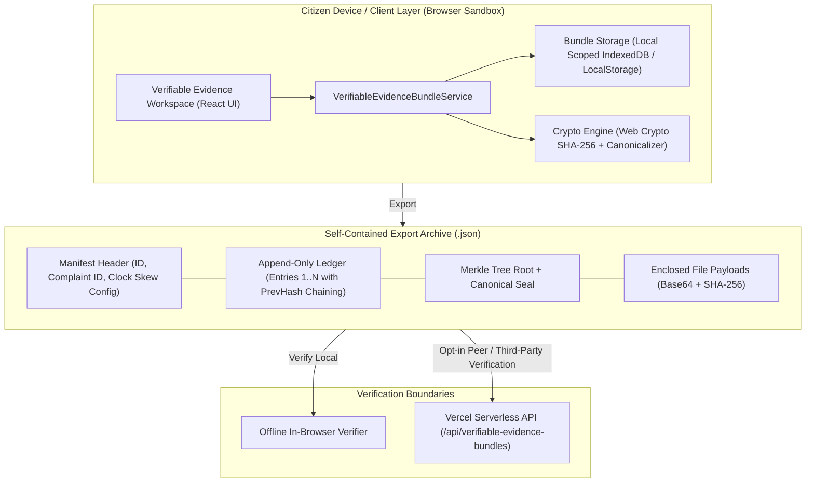

# Architecture Decision Record (ADR-1160) & Threat Model
# Verifiable Evidence Bundles for Civic Complaints

**Status:** Accepted  
**Date:** 2026-11-25  
**Context:** GitHub Issue #1160 — [level3][feature] Implement Verifiable Evidence Bundles for Civic Complaints  
**Owner:** Civic Help Setu Architecture & Security Core  

---

## 1. Problem Statement & Civic Context

When Indian citizens prepare civic complaints, administrative grievances, and public interest escalations (e.g., PWD road hazards, municipal sanitation failures, water tanker distribution anomalies, electricity billing overcharges, or RTI non-compliance), they accumulate diverse pieces of documentary and photographic evidence over weeks or months.

In typical workflows, evidence files are scattered, lack tamper detection, and lose verifiable provenance:
1. **Chain-of-Custody Loss:** When a citizen shares photos and PDFs with an ombudsman, appellate officer, or civic legal aid worker, there is no mathematical guarantee that an attachment has not been modified, swapped, or backdated.
2. **Ambiguity Between Assertions and Verified Facts:** Unsubstantiated claims (e.g., citizen notes or photos without an official timestamp) are often commingled with independently verified documents (e.g., municipal fee receipts, speed post tracking numbers, CPGRAMS registration slips).
3. **Clock Skew and Historical Reordering:** Mobile devices and local systems frequently possess unsynchronized clocks or altered timestamps, making reliable chronology audits difficult without explicit monotonic sequencing.
4. **Data Privacy & Surveillance Risks:** Forcing citizens to upload all evidence to a centralized server creates honeypots of sensitive complaint data, exposing complainants to premature administrative backlash or privacy violations.

Civic Help Setu introduces **Verifiable Evidence Bundles (VEB)** — a client-first, append-only, cryptographically hashed evidence packaging and verification architecture.

---

## 2. Core Invariants & Ethical Guardrails

### Invariant 1: Append-Only Cryptographic Chaining
Every entry in a bundle is monotonically numbered ($seq = 1, 2, \dots, N$) and includes the SHA-256 hash of the immediately preceding entry ($H_{prev}$). A master Merkle root and canonical manifest hash seal the entire bundle. Once an entry is added, any mutation, insertion, or deletion breaks the chain.

### Invariant 2: Strict Provenance Separation (No Government Attestation Claim)
Every evidence item must be tagged with a distinct provenance tier:
- `CITIZEN_ASSERTION`: Photos, personal observations, private notes, and citizen-asserted facts. Unverified by third parties.
- `INDEPENDENT_VERIFICATION`: Stamped municipal receipts, registered speed post tokens, official government portal acknowledgement numbers (e.g., CPGRAMS, Jan Sunwai), and bank payment challans.
- `SYSTEM_OBSERVED`: Client runtime timestamps, hash computation metadata, and cryptographic audit checks.

> **Statutory Disclaimer:** *Civic Help Setu is an educational and civic assistance platform. Verifiable Evidence Bundles establish mathematical data integrity and tamper detection for citizen records; they do NOT constitute sovereign government verification, official legal certification, or guaranteed statutory redressal.*

### Invariant 3: Client-First Privacy & Zero Central Retention
The core bundle creation, document storage, and hash generation execute entirely client-side using Web Crypto. File contents are never transmitted to Civic Help Setu central servers without explicit, single-use user action.

### Invariant 4: Deterministic Canonical JSON (RFC 8785)
Cryptographic digests must not vary based on JavaScript key enumeration order, spacing, or whitespace. All hashing operates on deterministic, canonically sorted representations.

### Invariant 5: Human-in-the-Loop AI Boundaries
Any AI or assistant recommendations (e.g., completeness checks, chronology suggestions) are classified as untrusted proposals. No automated process may file complaints, deny benefits, or alter evidence bundles without explicit citizen approval.

---

## 3. Architecture & Component Boundaries

### Component Roles & Responsibilities

| Component | Location | Responsibility & Ownership |
| :--- | :--- | :--- |
| **`verifiableEvidenceBundleContract.js`** | `src/data/` | Core schema definitions, RFC 8785 canonical serialization, Merkle tree computation, SHA-256 helpers, and integrity validation functions. |
| **`verifiableEvidenceBundleService.js`** | `src/services/` | Business workflow: bundle creation, append-only entry addition, duplicate detection, clock-skew mitigation, and dossier export. |
| **`verifiableEvidenceBundleStorage.js`** | `src/services/` | Scoped client persistence, multi-user isolation, storage quota management, and import/export marshaling. |
| **`VerifiableEvidenceBundleWorkspace.jsx`** | `src/pages/` | Accessible UI for citizens to manage evidence items, view chain integrity, inspect provenance tiers, and export verifiable bundles. |
| **`verifiable-evidence-bundles.js`** | `api/_lib/handlers/` | Serverless stateless verification endpoint for third-party reviewers (ombudsmen, civic clinics) to verify bundle integrity via REST API. |

---

## 4. Cryptographic Specifications & Algorithms

### 4.1 Canonical Serialization (RFC 8785 Implementation)
To prevent hash discrepancies across platforms:
1. Object keys are sorted lexicographically by UTF-16 code units.
2. Null values and primitives are formatted deterministically.
3. Whitespace, indentations, and trailing spaces are eliminated.

### 4.2 Entry Hash Formulation
For entry $i$ ($i \ge 1$):
$$\text{payload}_i = \text{Canonicalize}(\{ \text{sequence}, \text{entryId}, \text{timestamp}, \text{source}, \text{provenanceTier}, \text{title}, \text{userAnnotation}, \text{attachmentSha256}, \text{metadata}, \text{previousEntryHash} \})$$
$$\text{entryHash}_i = \text{SHA-256}(\text{payload}_i)$$

For the genesis entry ($i = 1$):
$$\text{previousEntryHash}_1 = \text{"0"}^{64}$$

### 4.3 Merkle Root Computation
The bundle computes a binary Merkle tree over all entry hashes $[\text{entryHash}_1, \dots, \text{entryHash}_N]$:
- If $N = 1$, $\text{rootHash} = \text{entryHash}_1$.
- For odd leaf counts at any tree level, the last leaf is duplicated to complete the pair.
- Parents are computed as $\text{SHA-256}(\text{leftHash} + \text{rightHash})$.

### 4.4 Clock Skew & Duplicate Detection
1. **Clock Skew:**
   - If $\text{timestamp}_{i} < \text{timestamp}_{i-1}$, flag `BACKWARD_TIMELAPSE`.
   - If $\text{timestamp}_{i} > \text{systemCurrentTime} + \Delta_{skew}$ (default $\Delta_{skew} = 300\text{s}$), flag `FUTURE_TIMESTAMP`.
   - Flags generate an explicit `integrityWarnings` array without corrupting historical records.
2. **Duplicate Evidence:**
   - Hash collisions on `attachmentSha256` are detected across entries.
   - Exact duplicates are tagged with `DUPLICATE_ATTACHMENT` warning, identifying previous entry ID where the identical file appeared.

---

## 5. STRIDE Threat Model

| Threat | Attack Scenario | Impact | Mitigation in Civic Help Setu |
| :--- | :--- | :--- | :--- |
| **Spoofing (S)** | Malicious actor distributes a fake bundle claiming official civic authority endorsement. | High | Permanent `provenanceTier` separation. Unambiguous UI headers stating that Civic Help Setu does not issue government seals or statutory findings. |
| **Tampering (T)** | A complainant or intermediary replaces a photograph or alters notes after bundle creation. | Critical | Append-only SHA-256 hash chaining + Merkle root. Any altered byte, swapped image, or modified note changes the hashes, causing instant verification failure. |
| **Repudiation (R)** | An officer or party denies having received a specific piece of evidence at a given date. | Medium | Standalone exportable bundle manifest with deterministic timestamps, previous hash seals, and receipt reference numbers. Third-party verifiers can confirm the exact manifest hash. |
| **Information Disclosure (I)** | Confidential complaint records leaked via server logs, network requests, or analytics. | High | Client-first local storage. Zero telemetry on evidence file content, complaint summaries, or personal identifiers. Logs only record synthetic telemetry IDs. |
| **Denial of Service (D)** | Large file uploads (e.g. 500 MB) exhausting client RAM or causing serverless timeout. | Medium | Maximum file size limited to 5 MB per attachment; maximum bundle capacity 25 MB / 50 entries. Streaming SHA-256 calculations in browser chunks. |
| **Elevation of Privilege (E)** | User B accessing or modifying User A's evidence drafts on a shared workstation. | High | Storage entries scoped strictly to authenticated user ID (`userId`) or isolated guest session. Integration with existing client-side encrypted vault. |

---

## 6. Failure Modes & Recovery Strategies

| Failure Mode | Trigger / Cause | System Behavior & Remediation |
| :--- | :--- | :--- |
| `TAMPERED_ATTACHMENT` | File byte mismatch against `attachment.sha256`. | Verification fails with status `CORRUPTED_ATTACHMENT`. UI highlights the exact defective entry with expected vs actual hash. |
| `BROKEN_CHAIN` | An intermediate entry was deleted or re-ordered. | Verification fails with `BROKEN_CHAIN_ERROR`. Identifies point of failure ($seq = k$). |
| `CLOCK_SKEW_ANOMALY` | Local device time altered or incorrect clock. | Non-blocking warning `CLOCK_SKEW_DETECTED`. Displays delta in minutes; preserves entry. |
| `STORAGE_QUOTA_EXCEEDED` | Browser localStorage / IndexedDB fills up. | Friendly user notification recommending bundle export and download as `.json` or `.md` dossier. |
| `NETWORK_OFFLINE` | Citizen working in low-connectivity rural ward. | 100% offline functionality. Hashing, chain validation, and local export require zero internet connectivity. |

---

## 7. Operational Ownership & Maintainer Guidelines

- **Operational Owner:** Civic Help Setu Core Framework & Security Team.
- **Review Cadence:** Semi-annual cryptographic review and dependency audit.
- **Backwards Compatibility:** All manifests carry `schemaVersion: "1.0.0"`. Future schema migrations must provide deterministic up-converters without mutating historical entry hashes.
